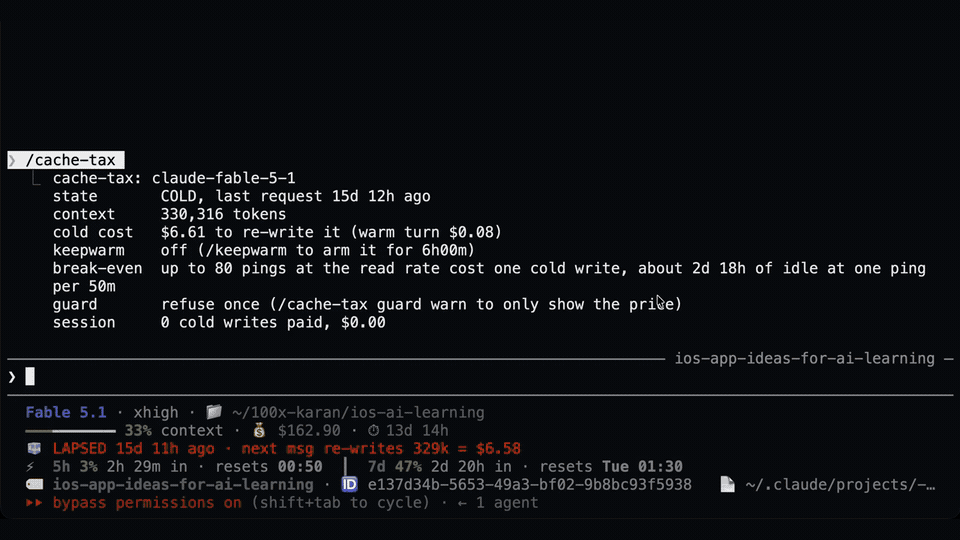

<picture>
  <source media="(prefers-color-scheme: dark)" srcset="site/assets/cache-tax-dark.svg">
  
</picture>

# Cache Tax für Claude Code

**Hält den Prompt-Cache von Claude Code in Pausen warm.**

Cache Tax ist ein Mod für Claude Code, der deinen Prompt-Cache auffrischt, während du dich entfernt, und dir vor einem Versand ohne Cache die geschätzten Kosten der Neuerstellung zeigt. Führe vor einer Pause `/keepwarm 90m` aus. Pings kosten Tokens; wähle ein Zeitfenster, in dem du voraussichtlich zurückkehrst.

**[Install](#install)** · [Website](https://cachetax.aidojo.si/) · [So funktioniert es](#so-funktioniert-es) · [Kosten und die Frage der Nutzungsgrenzen](#kosten-und-die-frage-der-nutzungsgrenzen) · [Befehle](#befehle)



Eine Zusammenfassung in zwei Zeilen in einer Sitzung mit 330k Tokens löste eine **Schätzung von 6,61 $** aus. Nach dem erneuten Senden belief der gemeldete Cache-Schreibvorgang auf **6,28 $**. Aufgezeichnet auf 2.1.1; der heutige Wortlaut sagt „bis zu“ der geschätzten Token-Anzahl. Es handelt sich um API-äquivalente Kosten, nicht um zusätzliche Abgaben auf dein Abo.

## Install

Vorausgesetzt sind [Claude Code 2.1.287 oder neuer](https://code.claude.com/docs/en/plugins/mods/overview#turn-mods-on-or-off), ein einstündiger Cache und ein laufendes Claude Code. Mods sind standardmäßig aktiviert. Pings kosten Tokens, einschließlich nicht gedeckelter Ausgabe.

```sh
claude plugin marketplace add claude-code-mods/claude-code-mods-de
claude plugin install cache-tax@claude-code-mods-de
```

Starte Claude Code neu oder führe `/reload-plugins` in einer offenen Sitzung aus. Ein Early-Access-Flag ist nicht nötig. Falls du früher `CLAUDE_CODE_ENABLE_FUNCTION_HOOKS` gesetzt hast, entferne es; aktuelles Claude Code ignoriert es.

Führe in einer warmen Sitzung `/keepwarm` aus, um sechs Stunden zu aktivieren. Nutze `/keepwarm 90m` für ein kürzeres Fenster oder `/keepwarm off` zum Beenden.

**Prüfe die Lebensdauer des Haupt-Caches.** Im enthaltenen Abo beträgt sie standardmäßig eine Stunde. Sitzungen mit API-Schlüssel, Nutzungsguthaben oder Cloud-Anbieter fallen standardmäßig auf fünf Minuten zurück; setze für diese Abrechnungswege [`promptCacheTtl`](https://code.claude.com/docs/en/prompt-caching#choose-the-ttl-yourself) auf `"1h"`. Ein 50-Minuten-Timer kann einen fünfminütigen Haupt-Cache nicht schützen. Die Belege aus dem Fork findest du unter [Limits](#limits).

**Lieber ein Settings-Hook?** Die [Hook-Version](https://github.com/karanb192/claude-code-hooks/tree/main/plugins/cache-tax) warnt standardmäßig, verweigert einmal mit `CACHE_TAX_BLOCK=1` und bietet einen eigenständigen Countdown in der Statuszeile. Das Warmhalten gehört zu diesem Mod.

Erstellt von [Karan Bansal](https://karanbansal.in/). Lies [die Geschichte von Cache Tax und die aufgezeichneten Cache-Kosten](https://karanbansal.in/blog/cache-tax/).

## Optionen

In `/config` unter cache-tax:

    Auto keepwarm:    on | off
    Display:          band | status
    Ping floor:       2 (a number, 0 oder mehr)
    Headless prompts: guard | send

`on` (die Voreinstellung) behält das bisherige Verhalten: Nachdem du einen Schreibvorgang ohne Cache bezahlt hast, aktiviert sich keepwarm für drei Stunden selbst. `off` lässt keepwarm in Ruhe, bis du es mit `/keepwarm` aktivierst; der Wortlaut der Warnung sagt dann, dass keepwarm aus bleibt, oder nennt die verbleibende Zeit eines aktivierten Fensters. `/keepwarm always` aktiviert es in beiden Fällen weiterhin.

Ping floor teilt die geschätzten Kosten einer Neuerstellung in ein Budget für Pausen ohne Aktivität: 2 erlaubt geschätzte Ping-Ausgaben unter der Hälfte einer Neuerstellung; 0 schaltet das Limit ab. Vor einem Ping müssen die in dieser Pause bereits beobachteten Ausgaben plus die Schätzung des nächsten Pings unter diesem Budget liegen. Die Schätzung verwendet den günstigsten der fünf letzten Belege für warme Lesevorgänge, neu bepreist für das aktuelle Modell und den aktuellen Kontext, einschließlich dessen Prompt-Tarifstufe. Ein neuer Hauptzug setzt die Ausgaben zurück; das Verlängern oder Beenden und erneute Aktivieren eines Fensters tut es nicht. Ein übersprungener Ping lässt den Cache kalt werden. Protokoll und Status nennen den Grund, und `$.cacheTax.status()` gibt `pingSkipped` und `idlePingUsd` heraus.

Der erste Ping hat noch keinen Beleg, daher geht er hinaus. Eine spätere Antwort kann mehr kosten als geschätzt; es handelt sich also um ein schätzungsbasiertes Limit, keine garantierte Obergrenze der Rechnung. Ohne Modellpreis, Kontext oder bepreiste Belege lässt sich kein Vergleich anstellen. Belege und Ausgaben liegen im Speicher: Ein Neustart oder neues Gespräch löscht sie. Pings können vor dem gewünschten Warmhaltefenster enden.

Display legt fest, wo der Zustand angezeigt wird, während keepwarm aktiv ist. `band` (die Voreinstellung) ist die Zeile über der Eingabe, mit einem Textsymbol im Terminal und dem Würfel auf dem Desktop. `status` bringt denselben Text in den Statuseintrag unter der Eingabe und zeichnet keine Zeile: Verwende es, wenn ein anderer Mod den Platz über der Eingabe belegt. Eine Einstellung zum Ausblenden gibt es nicht: Pings kosten Tokens, daher sagt der Bildschirm immer, wann sie laufen.

## So funktioniert es

**Vor einer Pause:** `/keepwarm` aktiviert ein begrenztes Fenster. Nach 50 Minuten ohne Aktivität sendet ein Timer innerhalb von Claude Code einen Fork ohne Werkzeug über das Transkript der Sitzung. Nach jedem Ping liest er die Nutzung und stoppt, wenn Lesevorgänge null sind oder Schreibvorgänge 10 % der Lesevorgänge erreichen. Das Limit für Ausgaben in Ruhe kann spätere Pings überspringen, bevor das Fenster endet. Es gibt keine Hintergrundschleife, die das Transkript abfragt.

**Wenn du kalt zurückkehrst:** Bei einem Kontext von mindestens 50.000 Tokens fragt der Wächter vor deiner gewöhnlichen Nachricht, wenn seine Ein-Stunden-Uhr „kalt“ anzeigt. Die Frage nennt die geschätzten Kosten der Neuerstellung und gibt Hinweise zum Warmhalten. **Send anyway** sendet die Nachricht; **Don't send** verwirft sie. Wird das Dialogfenster geschlossen oder kann der Host es nicht beantworten, verweigert der Wächter einmal und das erneute Senden geht durch. SDK-Hosts, die den Dialog beantworten können, behalten diese Auswahl. `/cache-tax guard refuse 5` fragt ab 5 $ oder mehr, auch bei einem Modell ohne Preiseintrag; günstigere Sendungen protokollieren ihren Preis und laufen durch.

`Headless prompts: send` optiert nichtinteraktive Prompts mit `sdk`-Herkunft bei der Voreinstellung des Wächters in sofortiges Senden ein. Claude Code verwendet dieselben Felder sowohl für `claude -p` als auch für Agent-SDK-Züge, daher gilt die Option für beide; sie kann die CLI nicht von einem SDK-Host unterscheiden. Die Voreinstellung `guard` fragt weiter nach oder verweigert einmal, wo niemand antworten kann. Ein ausdrückliches `/cache-tax guard refuse`, mit oder ohne Dollarbetrag, gilt auch mit `send`; `/cache-tax guard default` löscht diese ausdrückliche Einstellung. Nachrichten von Menschen aus der Ferne (`composer`, `bridge`, `unclassified` und Kanal-Herkünfte) behalten den Wächter, auch in einem nichtinteraktiven Host. Hintergrundbenachrichtigungen und geplante Prompts werden gesendet und ihr Preis protokolliert, weil niemand sie erneut senden kann.

Eine Verweigerung im Headless-Modus liefert ihren Grund zurück und protokolliert ihn im Transkript/Debug-Protokoll. Verwende bei der Fehlersuche in einem Skript Claude Codes `--debug-file`. Die Mod-API kann den Prozess-Exit-Code nicht setzen und eine Verweigerung nicht nach stderr schreiben; eine Verweigerung muss weder einen von null verschiedenen Exit-Code noch einen Grund auf stdout erzeugen. Ein optiertes Ausführen, das einen Dollarbetrag erreicht, muss weiterhin bewusst wiederholt werden.

Standardmäßig aktiviert ein erkannter Schreibvorgang ohne Cache automatisch mindestens drei Stunden keepwarm, mit `always` das always-Fenster (sechs Stunden, sofern du kein anderes setzt), und zeigt die Kosten an; die [Option](#optionen) Auto keepwarm schaltet den automatischen Teil aus. `/cache-tax` zeigt die aktuelle Cache-Schätzung, das Warmhaltefenster und die Zahl der Schreibvorgänge ohne Cache in dieser Sitzung.

Die Zählung folgt den Cache-Belegen. Für jede Anfrage schätzt sie den erneut geschriebenen alten Kontext als den kleineren Wert aus dem gemeldeten Schreibvorgang und dem vorherigen Kontext abzüglich des gemeldeten Lesevorgangs. Ein fehlender Rest, der kleiner als 10 % des Lesevorgangs ist, gilt als Cache-Treffer. Neuer Inhalt bei einem Treffer zählt nicht und aktiviert kein keepwarm; eine erhebliche teilweise Neuerstellung kann es sehr wohl. Jede Neuerstellung verwendet das Modell und die Preisstufe dieser Anfrage.

Meldet der Host nur summierte Nutzung pro Zug, kann die Schätzung eine Neuerstellung übersehen, die durch spätere Cache-Lesevorgänge verborgen wird; ein Zug, in dem komprimiert wurde, bleibt ohne Belege pro Anfrage unbewertet.

Hat ein vom Wächter erlaubter Sendevorgang keine erkannte Neuerstellung, erklärt ein Hinweis nach Abschluss, dass kein automatisches Fenster für Schreibvorgänge ohne Cache geöffnet wurde, oder nennt den bestehenden Warmhaltezustand. Das bestätigt nicht den Cache-Zustand des Servers anhand summierter Nutzung. Ein durch `/clear` unterbrochener Abschluss eines Schreibvorgangs ohne Cache kann sein automatisches Fenster nicht im nachfolgenden Gespräch öffnen.

Das Vorbereiten oder Überspringen einer Komprimierung lässt das Warmhalten unberührt. Eine durchgeführte Komprimierung pausiert es, bis eine Hauptanfrage den neuen Präfix liest oder schreibt. Ein aktiviertes Fenster kann dann wieder Pings senden, während der Zug auf ein Werkzeug oder eine Antwort des Nutzers wartet. Schreibvorgänge von Zusammenfassungen bleiben außerhalb der Zählung; eine vor der Komprimierung bezahlte Neuerstellung behält ihren ursprünglichen Kontext und Preis.

Fenster gehören zu einzelnen Sitzungen. Eine bereits kalte Sitzung wartet vor dem Pingen auf deinen nächsten Zug, ebenso ein nach einem Neustart von Claude Code wiederhergestelltes Fenster, bis der neue Prozess einen Zug zum Forken hat. Findet ein Ping nichts zum Forken, sagt eine einzeilige Meldung dies einmal, und die Pings beginnen nach deiner nächsten Nachricht. Ein von einem überlasteten API abgelehnter Ping (429, 529, 5xx) wird nach 1, 2 und 4 Minuten erneut versucht, solange er noch vor dem Kaltwerden des Caches ankommen kann. Mit `always` lässt jeder deiner Züge, die den Cache erreichen, mindestens das always-Fenster (standardmäßig sechs Stunden) im Standardintervall bestehen, vorbehaltlich des Limits für Ausgaben in Ruhe und eines erfolgreichen warmen Rücklesens. `/keepwarm always 24h` setzt diese Untergrenze für jede Sitzung auf 24 Stunden statt (1 h bis 168 h; nacktes `/keepwarm always` geht zurück auf sechs). Derselbe Zug bringt ein gestopptes Fenster zurück, dehnt ein kürzeres auf das always-Fenster aus und setzt eine Testperiode zurück; ein längeres von dir gesetztes Fenster bleibt. `/keepwarm off` in einer Sitzung beendet ab dem nächsten Zug das Fortlaufen in allen Sitzungen. Ein Fenster endet an seiner Frist; `/keepwarm off` bricht es außerdem ab und löscht die always-Einstellung.

### Ein aufgezeichneter Warmhalte-Ping


Sonnet 5, 16. September 2026: Der Status meldete **75k Tokens gelesen für 0,02 $**. Während des Live-Laufs erschien nichts im Gespräch. Diese Aufnahme nutzte das Testintervall von einer Minute auf 2.0.0; die Schätzung von 0,45 $ für eine Neuerstellung auf der Karte beruhte auf einer älteren Sonnet-Preiszeile gegenüber 0,30 $ für denselben Kontext mit der aktuellen Zeile. Der Ping für zwei Cent ist ein Beleg für diese Sitzung, kein fester Preis.

## Warum eine kurze Nachricht so viel kosten kann

Wenn das zwischengespeicherte Präfix abläuft, kann selbst „gib mir eine Zusammenfassung“ eine Neuerstellung des alten Kontexts vor der Antwort auslösen. Die Preiszeile von Cache Tax für Fable 5.1 vergleicht einen Schreibvorgang mit 1 h Laufzeit für 20 $ mit einem Cache-Lesevorgang für 0,25 $ pro Million Tokens: das Achtzigfache pro Token, nicht das Achtzigfache an Gesamtersparnis. Siehe [die Preisannahmen](#kosten-und-die-frage-der-nutzungsgrenzen) und [Anthropics Preistabelle](https://platform.claude.com/docs/en/about-claude/pricing).

[Sieh dir die 23-sekündige Übersicht an](docs/assets/cache-cost-explainer.mp4). Ihre gestalteten Szenen beschriften die Listenpreise von Fable 5.1; jedes Pixel des Terminals und der Statuszeile stammt aus der echten Aufzeichnung der Verweigerung und des Warmhalte-Belegs oben. Die Verweigerung wurde auf 2.1.1 aufgezeichnet, der Warmhalte-Ausschnitt auf 2.0.0.

Neu beim Caching? [Anthropic erklärt, wie Claude Code es nutzt](https://code.claude.com/docs/en/prompt-caching).

## Befehle

    /keepwarm               warmhalten für sechs Stunden
    /keepwarm 90m           warmhalten für ein selbst gewähltes Fenster, 1 m bis 168 h (auch 2h30m, 6h)
    /keepwarm always        jede Sitzung bis sechs Stunden nach ihrem letzten Zug warmhalten, über Sitzungen hinweg gespeichert
    /keepwarm always 24h    dasselbe, bis 24 Stunden nach dem letzten Zug (1 h bis 168 h)
    /keepwarm 6h every 2m   alle zwei Minuten pingen; ein Testregler, 1 m bis 59 m, nach diesem Fenster vergessen (mit always beim nächsten Zug)
    /keepwarm status        Warmhaltefenster, nächster Ping und letzter Beleg
    /keepwarm off           beenden, Fenster vergessen und always ausschalten
    /cache-tax              die Karte
    /cache-tax guard warn   Preis zeigen und senden (Voreinstellung des Hooks)
    /cache-tax guard default
                            die Voreinstellung des Wächters wiederherstellen und Headless prompts über nichtinteraktive SDK-Sendungen bestimmen lassen
    /cache-tax guard refuse vor einem Versand ohne Cache fragen, ohne Rücksicht auf Headless prompts: send
    /cache-tax guard refuse 5
                            nur ab 5 $ fragen; darunter Preis zeigen und senden
    /cache-tax guard test   einmal bei der nächsten von dir gesendeten Eingabe fragen, als wäre der Cache kalt, bepreist mit dem Kontext dieser Sitzung; der Test bewertet nichts, ein Versand in einen wirklich kalten Cache wird wie üblich bewertet

`/keepwarm` lehnt zusätzliche Wörter, ungültige Zeiträume und Fenster außerhalb der Grenzen ab, ohne das aktuelle Warmhaltefenster zu verändern. Beim Start verwirft es außerdem ungültige oder zu lange gespeicherte Fristen. Ein Fenster, das vor dem ersten fälligen Ping endet, sagt das in seiner Antwort.

Die Frage im Wortlaut, darunter **Send anyway ($4.01)** und **Don't send**:

    cache-tax: Der Prompt-Cache ist seit 2h00m kalt. Dieses Senden schreibt bis zu 200.502 Tokens zu $20/MTok neu = $4.01 (ein warmer Zug hätte $0.05 gekostet). Don't send spart $4.01; nach Send anyway ist keepwarm für bis zu 3h00m aktiviert. Allein das Cache-Lesen kostet etwa $0.05 pro Ping. Pings können wegen des Limits für Ausgaben in Ruhe früher enden und den Cache kalt werden lassen. Trotzdem senden?

Wird die Frage geschlossen oder kann ein überwachter Headless-Lauf sie nicht anzeigen, erscheint stattdessen die Verweigerung und das erneute Senden geht durch:

    cache-tax: Der Prompt-Cache ist seit 2h00m kalt. Dieses Senden schreibt bis zu 200.502 Tokens zu $20/MTok neu = $4.01 (ein warmer Zug hätte $0.05 gekostet). Sende es erneut, um zu bezahlen; keepwarm wird für bis zu 3h00m aktiviert, kann aber wegen des Limits für Ausgaben in Ruhe früher enden. Oder /clear und von einer Notiz aus neu beginnen.

Die Zahl ist eine Obergrenze. Die Kontextzahl, die die Engine für eine fortgesetzte Sitzung meldet, setzt sich aus Eingabe, Cache-Lesen, Cache-Schreiben und Ausgabe der letzten Antwort zusammen; die Nutzlast der Fortsetzung enthält keine getrennte Ausgabezahl, die abgezogen werden könnte. Bei einer 15 Tage alten Sitzung nannte der Wächter 330.316 Tokens und 6,61 $, und der darauffolgende Schreibvorgang umfasste 314k Tokens und kostete 6,28 $.

Solange keepwarm aktiv ist, zeigen das Terminal und der Code-Tab der Desktop-App eine Zeile über der Eingabe, es sei denn, Display ist `status`. Terminals verwenden ein fettes Textsymbol `[>]` in der Zustandsfarbe. Der Desktop zeigt den Cache-Tax-Würfel mit grünem Deckel bei warm, orange bei kalt und grau vor dem ersten Zug oder nach einer Komprimierung. Die fette Zustandsbezeichnung passt dazu; Timer und Belegtext verwenden normale Schriftstärke. Ein nicht leeres `NO_COLOR` wählt auf beiden Oberflächen ein fettes Textsymbol und entfernt die Zustandsfarbe. Beide Anzeigen nennen `warm`, `cold` oder `unknown`, sodass Farbe nie das einzige Signal ist. Diese Zustände nutzen dieselbe Ein-Stunden-Uhr wie `/cache-tax`; sie sind Schätzungen, keine Live-Prüfung des Server-Caches.

Die Zeile und der einfache Status-Ersatz aktualisieren sich einmal pro Minute, während keepwarm aktiv ist, auch im Leerlauf. Das Aktualisieren betrifft nur die Anzeige; es sendet keine Modell-Anfrage.

Die Zeile enthält das Warmhaltefenster, den nächsten Ping und das letzte Rücklesen. Eine gestoppte Schleife zeigt ein neutrales Symbol und ihren Grund. `/keepwarm off` oder ein abgelaufenes Fenster entfernt die Zeile. Umfragen haben vorübergehend Vorrang, und Inhalte anderer Mods bleiben in der Leiste. Display `status` zeigt denselben beschrifteten Text im Statuseintrag; Oberflächen ohne Leiste behalten den einfachen Statustext, solange Display auf `band` steht.

Der Desktop-Würfel und die Farbe des kalten Zustands im Terminal folgen Claudes hellem oder dunklem Design. Die eingebetteten SVGs stammen aus den offiziellen Assets der Website; Maintainer können sie mit `python3 tools/generate-status-icons.py` neu erzeugen. Zur Laufzeit werden keine Bilddateien gelesen oder abgerufen.

Der Mod liest das Design und `NO_COLOR` einmal beim Start der Sitzung. Akzeptierte Designänderungen aktualisieren das Symbol sofort; gewöhnliche Neuzeichnungen lesen keine der beiden Einstellungen erneut. Setze `NO_COLOR`, bevor du die Sitzung startest.

## Beide Formen installiert

Hook und Mod teilen sich Namen und Aufgabe; sind beide installiert, bedeutet das zwei Wächter bei jedem Versand ohne Cache. Der Mod prüft beim Sitzungsstart, ob der Befehl `/cache-tax:status` des Hooks existiert, und sagt dies einmal. Behalte einen Wächter. Der Hook bleibt eine Option für alle, die Settings-Hooks bevorzugen. Prüfe vor dem Deinstallieren deine Statuszeile: Die 🧊-Zeile, die mit `cache-tax.js` verdrahtet ist, stammt aus den Dateien des Hooks. Dieser Mod zeichnet über der Eingabe, während keepwarm aktiv ist; er ersetzt nicht deine Shell-Statuszeile.

## Was es erreichen kann

Validiert auf Claude Code 2.1.312:

    ❯ ./register.ts hooks: config.set{key=theme}, ui.render{component=AbovePrompt}, session.start, session.end, classic.SessionStart, command.run{command=keepwarm}, command.run{command=cache-tax}, prompt.submit, turn.step, turn.complete, session.compact
    ❯ ./register.ts calls: $.clock.after (via arm, ping), $.clock.every (via updateStatus), $.clock.now, $.command.list, $.command.register, $.config.list, $.env.get, $.model.fork (via ping), $.session.id (via reseat, seat), $.session.model, $.session.usage, $.store.delete, $.store.get, $.store.set, $.ui.ask (via ask), $.ui.invalidate, $.ui.log, $.ui.resolve, $.ui.status
    ❯ ./register.ts env reads: NO_COLOR

Reichweite L2, steuert Claude. Sieht jede Eingabe, die du tippst, den Zeitpunkt jeder Modell-Anfrage und die Token-Zahlen jeder Antwort.

Dieselbe Prüfung steht auf [cache-tax' Seite in Awesome Claude Code Mods](https://mods.aidojo.si/mods/karanb192--cache-tax--cache-tax/); dort ist verzeichnet, was Tausende anderer Mods erreichen können.

    Threat Modell for Cache-tax (reach L2, drives Claude)
    1. Reads:    of jede Prompt, whether it starts mit a slash und nothing else (the Text is passed on untouched, nie kept, nie logged); the Zeit; the Token counts und Modell id the engine already holds on Zug.complete und on the fork's reply; the resume fields Claude Code computes for settings Hooks; the Befehl list; the Sitzung id, the Sitzung's Modell und the engine's own Kontext figure und starten Zeit, once per Gespräch the process runs, und the Modell erneut vorher pricing a cold senden und vorher jede ping; the reason und Sitzung id of a Gespräch ending under /leeren oder an in-process resume; jede main request's Nachricht count; von its own $.store, the keepwarm deadline und the ping period keyed by Sitzung id, plus the global immer switch (und its Fenster) und guard mode mit its dollar floor; at load, its Auto keepwarm, Display, Ping floor und Headless prompts options; whether the Sitzung starts interactive
    2. Runs:     one $.Modell.fork per idle stretch inside a keepwarm Fenster, one per ping period (50 minutes unless the testing knob set it, floor 1 minute), nie outside the Fenster, nie onto a Cache der Mod already knows is cold, nie danach a readback that lesen nothing oder wrote at least a tenth of what it lesen, when prices und receipts are known, nur while observed idle spend plus the nächste estimated ping stays below the rewrite Kosten divided by Ping floor (0 disables the limit); one Frage in Claude Code's own dialog vorher a cold senden goes out, oder on the nächste Prompt danach /Cache-tax guard test
    3. Sends:    nothing leaves the machine except the fork, an API request over the Sitzung's own transcript mit a fixed one-line Prompt
    4. Persists: in $.store, the keepwarm deadline und the ping period under this Sitzung's id (mit immer on, rewritten danach jede Zug), und the immer switch (true, oder its Fenster in milliseconds) und the guard mode (a dollar floor is stored in its place) for every Sitzung; danach a refusal, the Zeit of the letzte response under this Sitzung's id, so a resend von a neu process (claude -p starts one per Zug) goes through, deleted by that resend oder /leeren; a Fenster that has ended is deleted at stoppen und at this Sitzung's nächste starten, together mit the bare keys of a 2.1.0 store; another Sitzung's keys are nie deleted here, because a lesen followed by a delete cannot be made atomic against that Sitzung renewing its Fenster, so a Sitzung that armed keepwarm und nie came zurück leaves two small keys behind; the Sitzung's cold-write tally, up to five warm ping receipts und idle ping spend live in memory und die mit the process
    5. Hostile Eingabe: the nur Text it parses is the argument of its two commands, matched against a duration regex, a dollar amount und a few literals; the dialog's Antwort is nur compared mit its own two labels; of the Prompt Text nur the erste non-blank character is inspected, for a slash; Werkzeug results und Dateien nie reach a Branch; the fork's Prompt is a constant, so nothing crafted can be sent through it; the guard nur ever drops the user's own Nachricht: danach Don't senden the resend is asked about erneut, und danach a dismissed oder unanswerable Frage the resend is unconditional; if a Hook throws, the engine skips it und the Nachricht enters unguarded, mit one dim Zeile

## Kosten und die Frage der Nutzungsgrenzen

Die Preise stammen aus der Listentabelle: Fable 5.1 liest für 0,25 $, schreibt in der 1-h-Stufe für 20 $ und antwortet für 50 $ pro Million Tokens; Fable 5.2 (0,20 $, 16 $, 40 $) und Sonnet 5 (0,20 $, 4 $, 10 $) haben eigene Zeilen. Nur aufgeführte Versionen sind bepreist: Ein neueres Modell als die Tabelle zeigt bei Dollarbeträgen `n/a` und eine Zeile, dass noch keine Preiszeile existiert, und übernimmt nie den Tarif eines älteren Modells. Mit einem API-Schlüssel ist die Rechnung einfach. Ein Ping wird das Cache-Lesen, die eigenen wenigen nicht zwischengespeicherten Tokens zum Basistarif und alles, was das Modell zurücksagt, zum Ausgabetarif berechnet; der angezeigte Ping-Preis umfasst alles, denn ein Fork hat keine Ausgabegrenze, und ein Modell mit hohem Denkaufwand darf nachdenken, bevor es „warm“ sagt. Eine Rückkehr nach dem Ablauf ist ein Schreibvorgang. Die Karte nennt die Obergrenze für reine Lesevorgänge bei deinem Modell, 80 Pings bei Fable 5.1, samt der Leerlaufzeit, die das aktuelle Ping-Intervall abdeckt; ein echter Ping kostet etwas mehr als ein Lesevorgang, daher liegt der tatsächliche Break-even unter dieser Zahl. Bei einem Abo sind die Dollars ein Maßstab, nicht die Rechnung, und wie ein Cache-Lesevorgang auf die 5-Stunden- und Wochengrenzen wirkt, ist nirgends dokumentiert, was ich finden konnte. Beobachte im ersten Fenster die Zeile der Ratenbegrenzung in deiner Statuszeile.

## Limits

- Mods benötigen Claude Code 2.1.287 oder neuer. Sie sind standardmäßig aktiviert, können aber durch lokale Einstellungen, den Safe Mode oder eine Organisationsrichtlinie am Laden gehindert werden. Siehe [Mod-Steuerung](https://code.claude.com/docs/en/plugins/mods/overview#turn-mods-on-or-off).
- Der 50-Minuten-Zeitplan erfordert einen einstündigen Haupt-Cache. Im enthaltenen Abo ist er standardmäßig vorhanden. Andere Abrechnungswege benötigen [`promptCacheTtl`](https://code.claude.com/docs/en/prompt-caching#choose-the-ttl-yourself) auf `"1h"`.
- Ein anhand des Transkripts überprüfter Fall mit dem Standardintervall, Fable 5.1 im Abo, 19. September 2026: `/keepwarm` wurde in Minute 42 einer Pause aktiviert, der Ping lief in Minute 50 und las 157k, und die in Minute 62 gesendete Nachricht las 156.886 Tokens aus dem Cache und schrieb 2,255. Claudes eigener Cache-Countdown wurde nach dem Ping auf 58 Minuten zurückgesetzt, der Fork trug also die einstündige TTL. Ein Lauf, eine Konfiguration: Er zeigt, dass der Ping diesen Cache über die Stunde hinaus am Leben hielt, keine Nettoersparnis für jede Einrichtung. Claude Code dokumentiert Forks im Bucket für Nicht-Haupt-Anfragen, normalerweise fünf Minuten. In diesem Lauf las der Fork trotzdem das einstündige Sitzungspräfix und setzte den nativen Countdown zurück. Das ist beobachtetes Verhalten in einer Konfiguration, kein Beweis, dass alle Anbieter die Buckets gleich behandeln.
- Ein warm lesender Ping beweist, dass der Cache damals warm war. Präfixänderungen können den Cache unabhängig von der Zeit ungültig machen. Die genaue Wirkung hängt vom Modell und davon ab, wann Claude Code die Änderung anwendet; siehe [Claude Codes Cache-Verhalten](https://code.claude.com/docs/en/prompt-caching).
- Fortsetzungsfelder erlauben dem Wächter, die erste gewöhnliche Sendung nach der Fortsetzung zu prüfen. Fehlen diese Felder, initialisieren der erste Zug seine Uhr und seinen Kontext.
- Bei Team- und Enterprise-Konten sitzt ein verwaltetes Plugin über diesem Mod, verarbeitet die klassischen Ereignisse und die Komprimierung und leitet sie darunter weiter, sodass sie den Mod nie erreichen. Danach erfährt er einen `/clear` aus dem Sitzungsende, also stoppt keepwarm und das neue Gespräch erhält sein eigenes Fenster; den Kontext eines fortgesetzten Transkripts entnimmt er den Werten der Engine ohne Zeitpunkt der letzten Antwort, daher protokolliert ab einer Stunde nach dem ersten Start dieses Transkripts die erste Nachricht, was eine Sendung ohne Cache kosten würde, statt zu verweigern; und eine Komprimierung durch eine Anfrage mit weniger als der Hälfte der Nachrichten der vorherigen (ein Rewind entfernt ein paar, eine Zusammenfassung ersetzt Dutzende), sodass ein Ping oder eine Sendung zwischen Komprimierung und dieser Anfrage noch den alten Kontext sieht. Die nach einer Komprimierung geschriebene Zusammenfassung wird nie als Schreibvorgang ohne Cache bewertet; ein Schreibvorgang ohne Cache, den derselbe Zug davor bezahlt hat, sehr wohl, wenn der Host Nutzung pro Anfrage meldet. Ein durch eine Fortsetzung im selben Prozess getragenes Fenster wechselt in die Schlüssel der neuen Sitzung.
- Die Token-Zahl des Wächters ist eine Obergrenze: Sie ist der Kontext, den die Engine für die letzte Antwort meldet, bei einer Fortsetzung einschließlich der Ausgabe dieser Antwort, und der Mod hat keine getrennte Ausgabezahl zum Abziehen.
- Die Zählung der Schreibvorgänge ohne Cache gilt pro Sitzung und liegt im Speicher; `/clear` leert sie.
- Die Kontextgröße ist der aktuelle Fensterwert der Engine. Die Nutzung eines Zugs selbst ist die Summe seiner Antworten, bei einem zehnschrittigen Zug also zehn Lesevorgänge des Kontexts; sie ist daher nur der Ersatzwert, wenn der Host keinen aktuellen Wert meldet.

## Lokale Entwicklung

Lade es aus einem lokalen Checkout für eine Sitzung:

    claude --plugin-dir .

Um es installiert zu lassen, nutze die [Marketplace-Befehle](#install).

Du willst eine Änderung senden? [CONTRIBUTING.md](CONTRIBUTING.md) sagt, welche Belege ein PR braucht.

## Pruefe es in deiner eigenen Sitzung

Die Tests mit simulierte Uhr beweisen den Timer, den Wächter und die Bewertung, nicht dass ein Fork den Haupt-Cache trifft. Ein Ping beweist das, und er kostet ein Cache-Lesen plus die Antwort. In einer beliebigen warmen Sitzung:

    > Antworte mit einem Wort: bereit
    > /keepwarm 1h every 1m

Sieh dir nach einer Minute die Zeile über der Eingabe an, oder den Statuseintrag, wenn Display auf `status` steht oder die Oberfläche keine Leiste hat. `last ping read 20k $0.01` meldet das Rücklesen des Forks. `keepwarm stopped: the ping read ... and wrote ...` bedeutet, dass das Rücklesen die Warm-Schwelle nicht erreichte; die Schleife ist gestoppt. `API busy, ping retry 1 of 3` bedeutet, dass ein 429, 529 oder 5xx erneut versucht wird; die Schleife stoppt, wenn die API nach drei Versuchen immer noch überlastet ist oder eine Minute vor dem Kaltwerden des Caches. `nothing to fork yet` bedeutet, dass der Prozess kein Gespräch zum Forken hat, etwa nach einem Neustart; das Fenster wartet auf deine nächste Nachricht. Jeder andere API-Fehler, eine Unterbrechung oder eine leere Antwort stoppt die Schleife mit einem Grund. Ältere Engines, die null zurückgeben, zeigen eine zusammengefasste Meldung zu kaltem Zustand oder API-Fehler. Beende mit `/keepwarm off`. Diese kurze Prüfung stellt ein Cache-Lesen fest, keine Erhaltung über das Standardintervall von 50 Minuten.

## Tests und Typecheck

Führe dies aus dem Repository-Stammverzeichnis aus:

```sh
claude plugin validate .claude-plugin/plugin.json
claude plugin test .
```

Die [366 Tests](tests/register.test.ts) nutzen eine simulierte Uhr und Engine. Sie decken ab:

- **Option Auto keepwarm:** `off` bewertet einen bezahlten Schreibvorgang ohne Cache, ohne keepwarm zu aktivieren, und sagt das in der Verweigerung und der Frage; ein von Hand aktiviertes Fenster wird bis zu seiner Frist zugesagt und pingt weiter; `always` erneuert weiterhin für sechs Stunden.
- **Option Ping floor:** kumulierte Ausgaben beenden eine lange Pause, ein Hauptzug setzt sie zurück, erneutes Aktivieren kann sie nicht zurücksetzen, ein kürzlich günstiger Beleg übersteht einen teuren Ausreißer, ein Modellwechsel wird vor dem nächsten Ping bepreist, und ein `off`-Befehl während des Modell-Lesens bricht diesen Ping ab. Ein über einen Stopp abgerechneter Ping zählt weiterhin, einer nach einem Zug abgeschlossene nicht, und ein fehlerhafter Zug behält das Überspringen. Die bestehende Abdeckung für Überspringen, Komprimierung, leeren, unbekannten Kontext und deaktiviertes Limit bleibt.
- **Option Headless prompts:** Opt-in für nichtinteraktive SDK-Prompts, SDK-Dialogantworten, Wächter bei interaktiven SDKs und Nachrichten von Menschen aus der Ferne, ausdrückliche Verweigerung und Dollarbeträge, Rücksetzen auf die Voreinstellung und eine Eingabe, die trifft, während gespeicherte Einstellungen noch laden.
- **Wächter:** die Frage Send anyway / Don't send, ihr Ersatz bei geschlossenem Dialog und der Wächter-Test, einmalige Verweigerung und erneutes Senden, auch aus einem neuen Prozess und nach einem API-Fehler ohne Antwort, Warn-Modus, ein Dollarbetrag (darunter, genau dafür, ein Modell ohne Preis, ein seit dem letzten Zug gewechseltes Modell), Slash-Befehle, kleine Kontexte, Prompts, die niemand getippt hat, Initialisierung bei Fortsetzung und Bewertung von Schreibvorgängen ohne Cache.
- **Warmhalten:** Voreinstellungen der Befehle und abgelehnte Fenster und Intervalle, always/off, always mit eigenem Fenster und den abgelehnten Fenstern, always nach `/clear`, always fortlaufend ab dem letzten Zug, Zurücksetzen bei Leerlauf, Stoppen anhand der Nutzung, Ablauf kalter Fenster und verzögerte Timer nach dem Schlaf.
- **Sitzungszustand:** getrennte Speicherschlüssel, wiederhergestellte Fenster, Aufräumen alter Schlüssel, Zurücksetzen bei leeren/Komprimierung und Isolierung von Subagenten. Ein Leeren während der Uhr oder des Speicherwartens eines automatischen Fensters kann das nächste Gespräch nicht aktivieren oder sein manuelles Fenster löschen.
- **Bereitschaft zur Komprimierung:** Das Vorbereiten oder Überspringen einer Zusammenfassung lässt das Warmhalten unberührt. Nach einer durchgeführten Komprimierung lässt eine Hauptantwort, die Cache liest oder schreibt, das Warmhalten wieder aufleben, während der Zug auf Werkzeuge oder eine Nutzerantwort wartet. Schreibvorgänge von Zusammenfassungen bleiben außerhalb der Zählung der Schreibvorgänge ohne Cache; fehlgeschlagene Anfragen und veraltete Antworten nach Leeren, Stopp oder einer neueren Komprimierung können keine Pings neu starten.
- **Verwaltete Plugins über dem Mod:** `/clear`, Fortsetzung, ein wiederhergestelltes Fenster und Komprimierung, deren klassische Ereignisse und Komprimierungsereignisse unter der Nutzer-Ebene weiterlaufen, dieselben Ereignisse zweimal oder in falscher Reihenfolge ohne zweites Fenster, Warnung oder Zurücksetzen, ein Fenster und ein Modellwechsel durch eine Fortsetzung im selben Prozess, ein Transkript, das nach seiner Fortsetzung alt genug für kalt wird, ein Rewind im Unterschied zu einer Komprimierung, ein Schreibvorgang einer Zusammenfassung, der kein Schreibvorgang ohne Cache ist, neben einem, der es ist (ein überwachter Sendevorgang komprimierte vor seiner ersten Anfrage, zwei Komprimierungen in einem Zug), ein Ende des alten Gesprächs, das die klassische Fortsetzung überlappt oder überdauert, und ein `/keepwarm`-Lauf, bevor der Host die ID des nächsten Gesprächs meldet.
- **Preise und Anzeige:** eine Zeile für jedes aufgeführte Modell in seinen datierten, anbieter- und anzeigenamen Varianten, keine geborgte Zeile für eine nicht aufgeführte Version, ein Schreibvorgang ohne Cache ohne Preiszeile getrennt von der Dollarsumme, der Long-Prompt-Tarif von Haiku 5.5 pro Anfrage, ein langer warmer Zug, dessen Anfragen zusammen die Hälfte des Kontexts schreiben, getrennt von einem Schreibvorgang ohne Cache, überwachte Cache-Treffer und große Einfügungen ohne Bewertung, teilweise Neuerstellungen getrennt von neuem Inhalt, spätere Lesevorgänge, die einen Fehlschlag pro Anfrage nicht verdecken können, alte Belege, die über eine gehaltene Anfrage oder ein Cache-Lesen während des Leerens verworfen werden, Opus 4 und 4.1 getrennt von Opus 4.5, Ausgabe- und nicht zwischengespeicherte Eingabekosten, Kontextzahlen, Formatierung von Zeiträumen und die Obergrenze für reine Lesevorgänge.
- **Indikator:** Textsymbole im Terminal ohne Bildelemente, Desktop-SVGs, Designauswahl, Übergänge warm/kalt, Fortsetzung, Komprimierung, leeren, Ablauf, Umfragen, Inhalte anderer Mods und `NO_COLOR`-Ersatz.
- **Display-Option:** `band` zeichnet die Zeile; `status` verschiebt den Text einschließlich der Beschriftung für cache-tax und Zustand in den Statuseintrag auf Terminal- und Desktop-Oberflächen ohne Zeile. Jeder andere Wert, etwa ein altes `off`, fällt auf die Zeile zurück.
- **Einstellungen:** ein Lesevorgang pro Sitzung, sofortige Designaktualisierungen, abgelehnte Änderungen und das vom Einstellungs-Schreiber zurückgegebene wirksame Design.
- **Fork-Fehler:** eine überlastete API wird erneut versucht, solange der Cache warm ist, ein zu spät aufwachender Wiederholungsversuch wird verworfen, bei nichts zum Forken wird auf den nächsten Zug gewartet, es ist immer nur ein Ping unterwegs, eine Antwort, die nach einer Anfrage, `/clear` oder einer Komprimierung eintrifft, wird verworfen, und andere Fehler sowie das von älteren Versionen zurückgegebene null-Ergebnis stoppen ohne erneuten Versuch.

Die Render-Tests prüfen die Elementstruktur, nicht native Terminal- oder Desktop-Pixel. Sie validieren keine serverseitige Cache-Erhaltung. Siehe [die Live-Prüfung](#pruefe-es-in-deiner-eigenen-sitzung).

### Typecheck

Lade diesen Checkout mit `claude --plugin-dir .`, um Deklarationen neben dem Plugin zu erzeugen. Führe dann aus dem Repository-Stammverzeichnis aus:

```sh
npx -p typescript tsc -p .
```

Die erzeugten Deklarationen liegen in `.claude-plugin/types/`. Lass sie unversioniert.

## Den Zustand aus einem anderen Mod lesen

Cache-tax ergänzt die Mods-API um einen lesenden `$.cacheTax.status()`, damit eine Statusleiste keepwarm anzeigen kann, ohne `/cache-tax` zu zerlegen. Es ist bis 3.0 experimentell: Felder können sich in einer Nebenversion ändern. `cold` ist dieselbe Ein-Stunden-Schätzung wie bei `/cache-tax`, keine Prüfung des Server-Caches. Der Aufruf liefert `{ keepwarm: 'on' | 'off' | 'stopped', leftMs, always, alwaysMs, autoWarm, guard, guardFloorUsd, cold, stopped, coldWrites, pingSkipped, idlePingUsd }`; die Typen stehen in `types/index.d.ts`. Wo cache-tax nicht installiert ist, gibt es kein `$.cacheTax`, daher umschließt ein Aufrufer den Aufruf mit `try`/`catch`.

## Weitere Claude-Code-Mods

Cache-tax ist einer der [Prompt-Cache-Mods für Claude Code](https://mods.aidojo.si/topics/prompt-cache/) in [Awesome Claude Code Mods](https://github.com/karanb192/awesome-claude-code-mods). Stöbere im vollständigen Katalog unter [mods.aidojo.si](https://mods.aidojo.si/), um einen Mod nach Aufgabe zu finden und zu sehen, worauf er zugreifen kann, bevor du ihn installierst.

## Quelle und Lizenz

- Originalautor: karanb192
- Originalrepository: https://github.com/karanb192/cache-tax
- Lizenz: MIT
- Deutsche Übersetzung und UI-Lokalisierung: Projekt claude-code-mods-de
