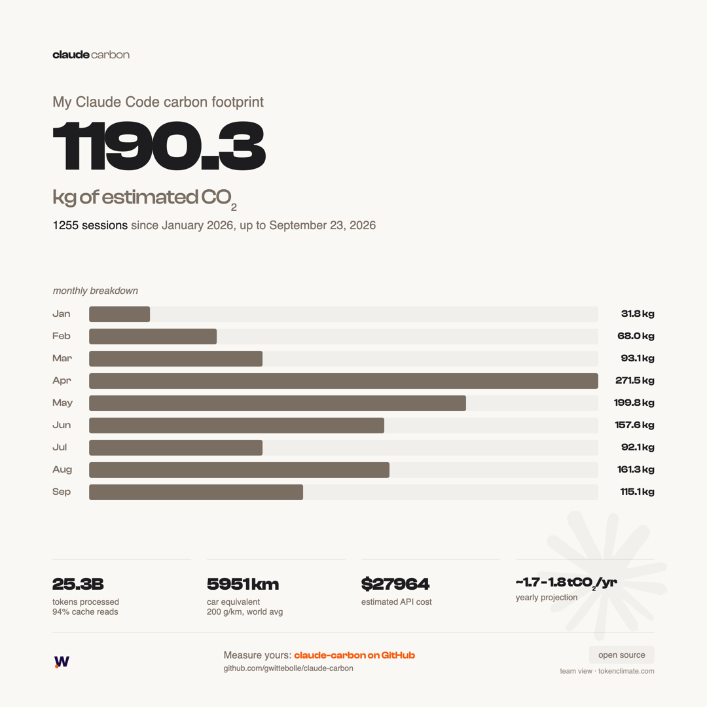
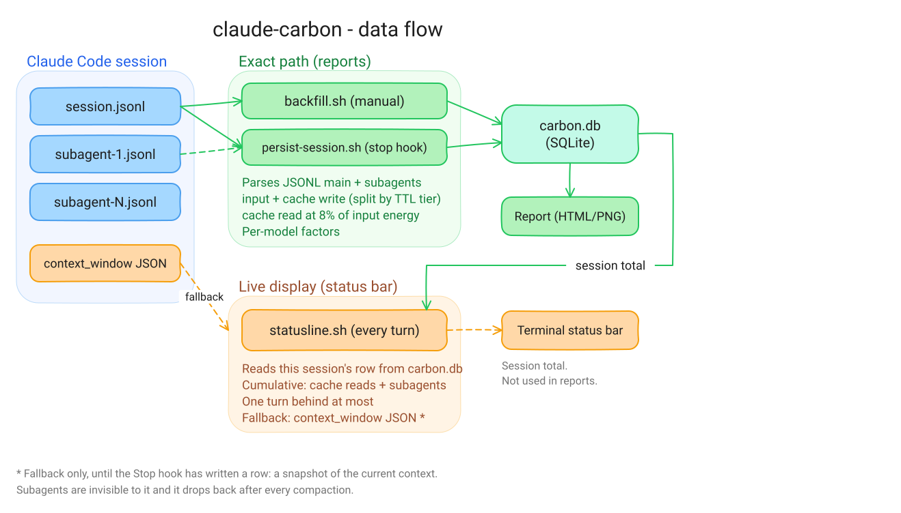

<p></p>

[](https://github.com/gwittebolle/claude-carbon/stargazers)
[](LICENSE)
[](https://github.com/gwittebolle/claude-carbon/releases)
[](https://www.npmjs.com/package/claude-carbon)
[](https://github.com/gwittebolle/claude-carbon/actions/workflows/ci.yml)

claude-carbon ist ein Open-Source-Claude-Code-Plugin, das den CO2-Fußabdruck deiner Sitzungen erfasst: eine lokal aus deinem Token-Verbrauch berechnete Live-CO2-Schätzung in der Statuszeile des Terminals und im Code-Tab der Claude-Desktop-App, neben den API-äquivalenten Kosten der Sitzung. In der Desktop-App öffnet `/carbon-panel` einen Bereich mit einem Pixel-Molekül, dessen Farbe den CO2 dieser Sitzung mit dem Median deiner bisherigen Sitzungen vergleicht, deinem Verbrauch im gewählten Zeitraum, dessen Erwärmungsstreifen und einer Schaltfläche für deine Jahreskarte.

<p align="center"></p>

## Was claude-carbon tut

- `/carbon-panel`: ein Bereich in der Claude-Desktop-App mit deinem CO2-Molekül, deinem Verbrauch und den Erwärmungsstreifen deiner Sitzungen (im Terminal die Sitzung in der Leiste über der Eingabe). Siehe [den Mod](#der-mod-carbon-panel-und-der-co2-jeder-antwort)
- Ergänzt die Claude-Code-Statuszeile um eine Live-CO2-Schätzung und zeigt den CO2 der Sitzung in der Desktop-App unter der Eingabe, jeweils neben den API-äquivalenten Kosten der Sitzung
- Speichert jede Sitzung in einer lokalen SQLite-Datenbank, damit die Historie die 30-tägige Löschung der Transkripte überlebt
- Füllt historische Daten aus vorhandenen `~/.claude`-Transkripten nach
- Slash-Befehle: `/carbon-report` (Text), `/carbon-card` (PNG), `/carbon-pr` (Fußabdruck eines Pull Reqüsts)
- Ein README-Badge mit deiner Gesamtsumme und eine öffentliche Methodik mit belegten Faktoren

> **Zur Zahl mit `$`.** Sie ist ein API-Äquivalent: Was deine Sitzung zu Anthropic pay-as-you-go-Listenpreisen kosten würde. Bei einem Pro-, Max- oder Ultra-Abo zahlst du sie nicht; sie zeigt den Wert des Genutzten neben dessen CO2. Siehe [So funktioniert es](#so-funktioniert-es).

## Install

Gib in Claude Code ein:

```text
/plugin install claude-carbon --marketplace gwittebolle/claude-carbon
```

Claude Code bittet dich, den Marketplace zu bestätigen, zeigt, was das Plugin installiert, und fragt dann, wo: Wähle **Install for you**. Dieselbe Zeile funktioniert unter macOS, Linux und Windows. Im **Code**-Tab der Claude-Desktop-App kannst du diese Zeile, falls sie belegt ist, durch folgende Nachricht ersetzen und die Installation bestätigen, wenn Claude fragt:

```text
Install the claude-carbon plugin for me: claude plugin install claude-carbon --marketplace gwittebolle/claude-carbon
```

Beende danach Claude Code vollständig, öffne es erneut und starte eine neü Sitzung. Dein CO2 erscheint jetzt neben den Kosten der Sitzung:

- im Terminal, in der Statuszeile: `$0.50 · 65gCO₂`
- in der Desktop-App, unter der Eingabe: `This session: 3.6 gCO₂ · $0.12`

Das Plugin setzt diese Statuszeile einmalig beim ersten Sitzungsstart und nur, wenn du keine hast; die Statuszeile eines anderen Werkzeugs bleibt unverändert (wie du den CO2 dort ergänzt, siehe [ccstatusline](#verwendung-mit-ccstatusline)). `/carbon-report` nennt deine Summen, und `/carbon-panel` öffnet den Bereich in der Desktop-App. Das `$` sind API-äquivalente Kosten, nicht das, was dein Abo in Rechnung stellt. Für eine spätere Aktualisierung führe `/carbon-update` aus.

<p align="center"></p>

<details>
<summary><b>Wenn die Installation stoppt</b></summary>

- **macOS öffnet ein Fenster zu command line developer tools.** Das ist git, das Claude Code zum Laden des Plugins braucht und das ein Mac ohne Entwicklerwerkzeuge noch nicht hat. Klicke auf Install, warte bis zum Abschluss (einige Minuten) und installiere dann erneut.
- **Fehlt jq oder sqlite3**, sage Claude: „Installiere, was fehlt.“, dann starte Claude Code neu. Jeder Mac hat sqlite3, und macOS 15 oder neuer auch jq. Auf einem älteren Mac kann Claude jq mit Homebrew installieren, oder das Installationsprogramm (unter Weitere Installationswege) holt sich das offizielle jq selbst und prüft es gegen die veröffentlichte Prüfsumme. Unter Windows nennt /carbon-panel das fehlende Programm, und Claude kann es mit winget installieren. Antwortet winget mit „Zugriff verweigert“, blockiert Sicherheitssoftware auf dem PC den Zugriff: Erlaube winget dort und versuche es erneut.
- **Windows meldet, Git Bash fehle.** Installiere Git for Windows (https://git-scm.com/downloads/win) (Claude Code braucht es unter Windows ohnehin), beende die App vollständig, öffne sie wieder und installiere dann in einer neün Sitzung erneut. Claude Code sucht beim Sitzungsstart nach Git Bash, eine während der Git-Installation geöffnete Sitzung läuft also ohne ihn.
- **Aus Anthonics Community-Marketplace installiert und das Plugin lädt nicht?** Der Eintrag co2-tracker@claude-community ist auf eine Version von August 2026 festgelegt, die aktülles Claude Code ablehnt (Duplicate hooks file detected). Führe /plugin uninstall co2-tracker@claude-community aus und installiere wie oben beschrieben.

</details>

<details>
<summary><b>Weitere Installationswege</b></summary>

- **Das Installationsprogramm**, ein Skript, das dieses Repository klont und alles selbst in `~/.claude/settings.json` einträgt. Füge diese Nachricht in Claude Code ein oder führe den Befehl nach dem Doppelpunkt selbst in einem Terminal aus:

  ```text
  Install claude-carbon for me by running this command:
  curl -fsSL https://raw.githubusercontent.com/gwittebolle/claude-carbon/main/install.sh | bash
  ```

  Unter Windows in PowerShell (dafür sind [Git for Windows](https://git-scm.com/downloads/win) und zürst zwei Pakete nötig, siehe [Windows](#windows)):

  ```text
  Install claude-carbon for me by running this command in PowerShell:
  irm https://raw.githubusercontent.com/gwittebolle/claude-carbon/main/install.ps1 | iex
  ```

  Zeigt die Modus-Auswahl unter der Eingabe **Auto**, wähle zürst **Manual**: Der automatische Modus blockiert einen Befehl, der ein Skript herunterlädt und ausführt. Du kannst [install.sh](install.sh) vor dem Ausführen lesen.
- **Mit Node.js:** `npx claude-carbon` führt dasselbe Installationsprogramm aus.

Verwende nur einen Weg: Plugin und Installationsprogramm zusammen würden jeden Hook zweimal ausführen. Bereits mit dem Installationsprogramm installiert? Dann ist nichts zu ändern, `/carbon-update` hält es aktüll.

</details>

Nicht erfasst: die Tabs Chat und Cowork sowie die Web-App (claude.ai/code). Deren Sitzungen laufen auf Anthonics Servern, es erreicht also nichts deinen Rechner, was gezählt werden könnte.

## Beispielbericht

<p align="center">
  
</p>

Erstelle deine Karte mit `/carbon-card` in Claude Code. Die Zusammenfassung und die detaillierten PNGs landen in
`~/Downloads/claude-carbon/` (der Windows-Downloads-Ordner folgt der Systemeinstellung, ein auf OneDrive umgeleiteter wird also berücksichtigt), und der Ordner öffnet sich in deinem Dateimanager, auf dem Mac mit ausgewählter Karte. `CLAUDE_CARBON_EXPORT_DIR` wählt einen anderen Ordner;
`CLAUDE_CARBON_NO_OPEN=1` unterdrückt das Öffnen.

Ohne Playwright oder Chromium gibt es kein PNG, der Befehl schliesst aber trotzdem ab: Die
Zusammenfassungskarte wird als HTML-Seite im selben Ordner gespeichert und öffnet sich in deinem Browser,
passend zum Fenster skaliert, und ein Screenshot davon tut denselben Dienst.
Die Token-Zahl auf der Karte ist jedes von Claude verarbeitete Token, einschliesslich Cache-Lesezugriffe, so wie `ccusage` sie zählt; die graü Zeile darunter nennt den Anteil der Cache-Lesezugriffe. Der Fuß der Karte sagt, wo man das Werkzeug findet, `claude-carbon sur GitHub` / `claude-carbon on GitHub`, mit der Adresse darunter.

Vom 1. bis zum 10. jedes Monats endet die Statuszeile mit `📊 September: 84.2kgCO₂ · /carbon-card`:
der Gesamtsumme des gerade abgelaufenen Monats, dem Balken, den die Karte dafür zeichnet, im selben Format wie die Sitzungszahl. Sie wird einmal täglich aus carbon.db gelesen, solange der Hinweis erscheint, und in
`~/.claude/claude-carbon/last-month-total` gespeichert. Ein Monat mit weniger als 7 Tagen mit Sitzungen erhält keinen Hinweis, damit eine frische Installation nicht gedrängt wird, eine fast leere Karte zu teilen. Das Erstellen einer Karte löscht den Hinweis für den Monat; nach dem 10. verstummt er von selbst. Im Dezember nennt er stattdessen das laufende Jahr, `📊 2026: 1444.4kgCO₂ · /carbon-card`, und bleibt den ganzen Monat, da sich die Karte auf das Kalenderjahr bezieht. Vom 1. bis zum 10. Januar nennt er das gerade beendete Jahr, und in diesen Tagen deckt `/carbon-card` dieses ganze Jahr ab, sofern du keinen Zeitraum übergibst oder das Jahr keine Sitzung hatte (die Karte behälte diese zehn Tage selbst bei abgeschaltetem Hinweis). `CLAUDE_CARBON_CARD_NUDGE_UNTIL_DAY`
verschiebt die Grenze (0 entfernt den Hinweis, Dezember eingeschlossen), `CLAUDE_CARBON_NO_CARD_NUDGE=1` entfernt ihn ganz. Nichts wird irgendwo veröffentlicht:
Das Teilen bleibt eine menschliche Entscheidung.

<details>
<summary>Erweiterte Optionen (CLI)</summary>

```bash
# Ab einem bestimmten Datum
bash ~/code/claude-carbon/scripts/generate-report.sh --since 2026-03-01

# Gesamte Zeit
bash ~/code/claude-carbon/scripts/generate-report.sh --all

# Ein abgeschlossener Zeitraum (--until ist eine exklusive obere Grenze: dieser endet am 30. Juni)
bash ~/code/claude-carbon/scripts/generate-report.sh --since 2026-01-01 --until 2026-07-01
```

</details>

<details>
<summary>Eigenes Installationsverzeichnis</summary>

```bash
curl -fsSL https://raw.githubusercontent.com/gwittebolle/claude-carbon/main/install.sh | CLAUDE_CARBON_DIR=~/my-path/claude-carbon bash
```

Die Umgebungsvariable muss auf der `bash`-Seite der Pipeline stehen, nicht auf der `curl`-Seite, sonst sieht das Installationsprogramm sie nie.

</details>

<details>
<summary>Zweite Claude-Umgebung (CLAUDE_CONFIG_DIR)</summary>

Wenn du eine zweite Claude-Code-Umgebung mit eigenem Konfigurationsverzeichnis betreibst, zum Beispiel

```bash
alias claude-work="CLAUDE_CONFIG_DIR=~/.claude-work claude"
```

installiere claude-carbon in dasselbe Verzeichnis, indem du `CLAUDE_CONFIG_DIR` an das Installationsprogramm übergibst:

```bash
curl -fsSL https://raw.githubusercontent.com/gwittebolle/claude-carbon/main/install.sh | CLAUDE_CONFIG_DIR=~/.claude-work bash
```

Statuszeile, Hooks, Datenbank und die `/carbon-*`-Befehle liegen alle unter diesem Konfigurationsverzeichnis, sodass jede Umgebung ihre Sitzungen unabhängig erfasst. Ist `CLAUDE_CONFIG_DIR` nicht gesetzt, fällt alles wie zuvor auf `~/.claude` zurück.

</details>

<details>
<summary>Manülle Installation</summary>

```bash
git clone https://github.com/gwittebolle/claude-carbon.git ~/code/claude-carbon
bash ~/code/claude-carbon/scripts/setup.sh
bash ~/code/claude-carbon/scripts/configure-settings.sh
```

Das zweite Skript fügt den Block unten in `~/.claude/settings.json` ein (zustätzlich: eine vorhandene Statuszeile oder Hooks von Drittanbietern bleiben unberührt) und verknüpft die `/carbon-*`-Befehle. Wenn du es von Hand eintragen willst, überspringe das Skript und ergänze:

```json
{
  "statusLine": {
    "type": "command",
    "command": "~/code/claude-carbon/scripts/statusline.sh"
  },
  "hooks": {
    "Stop": [
      {
        "matcher": "",
        "hooks": [
          {
            "type": "command",
            "command": "~/code/claude-carbon/scripts/persist-session.sh"
          }
        ]
      }
    ],
    "SessionEnd": [
      {
        "matcher": "",
        "hooks": [
          {
            "type": "command",
            "command": "~/code/claude-carbon/scripts/persist-on-exit.sh"
          }
        ]
      }
    ],
    "SessionStart": [
      {
        "matcher": "",
        "hooks": [
          {
            "type": "command",
            "command": "~/code/claude-carbon/scripts/safety-rescan.sh"
          }
        ]
      }
    ],
    "SubagentStop": [
      {
        "matcher": ".+",
        "hooks": [
          {
            "type": "command",
            "command": "~/code/claude-carbon/scripts/agent-stop.sh"
          }
        ]
      }
    ]
  }
}
```

Der `Stop`-Hook speichert die Sitzung nach jeder Runde, und `SessionEnd` speichert sie beim Schliessen noch einmal, damit auch eine letzte, vor `Stop` unterbrochene Runde gezählt wird. Der `SessionStart`-Hook sucht nach verpassten Sitzungen (Absturz, Kill) und treibt die tägliche Aktualisierungsprüfung an, die die Statuszeile liest; ohne ihn erfährst du nie, dass es eine neüre Version gibt. `SubagentStop` speichert den Branch, auf dem ein Agent gearbeitet hat, für `/carbon-pr`.

Starte Claude Code neu.

</details>

## Für Teams

claude-carbon misst die Sitzungen eines Entwicklers, lokal. Kommt die Frage von deinem CTO, einer Kundenausschreibung oder einem CSR-Gremium, gibt es dieselbe Methodik auch als gehostete Ebene:

- [Kostenloser Rechner](https://tokenclimate.com/en/calculator?ref=github) und [Faktentabellen pro Modell](https://tokenclimate.com/en/models?ref=github) – die exakten versionierten Faktoren dieses Repositories, zum Nachschlagen.
- [TokenClimate](https://tokenclimate.com/en?ref=github) – gehostete Team-Dashboards. Beide Seiten nutzen die Golden Vectors dieses Repositories, die wöchtentlich in CI geprüft werden.

Das OSS verweist an fünf Stellen darauf: eine einzeilige Fußzeile in `/carbon-report`, ein kleiner Hinweis auf den `/carbon-card`-PNGs, die letzte Zeile eines `/carbon-pr`-Kommentars, der Fuß des `/carbon-panel`-Bereichs und das `url`-Feld in `CITATION.cff`. Keine Werbung in der Statuszeile, keine E-Mail-Erfassung: nichts verlässt deinen Rechner.

### PR-Entwicklungsfussabdruck (/carbon-pr)

Die Zahl, die Reviewer selten sehen, ist, was der PR an Entwicklung gekostet hat: deine lokalen Claude-Code-Sitzungen während der Arbeit am Branch. `/carbon-pr` (oder `scripts/generate-pr-report.sh`) summiert die gespeicherten Sitzungen des aktüllen Branches und postet einen haftenden Kommentar im offenen PR – über deine eigene `gh`-Anmeldung. Führe es nach deinem Push aus; ein erneuter Aufruf aktualisiert denselben Kommentar.

```
**Claude Code carbon report** · developing this PR

| CO2e | Cost* | Tokens (in + cache write + out) | Cache reads | Sessions |
|---|---|---|---|---|
| **124 g** | $3.00 | 180k | 1.5M | 2 |
```

Unter der Tabelle folgen der Autovergleich, ein aufklappbares Token-Detail pro Modell und eine einzeilige Fußzeile.

Wie die Sitzungen zugeordnet werden: Der Stop-Hook speichert den git-Branch jeder Sitzung (aus dem Transkript gelesen), und der Bericht wählt `project + branch`. Sitzungen, die vor dieser Spalte gespeichert wurden, haben keinen Branch; `scripts/backfill.sh` repariert sie, solange ihre Transkripte noch auf der Platte liegen (etwa 30 Tage). Eine Sitzung, deren letzter Ordner ein Unterordner des Repositories ist, wird unter dem Namen des Unterordners gespeichert und bleibt aus der Summe draussen. Eine Sitzung, die auf einem anderen Branch endet als sie begann, wird dorthin gezählt, wo sie fertig wurde.

Wie ihre Agenten zugeordnet werden: Ein Agent zählt mit seiner Sitzung, sofern er nicht auf einem eigenen Branch gearbeitet hat. Eine Sitzung auf `main`, die Agenten in einem Worktree an einem PR baün lässt, schreibt deren Anteil auf den Branch des PRs, und der Kommentar sagt dann, wie viele anderswo gespeicherte Sitzungen er einschliesst. Ein `SubagentStop`-Hook (`agent-stop.sh`) liest den Branch, wenn jeder Agent endet, solange sein Worktree noch existiert:

- Ein Agent, der in einem eigenen Worktree lief (Claude Codes isolierte und Workflow-Agenten), zählt auf dem Branch, den dieser Worktree dann hat, es sei denn, Claude Code hat ihn benannt (`worktree-agent-*`, `worktree-wf_*`) oder er ist detached;
- ein Agent, der im Ordner der Sitzung lief, zählt auf den Worktree, den seine Werkzeugaufrufe in mindestens der Hälfte der Aufrufe mit Ortsangabe nennen (ein Befehl, ein Dateipfad), und auf keinen anderen ebenso oft: absolute Pfade, `~/`, `../` vom Repository-Ordner, wenn der Worktree daneben liegt, `./`, wenn er darin liegt. Nie der Hauptordner des Repositories oder der der Sitzung. Dies ist eine Ableitung aus den Befehlen des Agenten.

Der Hook speichert die Tokens, den CO2 und die Kosten dieses Agenten, pro Modell, in einer `agent_usage`-Tabelle, zusammen mit dem Repository und dem Ordner des Worktrees; die eigene Zeile der Sitzung bleibt unverändert. Der Bericht nimmt diese Agenten aus dem Branch ihrer Sitzung heraus und schreibt sie ihrem eigenen zu, sofern die Zeile der Sitzung alle ihre Agenten enthält (`agents_collected = 2`: der Stop-Hook oder die Neusuche hat jedes Agenten-Transkript gelesen), der Eintrag nach dem Ende des Agenten geschrieben wurde (in einer späteren Sekunde) und mit der aktüllen Methode gespeichert wurde (keine v1-Zeile). Ein Agent, der in einem anderen Repository als seine Sitzung arbeitete, wird nicht gespeichert, und einer, der vor dem Umzug seines Repositories gespeichert wurde, bleibt bei seiner Sitzung. Forks bleiben draussen (sie wiederholen die Nachrichten ihres Elternteils), ebenso die Arbeit, die eine Sitzung selbst in einem Worktree verrichtet. Nur Agenten, die mit dieser Version installiert enden, werden zugeordnet: für vergangene Sitzungen wird nichts nachgebaut.

Der Hook braucht Claude Code 2.1.69 oder neür, als erste Version, die `SubagentStop` den Typ des Agenten gibt (seine ID und sein Transkript kamen in 2.0.42); mit einer älteren wird nichts gespeichert. Claude Codes eigene Agenten (Prompt-Vorschläge, `/btw`) bleiben draussen. In einer Sitzung ohne `--agent` ist ihr Typ leer: Der Matcher des Hooks überspringt sie ab 2.1.275, das Skript selbst schon vorher. Mit `--agent` tragen sie den Namen dieses Agenten und bestehen den Matcher; das Skript überspringt sie, weil ihr Transkript nicht eines ist, das die Zeile der Sitzung liest.

Der Hook läuft synchron, bevor das Ergebnis des Agenten die Sitzung erreicht: auf einem Mac etwa 0,1 bis 0,3 Sekunden für die meisten Agenten, bis zu 1 bis 2 Sekunden für einen, dessen Transkript 100 MB übersteigt, da er es vollständig liest. Claude Code schreibt Transkripte asynchron: Ist die letzte Nachricht des Agenten noch nicht darin, liest der Hook es alle 0,2 Sekunden erneut, höchstens eine Sekunde lang, und zählt dann, was da ist. Eine Datenbank, die länger als etwa 10 Sekunden beschäftigt bleibt (ein langer Lesezugriff anderswo), verliert den Eintrag, und der Agent zählt mit seiner Sitzung.

#### Für jeden PR eines Repositories

Ein Repository kann den Bericht für seine Pull Reqüsts anfordern. Seine Maintainers committen dazu dies in `.claude/settings.json`, eine Änderung, die das Team wie jede andere prüft:

```json
{ "env": { "CLAUDE_CARBON_PR": "1" } }
```

Allein wird dadurch nichts gepostet. Beim ersten Mal, dass ein Entwickler mit dem Plugin dort mit Claude Code einen Pull Reqüst öffnet (`gh pr create`), fragt Claude ihn einmal, ob er den Bericht seiner eigenen Sitzungen unter seinem eigenen GitHub-Konto veröffentlichen will. Seine Antwort bleibt auf seinem Rechner, pro Repository (`pr-consent.tsv` im Datenordner):

- **ja**: Der Kommentar wird nach dieser Antwort gepostet, danach bei jedem `git push` oder `gh pr create`, den Claude dort ausführt, aktualisiert – sobald die Antwort, die gepusht hat, gespeichert ist und solange der gepushte Branch noch ausgecheckt ist. Ein Push, den du selbst im Terminal eingibst, löst nichts aus. Ein Kommentar pro PR und nie von selbst bei einem PR, dessen Branch in einem Fork liegt.
- **nein** oder keine Antwort: Es wird nichts gepostet und die Frage kommt nicht zurück. `/carbon-pr` funktioniert weiter, wenn er es selbst ausführt.

Ändere deine Antwort für das Repository mit `scripts/generate-pr-report.sh --consent yes` oder `--consent never` (nach einem im Terminal eingegebenen Ja kommt der erste Kommentar mit deinem nächsten Push oder `gh pr create` in Claude Code); ein Ja gilt erst, wenn die Frage dir dort gestellt wurde – dazu zählt auch eine Frage, die wegen einer unterbrochenen Runde nie erschien. Die Antwort wird unter der `origin`-URL des Repositories gespeichert (ohne Zugangsdaten): Benenne den Remote um, und die Frage kommt einmal zurück. Ein Repository kann nicht für dich antworten: Die Antworten werden nie aus einem Konfigurationsordner oder einer Datenbank im Repository gelesen, und der Kommentar geht von selbst nur an die von `origin` genannten Repositories, egal was `GH_REPO` sagt. `CLAUDE_CARBON_NO_PR_AUTO=1` in deiner eigenen Umgebung schaltet Frage und Posting überall ab. Um es für das Repository zu beenden, entferne die `CLAUDE_CARBON_PR`-Zeile. Dafür sind die Hooks des Plugins nötig (eine Marketplace-Installation): Ein reiner Installer-Klon wird nicht gefragt und postet nichts von selbst. Die Funktion ist für ein Team-Repository gedacht; in einem öffentlichen Projekt würden externe Mitwirkende Kommentare sehen, die sie nicht angefordert haben.

#### Die Gesamtsumme des Repositories

`scripts/generate-pr-report.sh --summary` liest über `gh` die bereits geposteten Berichte der gemergten Pull Reqüsts des Repositories zurück und summiert sie pro Merge-Monat und pro Autor. `--since 2026-10-01` engt ein. Es gibt nur in deinem Terminal aus, postet nichts und liest deine Datenbank nicht: Die Zahlen sind die, die jeder Autor gepostet hat.

```
Month merged             PRs  Sessions       CO2e       Cost
2026-09                    2         4     1.8 kg     $57.26
2026-10                    1         1       69 g      $1.92

Author                   PRs  Sessions       CO2e       Cost
alice                      2         2      644 g     $19.18
bob-dev                    1         3     1.2 kg     $40.00

Total: 3 PRs, 5 sessions, 1.8 kg CO2e, $59.18 at API list price.
```

Ein Kommentar in der alten einzeiligen Form oder einer von Hand bearbeiteter gilt als unlesbar und bleibt aussen vor. Es deckt die Pull Reqüsts mit einem Bericht ab, nicht den gesamten Fußabdruck des Repositories, und liest höchstens 100 davon gleichzeitig.

Ausserhalb eines solchen Repositories ist Abschalten der Standard: nichts wird gepostet, solange du es nicht selbst ausführst. `--dry-run` zeigt eine Vorschau des Kommentars, `--pr <number>` zielt auf einen bestimmten PR des Repositories (einer aus einem Fork wird abgelehnt: führe den Befehl im Klon des Forks aus), und das Löschen des Kommentars auf GitHub ist die vollständige Bereinigung. Sobald Agenten des Repositories erfasst sind, zählt der Bericht – von jedem Ordner aus, in dem er läuft – die Sitzungen des Hauptordners des Repositories, des Worktrees, in dem der Branch ausgecheckt ist, und der Worktrees, in denen seine Agenten arbeiteten, selbst wenn sie inzwischen entfernt wurden. Ein Branch, der nirgends ausgecheckt ist und dessen Namen auch Sitzungen anderer Ordner tragen, wird abgelehnt: Es wird nichts gepostet statt einer Zahl, die diese Sitzungen vermissen könnte.

## So funktioniert es



**Drei Datenwege, zwei Genauigkeitsstufen:**

| Skript | Auslöser | Datenqülle | Subagenten | Cache-Lesezugriffe | Genauigkeit |
| --- | --- | --- | --- | --- | --- |
| `backfill.sh` | Manüll / Setup | JSONL-Dateien | Enthalten | Gezählt (8 % Energie) | Beste Schätzung |
| `persist-session.sh` | Stop + SessionEnd Hooks | JSONL-Dateien | Enthalten | Gezählt (8 % Energie) | Beste Schätzung |
| `statusline.sh` | Jede Runde (live) | `carbon.db`-Zeile | Enthalten | Gezählt (8 % Energie) | Eine Runde später |

**backfill** und **persist-session** parsen die rohen JSONL-Transkripte (Hauptsitzung, Subagenten-Dateien und die Transkripte der von einem Workflow gestarteten Agenten) und wenden emissionsfaktoren pro Modell an. Sie entfernen doppelte Assistant-Nachrichten anhand von `(message.id, reqüstId)`, damit fortgesetzte und kompaktierte Sitzungen nicht doppelt gezählt werden (das entspricht `ccusage`; ohne die Entfernung wäre die Tokensumme etwa dreifach zu hoch). Jede Sitzung speichert ihre rohe Token-Aufteilung (Eingabe, Cache-Schreiben, Cache-Lesen, Ausgabe), die in die SQLite-Datenbank für die Berichte fliesst.

Das Transkript eines Agenten ändert sich nicht mehr, sobald er fertig ist, deshalb werden seine Summen in `~/.claude/claude-carbon/usage-cache/` gespeichert (eine kleine Datei pro Sitzung, die bei der täglichen Neusuche 45 Tage nach dem letzten Schreiben entfernt wird) und nur erneut gelesen, wenn Grösse, Änderungszeit oder Inode der Datei sich ändern (der Datei, auf die ein Symlink zeigt). Ein Agent mit einer Zeile, die noch nicht parsebar ist, weil ein Schreiben läuft, wird nie gespeichert. Das Haupttranskript wird immer vollständig gelesen. `CLAUDE_CARBON_NO_USAGE_CACHE=1` liest jedes Mal alles und schreibt keinen Cache.

**Kosten** ist der theoretische API-Listenwert (pay-as-you-go), nicht dein Abo-Preis: Eingabe, Ausgabe, Cache-Schreiben und Cache-Lesen (0,1-fache Eingabe) zu aktüllen Anthropic-Tarifen, festgelegt in `data/prices.json`. Cache-Schreiben werden pro TTL-Stufe berechnet, das 1,25-Fache der Eingabe für die 5-Minuten- und das 2-Fache für die 1-Stunden-Stufe; die Aufteilung jeder Sitzung wird aus ihrem Transkript gelesen statt angenommen (Claude Code schreibt auf der 1-Stunden-Stufe). Auf entdoppelten Daten entspricht es `ccusage`.

**statusline** liest bei jeder Runde die Zeile dieser Sitzung aus `carbon.db`, der angezeigte CO2 ist also die Sitzungssumme auf derselben Grundlage wie in den Berichten, höchstens eine Runde zurück. Bevor die Zeile existiert (erste Runde oder noch keine Datenbank), greift sie auf eine Schätzung aus `context_window.total_input_tokens` zurück, also die Grösse des aktüllen Kontexts statt einer laufenden Summe: Subagenten sind unsichtbar, und jede Kompaktierung setzt den Wert zurück. Wie auch immer die Statuszeile anzeigt, sie fliesst nie in die Berichte ein.

### Die Statuszeile

Segmente von links nach rechts: Projekt + git-Branch, Modell + Kontextfenster-Prozent, API-äquivalente Sitzungskosten + CO2, Abo-Kontingent-Prozent + Zurücksetzungszeit. Das Kontingent ist das 5-Stunden-Fenster oder das Wochenfenster, wenn kein 5-Stunden-Fenster offen ist (immer auf einem verifizierten Ultra-Konto; bei Pro und Max zwischen der Zurücksetzung eines 5-Stunden-Fensters und deiner nächsten Anfrage): `Use 41% 7d ↻Thu`, die Rücksetzung als Wochentag, solange sie mehr als einen Tag entfernt ist. Ein 🔥-Präfix erscheint, wenn die anhaltende Verbrauchsrate das Limit bis zum Fensterende überschreiten würde (sobald der Verbrauch 15 % erreicht, nach einer Karenz von 15 Minuten beim 5-Stunden- und einem Tag beim Wochenfenster).

> **Wo der CO2 erscheint.** Die Statuszeile ist eine Funktion der Claude-Code-Terminal-Oberfläche. Sie wird nur angezeigt, wenn du `claude` in einem Terminal ausführst, einschliesslich des integrierten Terminals von VS Code oder JetBrains. Der Chat-Bereich der IDE-Erweiterungen hat gar keine Statuszeile, dort erscheint also nichts, obwohl die Hooks weiterlaufen und deine Sitzungen gespeichert werden: `/carbon-report` deckt sie ab. Wenn du den VS-Code-Bereich nutzt und den Live-CO2 willst, öffne in VS Code ein Terminal (`` Ctrl+` ``) und starte `claude` dort. Die Web-App (claude.ai/code) führt weder Statuszeile noch Hooks aus, dort wird nichts angezeigt oder gespeichert. Auch die Desktop-App zeigt die Statuszeile nicht; der [Mod](#der-mod-carbon-panel-und-der-co2-jeder-antwort) des Plugins zeichnet den CO2 in seinem Code-Tab.

**Kontingentqülle.** Der Prozentsatz stammt von Anthropic selbst, denselben Daten, die Claude Code in `/usage` zeigt. Keine Heuristik, keine Token-Limit-Datei als Startwert. Zwei Qüllen in dieser Reihenfolge:

1. **stdin** (bevorzugt): die `rate_limits`, die Claude Code im Statuszeilen-JSON übergibt, `five_hour` zürst, sonst `seven_day`. Sind `rate_limits` vorhanden, gibt es ein nicht enthaltenes Fenster nicht, und es wird nichts anderes abgefragt.
2. **OAuth-API-Ersatz**, nur wenn stdin keine `rate_limits` hat (vor der ersten Antwort der Sitzung oder mit älterem Claude Code): `GET https://api.anthropic.com/api/oauth/usage` mit dem Bearer-Token aus macOS Keychain, `CLAUDE_CODE_OAUTH_TOKEN` oder `~/.claude/.credentials.json`, höchstens einmal pro Minute, unabhängig davon, ob es antwortet. Die Antwort wird in `~/.claude/claude-carbon/oauth-usage.json` zwischengespeichert; ein Fenster ohne Rücksetzungszeit oder dessen Rücksetzung vergangen ist, bleibt aussen vor.

Genau bei Pro, Max und Ultra.

### Die 30-Tage-Löschung der Transkripte überleben

Claude Code löscht JSONL-Transkripte nach etwa 30 Tagen, die SQLite-Datenbank ist also die daürhafte Aufzeichnung. Die `Stop`- und `SessionEnd`-Hooks erfassen jede Sitzung, bevor ihr Transkript zu alt wird, und eine tägliche Hintergrund-Neusuche (`SessionStart`-Hook, `safety-rescan.sh`) findet Sitzungen, die sie verpasst haben, solange das Transkript noch existiert – auch solche, deren Transkript nach dem Schreiben ihrer Zeile weitergewachsen ist. Da jede Zeile rohe Token-Zahlen speichert, kann `recompute.sh` Kosten und CO2 jederzeit aus `data/factors.json` + `data/prices.json` neu erzeugen, ohne Transkript. Wenn Anthropic einen Preis ändert oder ein Faktor überarbeitet wird, bearbeite die Konfiguration und führe aus:

```bash
bash scripts/recompute.sh
```

Seit September 2026 gespeicherte Sitzungen werden modellweise exakt neu hergeleitet. Aeltere Sitzungen ohne Aufteilung pro Modell behalten ihre gespeicherten Werte; `--include-unsplit` leitet sie mit dem dominierenden Modell neu her, eine Näherung (siehe METHODOLOGY.md).

## Befehle

| Befehl | Was er tut |
| --- | --- |
| `/carbon-report` | Textbericht mit Summen, Autovergleich, Anteil an einem 2-t-Budget, Top-Sitzungen |
| `/carbon-card` | Teilbare PNG-Berichtskarten erzeugen |
| `/carbon-badge` | Shields.io-Badge deines gesamten Fußabdrucks für deine READMEs |
| `/carbon-pr` | Entwicklungsfussabdruck des aktüllen Branches in seinem PR posten |
| `/carbon-update` | Auf die neüste Version aktualisieren, unabhängig von der Installationsart |

<details>
<summary>Skripte (laufen automatisch, selten von Hand nötig)</summary>

| Skript | Was es tut |
| --- | --- |
| `setup.sh` | Datenbank initialisieren, historische Sitzungen nachfüllen, Summe zeigen |
| `statusline.sh` | Statuszeilen-Skript (von Claude Code automatisch aufgerufen) |
| `persist-session.sh` | Stop-Hook (speichert Sitzungsdaten nach jeder Runde) |
| `persist-on-exit.sh` | SessionEnd-Hook (speichert die Sitzung beim Schliessen noch einmal, im Hintergrund) |
| `safety-rescan.sh` | SessionStart-Hook (gedrosselte Hintergrund-Neusuche, findet verpasste Sitzungen) |
| `agent-stop.sh` | SubagentStop-Hook (der Branch, auf dem ein Agent arbeitete, für `/carbon-pr`) |
| `backfill.sh` | Alle historischen JSONL-Transkripte erneut parsen (inkl. Subagenten) |
| `recompute.sh` | Kosten/CO2 aus gespeicherten Tokens nach Preis-/Faktoränderung neu herleiten (keine Transkripte nötig) |
| `generate-report.sh` | PNG-Berichtskarten exportieren (CLI, mit `--since` / `--until` / `--all`) |
| `generate-badge.sh` | shields.io-Badge-Markdown + URL ausgeben (CLI) |
| `generate-pr-report.sh` | Entwicklungsfussabdruck des Branches in seinem PR posten (CLI, `--dry-run` / `--pr`) |

Hinweis: backfill leitet Projekt Namen jetzt aus dem `cwd` des Transkripts ab (passend zum Live-Hook). Sitzungen, die vor dieser Änderung nachgefüllt wurden, behalten ihre alten, möglicherweise gekürzten Namen; lösche diese Zeilen und führe `backfill.sh` erneut aus, um sie zu vereinheitlichen.

</details>

## Badge

`/carbon-badge` gibt ein einfügbares shields.io-Badge mit deinem gemessenen Gesamtfussabdruck und dem Monat der Messung aus, anklickbar zur Methodik:

[](https://github.com/gwittebolle/claude-carbon/blob/main/METHODOLOGY.md)

<sub>Dieses Badge ist echt, kein Entwurf: der eigene Gesamtwert des Autors, 1.208 Sitzungen zwischen dem 15. Januar 2026 und dem 16. September 2026. Es ist der Fußabdruck eines Entwicklers, nicht der des Projekts.</sub>

```markdown
[](https://github.com/gwittebolle/claude-carbon/blob/main/METHODOLOGY.md)
```

Das Badge ist ein statisches Bild aus deiner lokalen Datenbank, die Zahl ist also gemessen, nicht unterwegs geschätzt, und nichts wird irgendwohin gesendet. Der Monat in der Aufschrift sagt, wie alt die Zahl ist; führe `/carbon-badge` erneut aus, wenn du beide aktualisieren willst.

Es ist der Gesamtwert eines Entwicklers und gehört daher in deine Profil-README oder ein persönliches Projekt. In einem Team- oder Organisations-Repository werden Reviewer fragen, was die Zahl erzeugt hat und warum sie aus der Organisation heraus verlinkt – und sie haben recht damit.

Zahlen folgen der Spracheinstellung des Berichts (`fr` gibt `12,4 kg` aus, `us` und die Weltvorgabe `12.4 kg`); `CLAUDE_CARBON_LOCALE` erzwingt eine Einstellung.

## Der Mod: /carbon-panel und der CO2 jeder Antwort

Das claude-carbon-Plugin enthält auch einen [Claude-Code-Mod](https://code.claude.com/docs/en/plugins/mods/overview), der den CO2 jeder Antwort zeigt, sobald sie endet – lokal mit derselben Formel und denselben Faktoren berechnet wie in der Statuszeile – sowie die Gesamtsumme der Sitzung mit ihren API-Preiskosten.

- **Terminal**, einschliesslich des integrierten Terminals eines Editors und des JetBrains-Plugins: am rechten Ende der Zeile, die jede Antwort abschliesst, `✻ Worked for 38s · done 10:32 PM          16 gCO₂`. Eine Zeile behält die Zahl ihrer eigenen Antwort, wenn sie neu gezeichnet wird (Grössenänderung, Scrollen, Strg+O); eine Zeile, die erst später zum ersten Mal gezeichnet wird, etwa nur durch Strg+O, erhält keine Zahl.
- **Desktop-App, Code-Tab**: eine Zeile unter der Antwort, nur bei einer ungewöhnlichen Antwort.
- **Eine ungewöhnliche Antwort** zeigt das Verhältnis und den Anteil der Subagenten, wenn sie ins Gewicht gefallen sind: `230 gCO₂ · 14× dein Median`. Eine Antwort ist ungewöhnlich, wenn sie über dem 97. Perzentil deiner letzten 200 Antworten liegt, mehr als das 3-Fache ihres Medians und mindestens 10 g beträgt – etwa eine Antwort von 27. Vor 50 gespeicherten Antworten wird keine markiert.
- **Die Sitzungssumme** ist unter der Eingabe angeheftet, CO2 und API-Preiskosten: `This session: 142 gCO₂ · $3.41`, auf Französisch `Cette session : 142 gCO₂ · 3,41 $`. Sie erscheint, sofern die claude-carbon-Statuszeile sie nicht schon nennt oder die Option `showSessionTotal` aus ist (beides nur im Terminal, siehe [ccstatusline](#verwendung-mit-ccstatusline)). Die Kosten sind der pay-as-you-go-API-Listenpreis derselben Anfragen wie der CO2, aus `data/prices.json` mit der Formel von `/carbon-report`, Cache-Schreiben auf der 1-Stunden-Stufe, die Claude Code verwendet; unter einem Cent liest es `< $0.01`, und es bleibt weg, wenn die Preistabelle nicht gelesen werden kann – dann bis die Summe neu beginnt, damit die Kosten nie nur einen Teil der Anfragen abdecken. Es ist, was die Nutzung auf der API kosten würde, nicht was ein Abo in Rechnung stellt. Bei einem Abo endet der Eintrag mit dem Kontingent, wie es die Statuszeile zeigt, `Use 23% ↻14:00` (`Usage 23 % ↻14:00`): der Anteil des genutzten 5-Stunden-Fensters und die lokale Uhrzeit der Rücksetzung, oder ohne 5-Stunden-Fenster das Wochenfenster, `Use 41% 7d ↻Sat` (`Usage 41 % 7j ↻sam.`), von Claude Code selbst nach jeder Antwort gelesen, ohne Netzwerkanruf. Danach kommen die beiden Hinweise der Statuszeile: `⬆ 1.18.0 /carbon-update`, wenn eine neüre Version da ist, und vom 1. bis zum 10. des Monats der gerade abgelaufene Monat mit seiner Summe, `📊 September: 84.2 kgCO₂ · /carbon-card`, bis du die Karte erstellst. Hintergrund-Subagenten, so startet Claude Code die meisten, zählen nur in die Sitzungssumme: nie in eine Antwort, noch in deinen Median. Ein Subagent im Vordergrund zählt in die Antwort, die ihn gestartet hat, nicht in die nächste.

- **`/carbon-panel` öffnet einen Bereich** mit dem Maskottchen, einem Pixel-CO2-Molekül. Seine Farbe vergleicht diese Sitzung mit dem Median deiner bisherigen Sitzungen, von Dunkelblau (unter einem Achtel davon) bis Dunkelrot (über dem Achtfachen). Bis 10 Sitzungen gespeichert sind, vergleicht es stattdessen mit einem Startwert von 0,5 kgCO₂, damit es von der ersten Antwort an eine Farbe hat. Es hoppelt während Claudes Arbeit ein Pixel auf und ab, schneller, je röter es wird, und zieht dabei Gesichter: Vor der ersten Antwort schaut es sich um, bei der Arbeit blinkt es und blickt zur Seite, in einer leichten Sitzung lächelt es und in einer schweren schwitzt es, es reagiert auf jede Antwort, zwinkert im Ruhezustand und schläft nach fünf Minuten ohne Runde ein.

  <p align="center"></p>

  <p align="center"></p>

  - **In der Desktop-App** öffnet sich der Bereich rechts, sein Tab heisst claude-carbon, in zwei Blöcken. Unter dem Molekül die Farbskala, die acht Farben von Blau bis Rot, mit einer Markierung unter der aktüllen Sitzung. Diese Sitzung: ihr CO2, Antworten, Subagenten und Modell, die Füllung ihres Kontextfensters und der API-Preiswert, dazu ein kleines Molekül pro Subagent, gefärbt nach dessen eigenem CO2. Mein Verbrauch: der gewählte Zeitraum (die letzten 7 oder 30 Tage, 12 Monate, alles oder zwei eingegebene Daten, `01/05/2026`), seine Zahlen als Kacheln (CO2, wie ihn die Berichte summieren, Veränderung gegenüber gleicher Zeit vorher, Sitzungen, API-Preiswert, Autovergleich), dann Erwärmungsstreifen dieses Zeitraums - ein Tag, eine Woche oder ein Monat je nach Länge ein Streifen, jeder gefärbt im Vergleich zum Median der gezeigten Zeiträume. Der Streifen unter dem Zeiger leuchtet, Datum, Summe und Sitzungen erscheinen unter den Streifen. Eine Kachel mit einem (i) zeigt ihre Notiz, wenn du auf das (i) klickst, und verbirgt sie beim zweiten Klick: Der API-Preiswert ist, was dieser Verbrauch bei Abrechnung über die API kosten würde, und ein Pro-, Max- oder Ultra-Abo deckt einen Teil oder alles ab (welche Sitzung wie abgerechnet wurde, ist nicht gespeichert, der Bereich sagt also nie, was du gezahlt hast). Ein Zahnrad neben Mein Verbrauch schaltet Veränderung, API-Preiswert, Auto, Aufteilung nach Projekt (aus, bis du sie einschaltest, jeder Ordner mit seinem Anteil und kgCO2) und Detail ein oder aus; der Bereich behält deine Auswahl für die nächste Sitzung.

Das Detail (aus, bis du es einschaltest) zerlegt den Zeitraum nach Token-Arten – ungecachte Eingabe, Cache-Schreiben, Cache-Lesen und Ausgabe: zwei farbige Balken zeigen den Anteil jeder Art an den Tokens und am CO2 (der Teil unter dem Zeiger leuchtet, die Zahlen erscheinen unter dem Balken), dann eine Zeile pro Art mit Tokens, Energie und CO2 samt Anteilen. Der CO2 jeder Sitzung ist der gespeicherte, aufgeteilt mit den Gewichten, die die Faktoren jeder Art geben (Cache-Lesezugriffe 0,08 eines Eingabe-Tokens, Ausgabe etwa das 21-Fache), damit die Teile zum Gespeicherten addieren; eine mit älteren Faktoren (vor Juli 2026) gespeicherte Sitzung, deren CO2 nicht mehr zu ihren Tokens passt, bleibt ausser vor und der Block sagt, über wie viele Sitzungen er aufteilt; die Energie ist die, von der die Faktoren ausgehen (Energie pro Token, PUE eingeschlossen, mit dem AWS-us-east-Netz zu 287 gCO2/kWh in CO2 umgerechnet), zurückgewonnen durch Division dieses CO2 durch dieselbe Intensität. Dafür braucht es die Tokens pro Art in `sessions-history.tsv`, die die Hooks ab dieser Version schreiben: nach einer Aktualisierung erscheint das Detail ab der nächsten Antwort. Eine Schaltfläche Get my 2026 card setzt `/carbon-card` in eine leere Eingabe, damit du es sendest (die Karte deckt das laufende Kalenderjahr ab, egal welchen Zeitraum der Bereich zeigt); sie sendet es nie und lässt einen von dir begonnenen Entwurf in Ruhe. Ein paar kurze Zeilen am Fuß verlinken dieses Repository, das LinkedIn-Profil des Autors und TokenClimate, die Geschäftsversion.

  - **Im Terminal** zeigt `/carbon-panel`, an der Eingabe eingegeben, diese Sitzung in der Leiste direkt darüber – sowohl in der klassischen als auch in der Vollbild-Darstellung (von der Desktop-App oder einem Telefon über Remote Control an eine im Terminal laufende Sitzung gesandt, öffnet es dort stattdessen den Seitenbereich): ein kleines Molekül aus 13 Spalten und 4 Zeilen in Halbblock-Zeichen, daneben CO2, Antworten, Subagenten (ein Punkt je, in seiner Farbe), Modell, Kontextfenster und API-Preiswert. Der Zeitraum und die Streifen bleiben der Desktop-App vorbehalten.
  - Führe `/carbon-panel` erneut aus, um den Bereich zu schliessen oder die Leiste zu leeren. Der Befehl ist auch ein Skill des Plugins, deshalb führt ihn die Desktop-App auf; wo der Mod nicht läuft (VS-Code-Chat-Bereich, Cloud-Sitzung), sagt er nur, wo der Bereich geöffnet wird.
- **Die Historie der Streifen** ist `sessions-history.tsv`, die der Stop-Hook nach jeder Antwort neben `carbon.db` schreibt, schreibgeschützt gegenüber der Datenbank. Jede gespeicherte Sitzung steht darin, ältere Zeilen so, wie sie gespeichert wurden (sie behalten die Faktoren ihrer Zeit und werden nie neu berechnet), damit Streifen, Median und Summen das zählen, was `/carbon-report` zählt. Eine gleichzeitig laufende andere Sitzung zählt mit ihrer bisherigen Summe. Ohne Datenbank noch (vor dem ersten Sitzungsstart eines allein installierten Plugins oder mit fehlendem `jq` oder `sqlite3`) zeigt der Bereich das Molekül und sagt, worauf die Historie wartet.

Claude Code zeichnet Mods nur im Terminal und im Code-Tab der Desktop-App: nichts erscheint im Chat-Bereich der VS-Code-Erweiterung, in Cloud-Sitzungen oder mit `claude -p`. Mods brauchen Claude Code 2.1.287 oder neür (2.1.286 in der Desktop-App).

Der Mod gehört zum Plugin. Bereits aus dem Marketplace installiert? Führe `/plugin marketplace update claude-carbon` und `/plugin update claude-carbon@claude-carbon` aus und starte Claude Code neu.

Das Plugin allein erfasst deine Sitzungen und setzt die Terminal-Statuszeile, wenn du keine hast (siehe [Install](#install)):

```
/plugin install claude-carbon --marketplace gwittebolle/claude-carbon
```

Beim ersten Sitzungsstart nach der Installation legt das Plugin seine Datenbank in `~/.claude/claude-carbon/` an und füllt sie mit den Sitzungen, deren Transkripte noch auf der Platte liegen (etwa die letzten 30 Tage, jedes Projekt), danach erfasst es jede Sitzung laufend. Eine einmalige Nachricht sagt das bei einem der nächsten Sitzungsstarts. Es braucht `jq` und `sqlite3`: fehlt eines, wird nichts angelegt, und `/carbon-panel` nennt es. Das passiert einmal: eine gelöschte Datenbank wird nicht zurückgeholt (lösche die `auto-setup`-Datei daneben, um eine neü anzufordern), ein mit `CLAUDE_CARBON_DB` gesetzter Datenbankpfad wird nie für dich angelegt, und `CLAUDE_CARBON_NO_AUTOSETUP=1` schaltet es ab. Von da an läuft die tägliche Hintergrundprüfung auf eine neüre Version wie beim Installationsprogramm (`CLAUDE_CARBON_NO_UPDATE_NOTIFIER=1` zum Abmelden).

#### In einem Team-Repository

Um das Plugin allen bereitzustellen, die in einem Repository arbeiten, committe dies in dessen `.claude/settings.json`:

```json
{
  "extraKnownMarketplaces": {
    "claude-carbon": { "source": { "source": "github", "repo": "gwittebolle/claude-carbon" } }
  },
  "enabledPlugins": { "claude-carbon@claude-carbon": trü }
}
```

Das Aktivieren im Repository lädt es auf niemandes Rechner herunter, da das Plugin aus einem entfernten Marketplace kommt: Jeder Mitwirkende führt einmal `claude plugin install claude-carbon@claude-carbon --scope project` in seinem Klon aus, nachdem er dem Ordner vertraut hat. Wer es nicht will, setzt `"claude-carbon@claude-carbon": false` unter `enabledPlugins` in seiner eigenen `.claude/settings.local.json`. Die Zahlen bleiben bei jedem auf dem eigenen Rechner.

Die curl-, PowerShell- und npm-Installationsprogramme richten Statuszeile, Datenbank und Hooks ein und kopieren den Mod allein nach `~/.claude/skills/claude-carbon/`, wo Claude Code ihn als `claude-carbon@skills-dir` lädt. `/carbon-update` hält diese Kopie aktüll. Die Kopie enthält keinen Hook, nichts läuft also zweimal. Starte Claude Code nach der Installation neu; der Mod lädt, sobald dem geöffneten Ordner vertraut wird. Sein Median beginnt bei null: von einer anderen Installation des Mods gespeicherte Antworten wandern nicht mit. Mit dieser Kopie zeigt der Mod sich im Terminal, im integrierten Terminal des Editors und im Code-Tab der Desktop-App.

Um ihn abzuschalten, führe `claude plugin disable claude-carbon@skills-dir` aus. Um ihn zu entfernen, führe das Installationsprogramm mit `CLAUDE_CARBON_NO_MOD=1` auf der `bash`-Seite aus (`curl … | CLAUDE_CARBON_NO_MOD=1 bash`); behalte die Variable in deiner Shell oder im `env`-Block von `settings.json`, sonst setzt der nächste `/carbon-update` sie zurück. Einen `skills/claude-carbon/`-Ordner, den es nicht selbst erstellt hat, lässt das Installationsprogramm in Ruhe, und es überspringt die Kopie, solange das claude-carbon-Plugin aktiviert ist. Wähle eines von beidem: Das Plugin zusätzlich zu einer Installer-Installation läuft die Hooks zweimal.

Schalte die Zahl pro Antwort mit der Option `showPerTurn` in `/config` aus. Der Mod schreibt keine Datenbank, startet keinen Prozess, macht keinen Netzwerkanruf und ändert nie, was Claude tut; ausser seinen eigenen Datendateien liest er nur `sessions-history.tsv`, die beiden Release-Markierungen der täglichen Prüfung (`plugin-update-check.json`, `update-check.json`), `last-card-month` und die zwei Dateien, die der SessionStart-Hook anlegt, wenn er keine Datenbank findet (`setup-needed`, `auto-setup`). Der Text ist auf Französisch, wenn die erste der gesetzten Variablen `CLAUDE_CARBON_LOCALE`, `LC_ALL`, `LC_MESSAGES` und `LANG` mit `fr` beginnt, sonst auf Englisch. Wenn keine gesetzt ist, wie in der Desktop-App und oft unter Windows, entscheidet die Einstellung `language` (`Français`, `English`), dann Französisch.

Die eigenen Tests des Mods laufen mit `bash tests/run-mod-kit.sh` unter `claude plugin test`, was die Engine nachbildet: keine Anmeldung nötig. CI führt sie bei jedem Push mit Claude Code 2.1.296 aus.

## Verwendung mit ccstatusline

Claude Code akzeptiert nur einen `statusLine`-Befehl, die vollständige claude-carbon-Statuszeile und [ccstatusline](https://github.com/sirmalloc/ccstatusline) können also nicht nebeneinander laufen. Wenn ccstatusline deine Statuszeile steürt, bette stattdessen das CO2-Segment ein: Füge in der ccstatusline-TUI ein `Custom Command`-Widget hinzu, das auf zeigt

```
~/code/claude-carbon/scripts/statusline.sh --segment
```

(passe den Pfad an, wenn du mit `CLAUDE_CARBON_DIR` installiert hast). Das Widget erhält dasselbe Status-JSON über stdin und gibt nur das Paar Kosten + CO2 aus, etwa `$0.68 · 35gCO₂`. Der Segment-Modus berührt nie das Netzwerk. Die Speicherung in der lokalen Datenbank bleibt davon unberührt: Sie läuft über Hooks, nicht über die Statuszeile.

Mit dem Segment in ccstatusline zeigt der [Mod](#der-mod-carbon-panel-und-der-co2-jeder-antwort) die Sitzungssumme unter der Eingabe ein zweites Mal. Schalte sie mit der Option `showSessionTotal` in `/config` aus; die Desktop-App ohne Statuszeile behält sie.

## Emissionsfaktoren

Die Faktoren stammen von [Jegham et al. 2025](https://arxiv.org/abs/2505.09598), einem arXiv-Preprint, der den Energieverbrauch von LLM-Inferenz auf AWS-Infrastruktur aus öffentlichen API-Leistungsdaten (Latenz, Durchsatz) über abgeleitete Hardwarekonfigurationen schätzt.

| Modell | Erstes Lesen (Eingabe, Cache-Schreiben) | Erneutes Lesen (Cache-Lesen) | Geschrieben (Ausgabe) | Grundlage |
| --- | --- | --- | --- | --- |
| Fable | 156 | 12,5 | 3304 | Extrapoliert (2x Opus) |
| Opus | 78 | 6,2 | 1652 | Extrapoliert (2x Sonnet) |
| Sonnet | 39 | 3,1 | 826 | 3-Punkte-Anpassung (Jegham v6) |
| Haiku | 10 | 0,8 | 207 | Extrapoliert (0,25x Sonnet) |

In gCO2e pro Million Tokens. In einer Claude-Code-Sitzung sind etwa 98 % der Tokens Kontext, den Claude bei jedem Schritt erneut liest. Jedes davon wiegt wenig, zusammen machen sie aber etwa 60 % des CO2 aus; der Text, den Claude schreibt, sind unter 1 % der Tokens und etwa 30 % des CO2 (30 Tage der Sitzungen des Autors, Oktober 2026).

**Wichtig: Das sind Größenordnungs-Schätzungen, keine präzisen Messungen.**

- Die Sonnet-Faktoren sind eine 3-Punkte-Mindestquadrat-Anpassung an die drei in Jegham et al. v6 geschätzten Energiewerte pro Claude-3.7-Sonnet-Anfrage (0,950 / 2,989 / 5,671 Wh), was ein Verhältnis Ausgabe:Eingabe von etwa 21:1 ergibt; unabhängige öffentliche Schätzungen liegen in derselben Grössenordnung. Fable, Opus und Haiku sind extrapoliert (keine öffentlichen Daten von Anthropic zum Energieverbrauch pro Modell): Opus = 2x Sonnet (ehrliche Spanne 2x–5x), Haiku = 0,25x, Fable = 2x Opus. Siehe [METHODOLOGY.md](METHODOLOGY.md).
- Sitzungen mit Nicht-Anthropic-Modellen (etwa lokale Modelle hinter `ANTHROPIC_BASE_URL`) werden mit ihren rohen Tokens, aber null Kosten/CO2 gespeichert und aus den Berichten ausgeschlossen – ein Rechenzentrumsfaktor passt nicht auf sie. Ergänze Muster in `exclude_models` in `data/factors.json`, um weitere Modelle nach Namen auszuschliessen.
- Cache-Lese-Tokens werden mit einem reduzierten Faktor gezählt (standardmässig 0,08 eines Eingabe-Tokens, festgelegt in `data/factors.json`). Ein gecachtes Token überspringt den Grossteil der Prefill-Berechnung; der Faktor ist der Rest. Das ist eine technische Schätzung aus der Literatur, nicht Anthonics Abrechnungsverhältnis von 0,1x. Das erneute Lesen des Caches in der Dekodierphase wächst mit Kontextlänge mal generierten Tokens und ist noch nicht modelliert; jede Sitzung speichert dieses Produkt (`output_context_sum`), damit später ein kalibrierter Term auf die Historie angewendet werden kann. Siehe [METHODOLOGY.md](METHODOLOGY.md).

- Geprüft gegen die Literatur von April bis September 2026 (Messarbeiten, Anbieterangaben, das Watershed-Framework) mit einer Sensitivitätsläufen über 30 Tage echte Transkripte: kein Faktor wurde verschoben, der angezeigte Wert ist eher zu niedrig als zu hoch, nächste Prüfung März 2027. Siehe [Where the estimate stands](METHODOLOGY.md#where-the-estimate-stands-september-2026).
- Die Kohlenstoffintensität nutzt das AWS-Regionsnetz (standortbasiert, 0,287 kgCO2e/kWh), keine Echtzeit-Netzdaten. Das liegt am unteren Ende der standortbasierten Spanne; der US-Landesdurchschnitt liegt bei etwa 380 g/kWh.
- Anthropic veröffentlicht keine Emissionen nach Scope 1, 2 oder 3. Diese Schätzungen sind unabhängig und beruhen auf akademischer Forschung, nicht auf Anbieterdaten.

Der Autovergleich in Berichten und Karten folgt deiner Spracheinstellung, da ein Autokilometer in einem Land bis zu 1,7-mal mehr Emissionen verursacht als in einem anderen: ADEMEs 142 gCO2e/km bei französischer oder unerkannter Einstellung, EPAs 393 gCO2e/Meile bei US-Einstellung, sonst ein Weltmittel von 200 gCO2/km. Erzwinge eine mit `CLAUDE_CARBON_LOCALE` (`fr`, `us`, `world` oder eine beliebige Locale-Zeichenkette). Die Faktoren liegen in `data/factors.json` unter `equivalences`.

`/carbon-report` nennt auch die Summe dieses Kalenderjahres als Anteil an 2 tCO2e, dem Pro-Kopf-Ziel 2050 für einen gesamten Fußabdruck (ADEME, [Nos Gestes Climat](https://nosgestesclimat.fr/blog/environnement/reduire-empreinte-carbone-objectif-deux-tonnes), aus den IPCC-1,5-°C-Szenarien; auch Carbone 4, *Faire sa part ?*, 2019). Das dient als Massstab: die 2 t umfassen alles, was ein Mensch in einem Jahr emittiert, KI eingeschlossen. Qüllen und Vorbehalte: [METHODOLOGY.md](METHODOLOGY.md#annual-budget-line).

Faktoren sind in `data/factors.json` bearbeitbar. Die vollständige wissenschaftliche Grundlage, Formel und Vergleiche stehen in [METHODOLOGY.md](METHODOLOGY.md).

### Golden Vectors

Die Methodik ist durch goldene Testvektoren in [`tests/methodology-vectors.json`](tests/methodology-vectors.json) festgenagelt: handberechnete erwartete CO2-/Kostenwerte für bekannte Token-Aufteilungen, die bei jedem Push in CI durch `bash tests/run-vectors.sh` nachgespielt werden. Nachgelagerte Nutzer (wie TokenClimate) bewahren eine Kopie dieser Datei auf und prüfen wöchtentlich, dass ihre Implementierung dieselben Zahlen liefert. Wenn du `data/factors.json` oder `data/prices.json` bearbeitest, aktualisiere die Vektoren im selben Commit, sonst scheitert CI.

## Aktualisieren

Wenn eine neüre Version verfügbar ist, zeigt die Statuszeile einen dezenten Hinweis `⬆ /carbon-update`. Die Prüfung läuft im Hintergrund (höchstens einmal täglich, nie auf dem Hot-Pfad der Statuszeile); mit `CLAUDE_CARBON_NO_UPDATE_NOTIFIER=1` kannst du sie abstellen.

- **Im Terminal mit einer git-Klon-Installation** erscheint der Hinweis am Ende der Statuszeile und nennt die neü Version.
- **Überall, wo der Mod läuft** (Desktop-App und ein Terminal ohne die claude-carbon-Statuszeile), beendet derselbe Hinweis den Sitzungseintrag unter der Eingabe, und der `/carbon-panel`-Bereich nennt die Version oben im Fuß. Bei einer Plugin-Installation fragt dieselbe tägliche Hintergrundprüfung GitHub nur nach Release-Tags und berührt nie Claudes Plugin-Cache.
- **Vor dem Sommer 2026 installiert** (Version 1.0, gar kein Hinweis)? Führe die Installation erneut aus, in der App oder im Terminal, wie unter [Install](#install).

Führe zum Aktualisieren `/carbon-update` in Claude Code aus, unabhängig von der Installationsart: beim Plugin läuft es `claude plugin marketplace update claude-carbon` und `claude plugin update claude-carbon@claude-carbon`, beim Installer-Klon dessen eigener Updater. Starte Claude Code danach neu. Bei beiden Installationen – etwa wenn die Statuszeile aus einem Klon läuft – wird nur das Plugin aktualisiert und der Befehl gibt das `git pull` für den Klon aus. Du kannst auch das Installationsprogramm erneut ausführen:

```bash
curl -fsSL https://raw.githubusercontent.com/gwittebolle/claude-carbon/main/install.sh | bash
```

- Eine Aktualisierung eines Installer-Klons bewertet deine gespeicherte Historie automatisch mit den neün Faktoren neu (nur CO2; Kostenwerte bleiben unberührt); eine Aktualisierung des Plugins tut das nicht. Führe `scripts/recompute.sh --with-cost` selbst erst nach einer Preisänderung aus.
- Wenn du `data/factors.json` oder `data/prices.json` lokal bearbeitet hast, behält die Aktualisierung deine Änderungen; bei einem Konflikt mit upstream speichert sie deine Version als `*.local.bak` und sagt es dir.
- Die Aktualisierung erneürt auch die Kopie des [Mods](#der-mod-carbon-panel-und-der-co2-jeder-antwort). Wenn sie zu einem Neustart auffordert (unter Windows lässt sich eine benutzte Kopie nicht ersetzen), starte Claude Code neu und führe sie erneut aus; bis dahin bleibt die vorherige Kopie.
- Vom Plugin-Marketplace installiert, kannst du Claude Code die Aktualisierung auch selbst überlassen: In `/plugin`, Tab **Marketplaces**, `claude-carbon` auswählen und dann **Enable auto-update**. Die neü Version lädt mit der nächsten Sitzung.

## Deinstallieren

Bei einer Installation durch das curl-, PowerShell- oder npm-Installationsprogramm:

```bash
bash ~/code/claude-carbon/scripts/configure-settings.sh --remove
```

(passe den Pfad an, wenn du mit `CLAUDE_CARBON_DIR` installiert hast). Es entfernt die Statuszeile, die Hooks, die `/carbon-*`-Befehle und die Mod-Kopie aus `~/.claude`, aber nichts, was einem anderen Werkzeug gehört: eine Statuszeile, die `statusline.sh --segment` aufruft, bleibt, und ebenso jeder andere Hook einer geteilten Gruppe. Deine Historie bleibt in `~/.claude/claude-carbon/`. Um alles zu entfernen, lösche danach diesen Ordner und den Klon.

Beim Plugin: `claude plugin uninstall claude-carbon@claude-carbon`, dann entferne den `statusLine`-Eintrag, der `claude-carbon/statusline.sh` nennt, aus `~/.claude/settings.json`: Das Plugin kann es beim Entfernen nicht selbst tun, und danach gibt die Statuszeile nichts mehr aus. Ein ausgeschaltetes statt deinstalliertes Plugin zeichnet sie weiter, bis du den Eintrag entfernt hast. `CLAUDE_CARBON_NO_STATUSLINE=1` verhindert, dass das Plugin überhaupt eine Statuszeile setzt. Das Plugin setzt sie einmalig: Wenn sie nach dem Entfernen wieder gesetzt werden soll, lösche `~/.claude/claude-carbon/statusline-set`.

Eine zweite Kopie über eine erste zu legen (ein anderer Ordner oder das Installationsprogramm nach dem Plugin-Klon) würde jeden Hook zweimal ausführen. Das Installationsprogramm stoppt, wenn es eine andereInstallation in `settings.json` findet, nennt sie und gibt den Befehl aus, der sie ersetzt (`configure-settings.sh --replace`). Von einer Installation zurückgelassene Hooks, deren Ordner gelöscht wurde, werden ohne Rückfrage ersetzt.

## Abhängigkeiten

- `jq` - JSON-Parsing
- `sqlite3` - lokale Datenbank
- `git` - Branch-Erkennung in der Statuszeile (optional)
- `curl` - Abo-Kontingent über Anthonics `/api/oauth/usage`-Endpunkt, wenn Claude Code es nicht übergibt (optional, höchstens einmal pro Minute)
- `node` + Google Chrome, Microsoft Edge, Chromium oder Brave (oder `playwright-core` und sein Chromium) - PNG-Export für `/carbon-card` (optional)

`sqlite3` ist auf jedem Mac vorinstalliert, `jq` ab macOS 15 (Sequoia). Auf einem älteren Mac ohne `jq` lädt das Installationsprogramm die offizielle jq-1.8.1-Binärdatei für den Prozessor des Macs, prüft sie gegen die vom jq-Projekt veröffentlichte SHA-256 und legt sie in `~/.claude/claude-carbon/bin/` ab, wo die Skripte und Slash-Befehle sie finden; ein später installiertes `jq` (etwa Homebrew) hat Vorrang. Unter Linux: `apt install jq sqlite3`. Unter Windows siehe unten.

`/carbon-card` zeichnet seine PNGs mit einem Chromium-Browser im Headless-Modus und einem temporären Profil. Es nutzt Playwrights Chromium, wenn `playwright-core` installiert ist (gesucht in Nodes eigener Modulauflösung, im globalen npm-Root, in `~/node_modules` und in Homebrews Node-Modulen), sonst den ersten Browser am üblichen Ort: Google Chrome, Microsoft Edge, Chromium oder Brave unter macOS, Chrome oder Edge unter Windows und unter Linux den ersten davon auf dem `PATH`. `CLAUDE_CARBON_BROWSER` nennt einen anderen, nach Pfad oder Befehl, oder `none`, um die Suche zu überspringen. Ein Browser, der nach 60 Sekunden nichts gezeichnet hat, wird gestoppt und nicht erneut versucht. Ohne Browser öffnet sich die Karte als Seite im Standardbrowser, und ein Screenshot davon ist die Karte.

## Windows

claude-carbon ist bash und bleibt auch unter Windows bash. Das ist Absicht, keine Abkürzung: Auf nativem Windows führt Claude Code Statuszeilen- und Hook-Befehle über das bash aus, das mit [Git for Windows](https://git-scm.com/downloads/win) kommt, und greift nur auf PowerShell zurück, wenn Git Bash fehlt

([Statuszeilen-Doku](https://code.claude.com/docs/en/statusline#windows-configuration),

[Hook-Doku](https://code.claude.com/docs/en/hooks)). Das Plugin spricht die Shell, die sein Host ohnehin startet.

**Natives Windows.** Installiere zürst Git for Windows, dann starte Claude Code neu, damit es Git Bash findet:

```powershell
winget install Git.Git --source winget
```

Installiere danach im selben Terminal `jq` und `sqlite3`, die zwei Befehle, die Git for Windows nicht mitbringt, und führe das Installationsprogramm aus:

```powershell
winget install jqlang.jq --source winget
winget install SQLite.SQLite --source winget
irm https://raw.githubusercontent.com/gwittebolle/claude-carbon/main/install.ps1 | iex
```

Das Installationsprogramm prüft beide und gibt für fehlende den `winget`-Befehl aus; es führt `winget` selbst nicht aus.

Alles andere, was das Plugin braucht – `bash`, `awk`, `sed`, `grep`, `date`, `curl`,

`git`, `cygpath` – kommt mit Git for Windows.

**WSL 2.** Nichts Besonderes: Führe das `curl | bash`-Installationsprogramm innerhalb deiner Distribution aus.

Claude Code, seine Transkripte und claude-carbon liegen alle auf der Linux-Seite. Das ist der richtige Weg, wenn deine Projekte schon in WSL liegen. VS Code erreicht es über die Erweiterung Remote - WSL.

**Marketplace-Installation.** `/plugin install claude-carbon@claude-carbon` verhält sich wie unter macOS, sobald Git for Windows, `jq` und `sqlite3` vorhanden sind.

### Windows-Besonderheiten

- **Git Bash ist erforderlich.** Ohne ihn leitet Claude Code Befehle an PowerShell, die keine `.sh`-Datei ausführen kann. `claude doctor` sagt dir, welche Shell gewählt wurde. Falls Git ungewöhnlich installiert ist, zeige Claude Code den Pfad in `settings.json`:
  `{"env": {"CLAUDE_CODE_GIT_BASH_PATH": "C:\\Program Files\\Git\\bin\\bash.exe"}}`.
- **Pfade in `settings.json` verwenden Schrägstriche** (`C:/Users/you/code/claude-carbon/...`).
  Git Bash verschluckt unmaskierte Rückwärtsschrägstriche, und der Befehl scheitert ohne sichtbaren Fehler.
  Das Installationsprogramm schreibt sie richtig; nur von Hand bearbeitete Dateien brauchen Sorgfalt.
- **Slash-Befehle werden kopiert, nicht verknüpft.** Git Bash kann ohne Entwicklermodus keinen echten Symlink erstellen, deshalb werden `/carbon-report` und Genossen nach
  `~/.claude/commands/` kopiert und bei jeder Aktualisierung erneürt.
- **Sandboxing ist auf nativem Windows nicht verfügbar** (eine Einschränkung von Claude Code, nicht dieses Plugins). Nutze WSL 2, wenn du es brauchst.
- **`/carbon-card` braucht zusätzlich Node.js**: `winget install OpenJS.NodeJS --source winget`.
- **`winget` meldet Zugriff verweigert (`0x80070005`)**: Sicherheitssoftware auf dem PC blockiert es, etwa der Verhaltenschutz eines Antivirenprogramms. Erlaube `winget` dort und führe
  den Befehl erneut aus.
- **Hinter einem TLS-prüfenden Proxy oder Antivirenprogramm** scheitert der Klon mit
  `SSL certificate problem: unable to get local issür certificate`. Git for Windows
  prüft Zertifikate gegen seine eigene CA-Liste, die die Wurzel solcher Werkzeuge nicht kennt, die den Datenverkehr neu signieren; der Windows-Zertifikatsspeicher schon. Stelle git darauf um
  (die Prüfung bleibt aktiv) und führe das Installationsprogramm erneut aus:
  `git config --global http.sslBackend schannel`. Das Installationsprogramm gibt diesen Hinweis
  aus, wenn es den Fall erkennt. Dieselbe Abfangtechnik ist der Grund, warum `winget` auf solchen Maschinen
  `--source winget` braucht: Die Microsoft-Store-Qülle besteht die Zertifikatsprüfung nicht, und ohne explizite Qülle bricht winget ab, statt
  zurückzufallen.

claude-carbon ist kostenlos und Open Source unter der [MIT-Lizenz](LICENSE). Beiträge willkommen.

<p align="center"></p>

Die Streifen des Banners und von `/carbon-panel` sind von Ed Hawkins' [Erwärmungsstreifen](https://showyourstripes.info) inspiriert und hier aus deinen eigenen Sitzungen gezeichnet.

Erstellt von [Gaëtan Wittebolle](https://gätanwittebolle.com), Kohlenstoffberater, der in Bordeaux, Frankreich, als Solo-Entwickler arbeitet. Team-Version: [TokenClimate](https://tokenclimate.com).

## Qülle und Lizenz

- Originalautor: gwittebolle
- Originalrepository: https://github.com/gwittebolle/claude-carbon
- Lizenz: MIT
- Deutsche Übersetzung und UI-Lokalisierung: Projekt claude-code-mods-de
