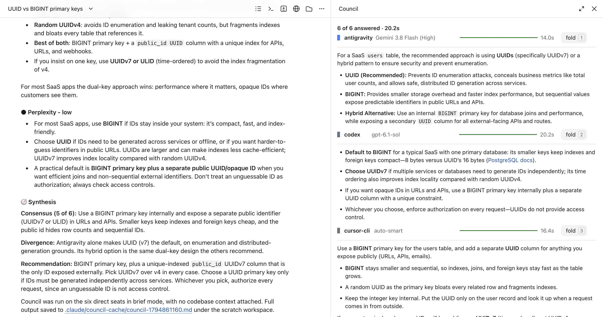

Ein Claude-Code-Plugin, das KI-Programmieragenten dieselbe Frage parallel stellt. Vergleiche ihre Antworten, wenn die Neigung eines einzelnen Modells dich in die Irre führen könnte: Architekturentscheidungen, Debug-Sackgassen, Sicherheitsprüfungen oder Framework-Wahlen.


[](https://github.com/hex/claude-council/actions/workflows/tests.yml)

## Wo es läuft

| Ort | Was du bekommst |
| --- | --- |
| Claude Code im Terminal | `/claude-council:ask`, jeden Sitzplatz und den Bereich neben dem Chat. |
| Claude Desktop, Code-Tab | Dasselbe Plugin und dieselben Befehle. Der Bereich öffnet sich in der Seitenleiste der Desktop-App. |
| Claude Desktop, gewöhnlicher Chat | Die [Desktop-Erweiterung](#claude-desktop): fünf Werkzeuge, eine Sitzplatz-Auswahl und ein Antwortbereich im Chat. macOS und Linux. |



In beiden Fällen kann Claude den Council auch als Werkzeug aufrufen. Es fragt zuerst, welche Sitzplätze und wie ausführlich geantwortet werden soll, dann erscheint eine Sende-Karte, und nichts verlässt deinen Rechner, bevor du bestätigst.

Der claude.ai-Chat und Cowork laufen in einer Sandbox, die Aufrufe anderer Anbieter blockieren kann, der Council funktioniert dort also nicht.

## Install

Du brauchst `curl` und `jq` unter macOS, Linux oder Windows über Git Bash.

```text
/plugin marketplace add hex/claude-marketplace
/plugin install claude-council
```

Gib in der Shell, aus der du Claude Code startest, mindestens einen Anbieter an:

```bash
export OPENAI_API_KEY="..."
# Oder GEMINI_API_KEY, XAI_API_KEY, PERPLEXITY_API_KEY,
# KIMI_API_KEY, OPENROUTER_API_KEY
```

Oder speichere die Keys in der Konfiguration des Plugins. Führe `/plugin configure claude-council` aus, fülle die Zeilen für die API-Keys aus und wähle Save configuration. Claude Code bewahrt sie in seinem sicheren Speicher auf, nicht in einer Einstellungsdatei. Der Mod des Councils setzt jeden gespeicherten Key für die gesamte Sitzung als dessen Variable, sodass jeder von Claude Code gestartete Befehl in jedem Projekt den gespeicherten Key statt eines von deiner Shell exportierten erhält. Die Zeile für OpenRouter-Modelle nimmt die Modell-IDs entgegen, die `OPENROUTER_MODELS` akzeptiert, die Sitzplätze des Routers brauchen also ebenfalls keinen Export.

Gespeicherte Keys benötigen Claude Code 2.1.287 oder neuer. Der Settings-Tab des Plugins in der Desktop-App nimmt sie ebenfalls entgegen, für Sitzungen auf diesem Rechner. Sie gelangen nie in den claude.ai-Chat oder nach Cowork. [API keys](docs/REFERENCE.md#api-keys) beschreibt, wo sie aufbewahrt werden, wann der Mod nicht lädt und wie sich ein gelöschter Key verhält.

Die CLIs `codex`, `agy` (Antigravity), `grok`, `kimi` und `cursor-agent` nutzen deine bestehenden Abonnements ohne API-Key. Claude Code selbst, die Copilot-CLI und OpenCode können ebenfalls dabei sein, wenn sie in `--providers` genannt werden. Ein lokales `ollama`-Modell braucht weder Key noch externes Netz. Ohne diese nutzt `--local` Claude-Subagenten. Siehe [Anbieterauswahl](docs/REFERENCE.md#choosing-providers) und [lokale Councils](docs/USAGE.md#local-council---local).

## Erster Lauf in 60 Sekunden

Lies [was gesendet und gespeichert wird](docs/REFERENCE.md#what-gets-sent-and-saved), bevor du zu deinem Code fragst.

```text
/claude-council:status
/claude-council:ask "Should I use UUID or BIGINT primary keys for a SaaS users table?"
```

Jeder Anbieter antwortet unabhängig. Claude schreibt eine Synthese aus ihren Übereinstimmungen, Meinungsverschiedenheiten und Empfehlungen. Übereinstimmung ist keine Verifikation: Die Modelle teilen deine Beschreibung und ihre Annahmen. [Die Synthese nennt die Prämisse, die die Antwort ändern könnte](docs/REFERENCE.md#reading-the-synthesis).

## Claude Desktop

Das Plugin braucht Claude Code. Für einen gewöhnlichen Claude-Desktop-Chat gibt es eine Desktop-Erweiterung, `council-<version>.mcpb`, die Claude fünf Werkzeuge gibt: `council_ask`, `council_pick`, `council_result`, `council_status` und `council_settings`. Sie läuft nur unter macOS und Linux, da sie die Bash-Skripte des Councils startet.

1. Lade `council-<version>.mcpb` aus dem [neuesten Release](https://github.com/hex/claude-council/releases/latest) herunter. Um sie selbst zu bauen, führe `bash extension/build.sh` in einem sauberen Checkout aus. Das braucht `npm` und schreibt `dist/council-<version>.mcpb`.
2. Doppelklicke die Datei. Desktop warnt, dass die Erweiterung Zugriff auf alles auf deinem Rechner erhält und nicht von Anthropic verifiziert ist. Beides gilt für jede aus einer Datei installierte Erweiterung: Ihr Server läuft als du, mit deinen Dateien und deinem Netzwerk, und Anthropic hat sie nicht geprüft. Installiere nur ein Paket, das du selbst gebaut hast oder dem du vertraust.
3. Füge in Settings, Extensions, Claude Council, Configure für jeden gewünschten Anbieter einen Key ein: Gemini, OpenAI, xAI, Perplexity, Kimi, OpenRouter. Ein leeres Feld lässt die API dieses Anbieters außen vor. Desktop speichert die Keys. Bei einer Frage geht jeder Key nur an die Sitzplätze seines eigenen Anbieters: dessen API und dessen CLI-Agent, falls installiert (`codex` erhält den OpenAI-Key, `agy` den Gemini-Key, `grok` den xAI-Key, `kimi` den Kimi-Key). Eine Statusprüfung ist anders: Sie startet jeden installierten CLI-Agenten, aber `claude` und `opencode` mit allen gesetzten Keys.
4. Bitte Claude in einem Chat, die Council-Einstellungen zu öffnen. Ein Bereich im Chat listet die Modelle jedes Anbieters mit einem Key, live von diesem Anbieter abgerufen. Wähle eines pro Anbieter oder schalte bis zu 12 OpenRouter-Modelle ein, je ein Sitzplatz. Jede Änderung wird sofort gespeichert und gilt für die nächste Frage.
5. Bitte Claude, eine Frage an den Council zu stellen. Desktop fordert dich auf, den Werkzeugaufruf zu genehmigen, und diese Genehmigung ist die einzige Prüfung, bevor die Frage deinen Rechner verlässt. Ein Bereich unter dem Werkzeugaufruf zeigt die Antwort jedes Sitzplatzes oder seinen Fehler in einer eigenen Karte mit dem Namen des Sitzplatzes und dem Logo seines Anbieters, darunter schreibt Claude die Synthese. Desktop wartet auf den gesamten Lauf, von Sekunden bis zu einigen Minuten.

### Sofortiges Fragen

Nenne die Sitzplätze oder eine Ausführlichkeit (standard, kurz oder detailliert) in deiner Nachricht, oder sage, dass einfach alle gefragt werden sollen, und Claude führt die Frage sofort aus, auf jedem Standardsitzplatz mit standardmäßiger Ausführlichkeit, sofern du keine anderen genannt hast. Claude übermittelt deine Frage, wie du sie gestellt hast, und ergänzt nur dann Kontext, wenn sie von früheren Nachrichten abhängt, die der Council nicht sehen kann.

### Die Auswahl

Andernfalls, etwa bei „frage den Council: welche Queue sollen wir nutzen?“, öffnet Claude `council_pick`, einen Bereich mit der Frage, einem Schalter pro Sitzplatz und den drei Ausführlichkeiten. Claude wartet dann im selben Zug in `council_result` auf den Lauf der Auswahl.

1. Drücke Ask. Die Antworten erscheinen in diesem Bereich, und die Zeile darunter sagt „Claude is writing the synthesis“.
2. Claude schreibt die Synthese ohne weitere Nachricht von dir. Wenn alle Sitzplätze scheitern, sagt Claude, was fehlgeschlagen ist.

Wenn kein Sitzplatz antwortet, sagt der Bereich das, und Ask funktioniert erneut.

### Modellwechsel in der Auswahl

Bei einem API-Sitzplatz oder einem OpenRouter-Sitzplatz ist das Modell in Grau eine Schaltfläche: Klicke es an, um ein anderes Modell aus der Live-Liste dieses Anbieters zu wählen (die von OpenRouter hat ein Suchfeld). Die Wahl wird sofort gespeichert, wie im Einstellungsbereich, und gilt für diese und die folgenden Fragen. Ein OpenRouter-Sitzplatz ändert nur sein eigenes Modell; das Hinzufügen oder Entfernen von OpenRouter-Sitzplätzen bleibt im Einstellungsbereich.

### Wenn Claude nicht mehr wartet

Claude wartet höchstens 11,5 Minuten, nachdem die Auswahl geöffnet wurde. Wenn es bis zum Eintreffen der Antworten nicht mehr wartet oder du Ask im selben Bereich ein zweites Mal drückst:

- Desktop setzt „Synthesise the council's answers (run 3f9a2c).“ in das Nachrichtenfeld, unter einem Warnhinweis zu bösartigen Inhalten; die die Zeile unter den Antworten sagt, Enter zu drücken. Der Bereich kann diese Nachricht nicht selbst senden.
- Claude ruft dann mit `council_result` die Antworten dieses Laufs ab und schreibt die Synthese.
- Lehnt Desktop die Nachricht ab, gibt die Zeile stattdessen den selbst zu sendenden Text an (`Ask Claude: "synthesise council run 3f9a2c"`).
- Die Erweiterung behält die letzten 5 Läufe, in denen ein Sitzplatz geantwortet hat; danach frage den Council erneut.

Eine Frage ohne genannte Anbieter geht an jeden Anbieter mit einem Key und an jeden CLI-Agenten, den die Skripte in deinem PATH, `~/.local/bin`, `~/bin`, `/opt/homebrew/bin` oder `/usr/local/bin` finden (`codex`, `agy`, `grok`, `kimi`, `cursor-agent`, `ollama`). `claude`, `copilot` und `opencode` erhalten sie nur, wenn die Frage sie nennt. Ein CLI-Agent antwortet mit seiner eigenen Anmeldung, erhält die Frage also auch dann, wenn das Key-Feld seines Anbieters leer ist; außer dem Key seines eigenen Anbieters bekommt er keinen aus dem Formular. Die [Referenz](docs/REFERENCE.md#claude-desktop-extension) listet die Dateien, die er aufbewahrt, und seine Grenzen.

## Funktionen

| Fähigkeit | Anleitung |
| --- | --- |
| Anbieter gemeinsam fragen oder einen mit Worten benennen | [Befehlsbeispiele](docs/REFERENCE.md#command-examples) |
| Anbieter auswählen und eine feste Mannschaft festlegen | [Anbieterauswahl](docs/REFERENCE.md#choosing-providers) |
| Spezialistenrollen zuweisen | [Rollen](docs/USAGE.md#specialized-roles) |
| Anbieter sich gegenseitig herausfordern lassen | [Debatte](docs/USAGE.md#debate-mode) |
| Vorher mit Agenten Code-Kontext sammeln | [Agentenmodus](docs/USAGE.md#agent-enhanced-analysis---agents) |
| Claude-Subagenten ohne externen Anbieter nutzen | [Lokaler Council](docs/USAGE.md#local-council---local) |
| Relevante Dateien einbeziehen oder eigene wählen | [Auto-Kontext](docs/USAGE.md#auto-context-injection) |
| Einen Screenshot anhängen | [Bildeingabe](docs/USAGE.md#image-input) |
| Zur laufenden Unterhaltung fragen | [`/advise`](docs/USAGE.md#asking-about-the-conversation-itself) |
| Im Hintergrund laufen und Ergebnis abrufen | [Hintergrundaufträge](docs/USAGE.md#background-jobs---async) |
| Antworten in eine Datei exportieren | [Export](docs/USAGE.md#export-to-file) |
| Nur die Synthese anzeigen | [Ruhiger Modus](docs/USAGE.md#quiet-mode) |
| Antworten eintreffen sehen und fehlgeschlagene Sitzplätze wiederholen | [Der Bereich](#the-pane) |
| Während Claudes Arbeit eine Notiz von einem Sitzplatz erhalten | [Hinweis-Nebenprüfung](#heads-up-side-check) |
| Ein zweites Modell den Diff prüfen lassen, bevor Claude stoppt | [Stop-Gate-Prüfung](docs/USAGE.md#stop-gate-review-opt-in-off-by-default) |
| Aus einem Claude-Desktop-Chat den Council fragen | [Claude Desktop](#claude-desktop) |
| Die Skripte ohne Claude Code aufrufen | [Direkte Skriptnutzung](docs/REFERENCE.md#direct-script-usage) |

Die [Referenz](docs/REFERENCE.md) listet jedes Flag, jede Variable, jeden Modellstandard und jede Grenze. [Architektur](docs/ARCHITECTURE.md) beschreibt die Umsetzung. [TESTING.md](TESTING.md) behandelt Tests, Releases und das Hinzufügen eines Anbieters.

## Hinweis-Nebenprüfung


Aktiviere sie über die Zeile „Heads-up side-check“ in `/config` oder in `.claude/council-heads-up.json` des Projekts. Ein Sitzplatz, standardmäßig codex, prüft während Claudes Arbeit die letzten Züge und Werkzeugergebnisse. Bei einem Write oder Edit erhält er den von Claude geschriebenen Text. Die Notiz zeigt, was wohin gegangen ist. Learn more klappt sie auf; Tell Claude legt einen Entwurf ins Eingabefeld, ohne ihn zu senden. Lies die [Datengrenzen und den Ausschalter](docs/REFERENCE.md#what-gets-sent-and-saved) sowie die [Anleitung zur Nebenprüfung](docs/USAGE.md#heads-up-side-check-opt-in-off-by-default).

## Der Bereich

Ab Claude Code 2.1.287 öffnet sich der Bereich innerhalb von Claude Code, wie in der Animation oben. Jeder Sitzplatz hat eine Zeile mit seinem Modell, einem Balken für seinen Zustand, seiner Zeit und einer Schaltfläche für seine aktuelle Aktion: abbrechen, wiederholen, öffnen oder falten. Wenn der Lauf endet, öffnet sich die Synthese oben, mit den Antworten darunter gefaltet. Der letzte Lauf lässt sich mit `/council-pane` wieder öffnen. Innerhalb von tmux fragt der Mod einmal, welchen Bereich du möchtest.

Die [Mod-Anleitung](mods/council-pane/README.md) listet Tasten, Einstellungen, Grenzen und wann der Mod nicht lädt. Sie erlaubt Claude auch, den Council als Werkzeug aufzurufen; bei jedem Aufruf wirst du zuerst gefragt.

### Was der Mod ausführt, liest und sendet

Der Mod tätigt selbst keine Netzwerkaufrufe. Er startet die folgenden Programme aus einem Argument-Array, nie aus einer Shell-Zeichenkette, und übergibt `bash -c` nie ein Skript. Dein Text erreicht Modellanbieter nur über die ersten beiden:

- `bash scripts/run-council.sh`, wenn Claude das Council-Werkzeug aufruft und falls du `Send to the council` wählst. Es sendet deine Frage an die von dir eingerichteten Anbieter.
- `bash scripts/heads-up.sh`, nur bei eingeschalteter Nebenprüfung. Es liest das Transkript dieser Sitzung (standardmäßig die letzten 5 Züge und bis zu 8 Werkzeugergebnisse mit je 2.000 Zeichen) und sendet diese Zusammenfassung an einen Sitzplatz, standardmäßig `codex`, falls du keinen anderen wählst. Das Laufverzeichnis bewahrt `digest.md` und `prompt.md`, also genau das, was den Rechner verlassen hat, bis der Mod das Ergebnis liest und es entfernt. Der codex-Sitzplatz läuft in diesem Verzeichnis mit einem eigenen codex-Home: dein Modell und Aufwand, ein Link zu deiner `auth.json`, damit eine Token-Aktualisierung deine Anmeldung erreicht (ohne sie meldet `CODEX_API_KEY` oder `OPENAI_API_KEY` codex an), und ohne deine Plugins, Hooks, `AGENTS.md`, Skills oder MCP-Server.
- `bash scripts/query-council.sh --list-default-models`, wenn Claude das Council-Werkzeug aufruft, um die angebotenen Sitzplätze zu listen und die genannten zu prüfen. Es liest deine Konfiguration und sendet nichts.
- `bash scripts/seat-info.sh discover`, `model <seat>` oder `allowlisted <seat>` während `/heads-up setup` und `/heads-up on <seat>`. Es prüft, welche Sitzplätze dieser Rechner ausführen kann, und sendet nichts.
- `codex debug models` während `/heads-up setup` mit dem codex-Sitzplatz, um dessen Modelle zu listen. Dieser Befehl gehört zu codex, und ebenso jede Anfrage, die er stellt.
- `kill -0 <pid>`, um zu prüfen, ob ein Council-Lauf noch läuft. Es sendet kein Signal.
- `rm -rf` und `mv -f` in seinen eigenen Laufverzeichnissen unter `$TMPDIR/council-mod.<session id>`, um einen beendeten Lauf aufzuräumen und das Wiederholungsangebot zu beantworten.

Er schreibt Dateien in dieses `$TMPDIR`-Verzeichnis, darunter `model.json` und `avoid.txt`, die `heads-up.sh` liest. Außerhalb davon schreibt er eine Datei, `.claude/council-heads-up.json` im Projekt, und nur aus `/heads-up setup`, `/heads-up on`, `/heads-up off` oder dem `Turn off` einer Notiz. Diese Datei ist der Schalter für die Nebenprüfung. Claude Code selbst liest sie nicht.

Er setzt Umgebungsvariablen im eigenen Prozess von Claude Code. Mit einem API-Key oder der OpenRouter-Modellliste in der Plugin-Konfiguration setzt er diese Variable, etwa `OPENAI_API_KEY` oder `OPENROUTER_MODELS`, bei Sitzungsbeginn. Jeder danach von Claude Code gestartete Befehl erhält den gespeicherten Wert statt des von deiner Shell exportierten, genau wie bei einem Export. Vor einem Council-Lauf setzt er `COUNCIL_MOD_PANE_DIR`.

Er berührt den Prompt an zwei Stellen. Mit eingeschaltetem `wake_on_async_done` reicht er `Der Hintergrund-Council-Auftrag <id> ist fertig. Rufe ihn mit /claude-council:result <id> ab und fasse ihn zusammen.` ein, sobald ein Hintergrundauftrag fertig ist. Das `Tell Claude` einer Notiz legt einen Entwurf ins Prompt-Feld, und du entscheidest, ob du ihn sendest.

Er liest den Text jedes von Claude ausgeführten Bash-Befehls, nur um einen Aufruf von `run-council.sh` zu erkennen. Direkt davor setzt er `COUNCIL_MOD_PANE_DIR`, damit der Lauf in diesem Bereich zeichnet, und löscht es, wenn tmux den Bereich besitzt. Er liest `TMPDIR` und `TMUX`. Die Einstellung `claude-council.heads_up` schaltet er nur ein, wenn du in `/heads-up setup` „every project“ wählst.


Ohne den Mod öffnet tmux einen Seitenbereich, der Antworten und den Status jedes Anbieters streamt. Er bietet an, fehlgeschlagene Sitzplätze zu wiederholen. Esc schließt ihn. `--no-pane` oder `COUNCIL_NO_PANE=1` schaltet ihn ab. Außerhalb beider Bereichsmodi kommen die Antworten im Chat an. Siehe [Terminal-Integration](docs/REFERENCE.md#display--terminal-integration).

Die Council- und tmux-Animationen zeigen echte Antworten auf „Soll eine Demo-App mit einem Knoten SQLite oder Postgres nutzen?“. Codex und Antigravity nutzen Abonnements, Gemini und OpenAI ihre APIs. Kimi ist ein Rate-Limit-Fixture. Die Hinweis-Animation nutzt einen falschen Sitzplatz und einen echten Claude-Code-Host. [Aufnahme-Skripte und Rohbilder](assets/capture/README.md) beschreiben, wie man sie reproduziert.

## Was ein CLI-Sitzplatz lädt

Jeder CLI-Sitzplatz läuft aus einem leeren Verzeichnis, `$TMPDIR/claude-council-<uid>/seat`, wobei `<uid>` deine numerische Benutzer-ID ist. Die `CLAUDE.md`, `AGENTS.md`, Regeln, Skills, Hooks und MCP-Server des Projekts, aus dem du fragst, gelangen nicht dorthin. Das Verzeichnis schränkt nicht ein, was ein Sitzplatz lesen kann: codex kann zum Beispiel weiterhin jede Datei über ihren vollständigen Pfad öffnen.

Das Verzeichnis ist schreibgeschützt. Das verhindert, dass ein Sitzplatz dort eine Datei schreibt, aber nicht, dass er vorher die Rechte ändert. Ein Sitzplatz weigert sich auch zu starten, wenn er etwas darin findet, und nennt den Pfad, damit du nachsehen kannst, bevor du es entfernst. Eine Datei, die während anderer Sitzplätze dort landet, kann diese erreichen; der nächste startende Sitzplatz verweigert den Start. Ein Sitzplatz verweigert den Start auch, wenn `TMPDIR` innerhalb eines Git-Repositories liegt, und nennt es: Eine CLI würde sonst das gesamte Repo als Projekt des Sitzplatzes nehmen.

Die folgenden Sitzplätze laufen zusätzlich unter einem eigenen Home in `$TMPDIR/claude-council-<uid>/seat-home`. Es verlinkt nur, was die CLI zum Anmelden und Starten braucht. Nur du kannst eines der beiden Verzeichnisse öffnen, und ein Sitzplatz verweigert den Start, wenn eines davon einem anderen Benutzer gehört oder ein Symlink ist.

| Sitzplatz | Lädt nicht mehr | Lädt weiterhin |
| --- | --- | --- |
| `cursor-cli` | Skills und Plugins aus `~/.cursor`, `~/.claude`, `~/.codex`, `~/.grok` und `~/.agents`, Cursor- und Claude-Hooks, `~/.cursor/mcp.json` | Team-Befehle aus deinem Cursor-Dashboard (aus dem CLI-Bundle gelesen, in einem Lauf nicht sichtbar) |
| `grok-cli` | Claude-Plugins, `~/.agents`-Skills, groks Gedächtnis über Sitzungen hinweg | Deine `~/.grok`-Konfiguration und die Hooks in `~/.grok/hooks`, da keine grok-Einstellung sie abschaltet. Das Sitzplatz-Home verlinkt deinen Anmelde-Keychain (macOS) und `~/.docker/run` für den Socket von Docker Desktop |
| `antigravity` | Unter macOS: deine `~/.gemini`-Regeln, Skills, MCP-Server und gespeicherten Unterhaltungen | Unter Linux: alles unter `~/.gemini`, da nicht bestätigt ist, wo agy dort seine Anmeldung speichert |
| `opencode` | Die `~/.claude`- und `~/.agents`-Skills, Agenten und `CLAUDE.md` | Deine Anmeldung und Sitzungshistorie in `~/.local/share/opencode` |
| `codex` | Deine Plugins, Hooks, Skills, Erinnerungen und MCP-Server. Jede Frage erhält ein eigenes codex-Home mit deinem Modell, deinem Aufwand und einem Link zu `auth.json` | Nichts. Ohne `auth.json` und mit `cli_auth_credentials_store` gleich `keyring` oder `auto` liegt deine Anmeldung im System-Keyring, den codex aus einem anderen Home nicht lesen kann, daher läuft der Sitzplatz unter deinem eigenen codex-Home und die Antwort beginnt mit einem Hinweis. Ein exportiertes `OPENAI_API_KEY` ändert das nicht; ein exportiertes `CODEX_API_KEY` meldet codex dennoch vor jeder Anmeldung an, wie beim direkten Aufruf. Setze `cli_auth_credentials_store = "file"` und führe `codex login` erneut aus, um es zu isolieren. Ohne jede Anmeldung stoppt der Sitzplatz und sagt es |
| `claude-cli` | Die Git-Status- und Commit-Anweisungen, die ein Repository ergänzt | Admin-Richtlinie und die Anweisungen deiner Organisation |
| `kimi-cli`, `copilot-cli` | Die Dateien des Projekts | Dein Home: Kimis Hooks in `~/.kimi-code/config.toml`, Copilots Skills in `~/.copilot` und `~/.agents` |

Cursor und Antigravity behalten das gewählte Modell in ihrer eigenen Konfiguration: Der Sitzplatz liest es aus deinem echten Home und gibt es weiter. Unter Windows behalten die Sitzplätze dein Home, da die nativen CLIs es über `USERPROFILE` finden. [Sitzplatz-Isolation](docs/ARCHITECTURE.md) hat die Details zu jedem Sitzplatz.

## Fehlerbehebung

| Problem | Lösung |
| --- | --- |
| Repository geklont und nichts lädt | Klone nicht nach `~/.claude/plugins/`. `pluginDirectories` ist keine Einstellung. Folge [dem Lauf aus einem lokalen Clone](docs/REFERENCE.md#running-from-a-local-clone). |
| Keine Anbieter gefunden | Führe `/claude-council:status` aus. Exportiere Keys in der Shell, die Claude Code startet, speichere sie mit `/plugin configure claude-council` oder nutze `--local`. |
| Ein gespeicherter Key wird nicht genutzt | Starte Claude Code neu, nachdem du ihn in einer Shell mit `claude plugin configure` gespeichert hast. Gespeicherte Keys brauchen den Council-Mod, der ab Claude Code 2.1.287 lädt und nicht unter `--safe-mode` oder `disableAllHooks`. Ohne ihn exportiere den Key in deiner Shell. |
| Ein anderes Modell hat geantwortet | Eine Kopfzeile wie `grok-4.7 (grok-latest unavailable)` hält einen [Modell-Rückfall](docs/REFERENCE.md#model-fallback) fest. Das Setzen der `_MODEL`-Variable dieses Anbieters schaltet den Rückfall ab. |
| Kein Bereich | Nutze tmux oder aktualisiere auf Claude Code 2.1.287 oder neuer für den Bereich innerhalb von Claude Code. Die [Mod-Anleitung](mods/council-pane/README.md) listet, was das Laden verhindert. |
| Aktualisieren | Führe `/plugin update claude-council` aus und starte Claude Code neu. |

## Quelle und Lizenz

- Originalautor: hex
- Originalrepository: https://github.com/hex/claude-council
- Lizenz: MIT
- Deutsche Übersetzung und UI-Lokalisierung: Projekt claude-code-mods-de
