A Claude Code plugin that asks AI coding Agenten the same Frage in
parallel. Compare their answers when one Modell's bias could mislead you:
architecture decisions, debugging dead ends, security reviews, oder framework
choices.



[](https://github.com/hex/claude-council/actions/workflows/tests.yml)

## Where it runs

| Where | What you get |
| --- | --- |
| Claude Code in a terminal | `/claude-council:ask`, every seat, und the pane beside the chat. |
| Claude Desktop, Code tab | The same plugin und the same commands. The pane öffnet in Desktop's side Bereich. |
| Claude Desktop, an ordinary chat | The [Desktop extension](#claude-desktop): five Werkzeuge, a seat picker und an answers Bereich in the chat. macOS und Linux. |


In both, Claude can auch call the council as a Werkzeug. It asks which seats und
how verbose erste, dann zeigt a Send card, und nothing leaves your machine
until you bestätigen it.

claude.ai chat und Cowork ausführen in a sandbox that can block calls to other
providers, so the council does nicht work there.

## Install

You need `curl` und `jq` on macOS, Linux, oder Windows through Git Bash.

```text
/plugin marketplace add hex/claude-marketplace
/plugin install claude-council
```

Give it at least one provider in the shell you starten Claude Code von:

```bash
export OPENAI_API_KEY="..."
# Or GEMINI_API_KEY, XAI_API_KEY, PERPLEXITY_API_KEY,
# KIMI_API_KEY, OPENROUTER_API_KEY
```

Or store the keys in das Plugin's config. Run `/plugin configure claude-council`,
fill in the API key rows, und wählen Save configuration. Claude Code keeps them in
its secure storage, nicht in a settings Datei. The council's mod sets jede stored
key as its variable for the whole Sitzung, so every Befehl Claude Code starts,
in every Projekt, gets the stored key in place of one your shell exports.
The OpenRouter Modelle row takes the Modell ids `OPENROUTER_MODELS` takes, so
the router's seats need nein export either.
Stored keys need Claude Code 2.1.287 oder later. The desktop app's plugin
Einstellungen tab takes them too, for Sitzungen on that computer. They nie reach
claude.ai chat oder Cowork. [API keys](docs/REFERENCE.md#api-keys) covers where they are kept,
when der Mod does nicht load, und how a cleared key behaves.

The `codex`, `agy` (Antigravity), `grok`, `kimi`, und `cursor-agent` CLIs verwenden
your existing subscriptions ohne an API key. Claude Code itself, the
Copilot CLI und OpenCode can sit too, when named in `--providers`. A local
`ollama` Modell needs nein key oder external network. With keine of these, `--local` verwendet Claude
Subagenten. See [provider selection](docs/REFERENCE.md#choosing-providers) und
[local councils](docs/USAGE.md#local-council---local).

## First ausführen in 60 seconds

Read [what gets sent and saved](docs/REFERENCE.md#what-gets-sent-and-saved)
vorher asking about your code.

```text
/claude-council:status
/claude-council:ask "Should I use UUID or BIGINT primary keys for a SaaS users table?"
```

Each provider answers independently. Claude schreibt a synthesis of their
agreement, disagreements, und recommendation. Agreement is nicht verification:
the Modelle share your Beschreibung und its assumptions.
[The synthesis names the premise that could change the answer](docs/REFERENCE.md#reading-the-synthesis).

## Claude Desktop

Das Plugin needs Claude Code. For an ordinary Claude Desktop chat es gibt a
Desktop extension, `council-<version>.mcpb`, that gives Claude five Werkzeuge:
`council_ask`, `council_pick`, `council_result`, `council_status` und
`council_settings`. It runs on macOS und Linux nur, because it starts the
council's bash scripts.

1. Download `council-<version>.mcpb` von the
   [latest release](https://github.com/hex/claude-council/releases/latest).
   To build it yourself, ausführen `bash extension/build.sh` in a clean checkout.
   It needs `npm` und schreibt `dist/council-<version>.mcpb`.
2. Double-click the Datei. Desktop warns that the extension gets access to
   everything on your computer und is nicht verified by Anthropic. Both hold for
   any extension installed von a Datei: its Server runs as you, mit your Dateien
   und network, und Anthropic has nicht reviewed it. Install nur a package you
   built oder trust.
3. In Einstellungen, Extensions, Claude Council, Configure, paste a key for jede
   provider you want: Gemini, OpenAI, xAI, Perplexity, Kimi, OpenRouter. An
   empty field leaves that provider's API out. Desktop stores the keys. For a
   Frage, jede key goes nur to its own vendor's seats: the vendor's API,
   und its CLI Agent when one is installed (`codex` gets the OpenAI key, `agy`
   the Gemini key, `grok` the xAI key, `kimi` the Kimi key). A Status prüfen is
   different: it starts jede installed CLI Agent aber `claude` und `opencode`
   mit every key set.
4. In a chat, ask Claude to öffnen the council settings. A Bereich in the chat
   lists jede keyed provider's Modelle, fetched live von that provider. Pick
   one per provider, oder switch on up to 12 OpenRouter Modelle, one seat jede.
   Every ändern saves at once und applies to the nächste Frage.
5. Ask Claude to put a Frage to the council. Desktop asks you to genehmigen
   the Werkzeug call, und that approval is the nur prüfen vorher the Frage
   leaves your machine. A Bereich under the Werkzeug call zeigt jede seat's Antwort,
   oder its Fehler, in a card of its own headed by the seat's Name und its
   vendor's logo, und Claude schreibt the synthesis below it. Desktop waits for
   the whole ausführen, von seconds to a few minutes.

### Asking at once

Name the seats oder a verbosity (standard, brief oder
detailed) in your Nachricht, oder say to just ask everyone, und Claude runs the
Frage at once, on every default seat at standard unless you named others.
Claude passes your Frage as you asked it, adding Kontext nur when it
depends on earlier Nachrichten the council cannot see.

### The picker

Otherwise, as in "ask the council: which queue should we
verwenden?", Claude öffnet `council_pick`, a Bereich mit the Frage, a switch per
seat und the three verbosities. Claude dann waits, in the same Zug, in
`council_result` for the picker's ausführen.

1. Press Ask. The answers appear in that Bereich, und the Zeile under them says
   "Claude is writing the synthesis".
2. Claude schreibt the synthesis mit nein Nachricht von you. When every seat
   fails, Claude says what failed.

When nein seat answers, the Bereich says so und Ask works erneut.

### Changing a Modell in the picker

On an API seat oder an OpenRouter seat the
Modell in grey is a Schaltfläche: klicken it to pick another Modell von that
provider's live list (OpenRouter's has a filter box). The choice saves at
once, as the settings Bereich's would, und applies to this Frage und the
ones danach it. An OpenRouter seat ändert nur its own Modell; adding oder
removing OpenRouter seats stays in the settings Bereich.

### When Claude is nein longer waiting

Claude waits at most 11.5 minutes von
when the picker opened. If it has stopped waiting by the Zeit the answers are
in, oder you drücken Ask a second Zeit in the same Bereich:

- Desktop puts "Synthesise the council's answers (ausführen 3f9a2c)." in the
  Nachricht box, under a caution about malicious content, und the Zeile under
  the answers says to drücken Enter. The Bereich cannot senden that Nachricht itself.
- Claude dann fetches that ausführen's answers mit `council_result` und schreibt the
  synthesis.
- If Desktop refuses the Nachricht, the Zeile instead gives the words to senden
  yourself (`Ask Claude: "synthesise council run 3f9a2c"`).
- The extension keeps the letzte 5 runs in which a seat answered; danach that,
  ask the council erneut.

A Frage mit nein providers named goes to every provider mit a key und to
every CLI Agent the scripts find (`codex`, `agy`, `grok`, `kimi`,
`cursor-agent`, `ollama`) in your PATH, `~/.local/bin`, `~/bin`,
`/opt/homebrew/bin` oder `/usr/local/bin`. `claude`, `copilot` und `opencode`
get it nur when the Frage names them. A CLI Agent answers on its own
login, so it receives the Frage even when its vendor's key field is
empty; apart von its own vendor's key it gets nein key von the form. The
[reference](docs/REFERENCE.md#claude-desktop-extension) lists the Dateien it
keeps und its limits.

## Funktionen

| Capability | Guide |
|---|---|
| Ask providers together, oder Name one in plain words | [Command examples](docs/REFERENCE.md#command-examples) |
| Choose providers und pin a standing roster | [Provider selection](docs/REFERENCE.md#choosing-providers) |
| Assign specialist roles | [Roles](docs/USAGE.md#specialized-roles) |
| Have providers challenge jede other's answers | [Debate](docs/USAGE.md#debate-mode) |
| Gather code Kontext mit Agenten vorher asking | [Agent mode](docs/USAGE.md#agent-enhanced-analysis---agents) |
| Use Claude Subagenten ohne an external provider | [Local council](docs/USAGE.md#local-council---local) |
| Include relevant Dateien oder wählen your own | [Auto-context](docs/USAGE.md#auto-context-injection) |
| Attach a Screenshot | [Image input](docs/USAGE.md#image-input) |
| Ask about the aktuell Gespräch | [`/advise`](docs/USAGE.md#asking-about-the-conversation-itself) |
| Run in the background und fetch the Ergebnis | [Background jobs](docs/USAGE.md#background-jobs---async) |
| Export the answers to a Datei | [Export](docs/USAGE.md#export-to-file) |
| Show nur the synthesis | [Quiet mode](docs/USAGE.md#quiet-mode) |
| Watch answers arrive und erneut versuchen failed seats | [The pane](#the-pane) |
| Get a note von one seat while Claude works | [Heads-up side-check](#heads-up-side-check) |
| Have a second Modell review the diff vorher Claude stops | [Stop-gate review](docs/USAGE.md#stop-gate-review-opt-in-off-by-default) |
| Ask the council von a Claude Desktop chat | [Claude Desktop](#claude-desktop) |
| Call the scripts ohne Claude Code | [Direct script usage](docs/REFERENCE.md#direct-script-usage) |

The [reference](docs/REFERENCE.md) lists every flag, variable, Modell default,
und limit. [Architecture](docs/ARCHITECTURE.md) covers the implementation.
[TESTING.md](TESTING.md) covers tests, releases, und adding a provider.

## Heads-up side-check


Opt in through the "Heads-up side-check" row in `/config` oder the Projekt's
`.claude/council-heads-up.json`. One seat, codex standardmäßig, prüft recent
turns und Werkzeug results while Claude works. For a Write oder an Edit, it gets the
Text Claude wrote. The note zeigt what went where.
Learn mehr expands it; Tell Claude puts a draft in the Prompt ohne sending
it. Read the [data limits and off switch](docs/REFERENCE.md#what-gets-sent-and-saved)
und the [heads-up guide](docs/USAGE.md#heads-up-side-check-opt-in-off-by-default).

## The pane

On Claude Code 2.1.287 oder later, the pane öffnet inside Claude Code,
as in the animation above. Each seat has one row mit its Modell, a bar for
its state, its Zeit, und a Schaltfläche for what it does jetzt: abbrechen, erneut versuchen, öffnen,
oder fold. When the ausführen ends,
the synthesis öffnet at the top mit the answers folded below it. Reopen the
letzte ausführen mit `/council-pane`. Inside tmux, der Mod asks once which pane you want.

The [mod guide](mods/council-pane/README.md) lists keys, settings, limits,
und when der Mod does nicht load. It auch lets Claude call the council as a Werkzeug;
every call asks you erste.

### What der Mod runs, liest und sendet

Der Mod makes nein network calls of its own. It starts the programs below
von an argument array, nie a shell string, und nie hands `bash -c` a
script. Your Text reaches Modell providers nur through the erste two:

- `bash scripts/run-council.sh` when Claude calls the council Werkzeug und you
  wählen `Send to the council`. It sendet your Frage to the providers you
  set up.
- `bash scripts/heads-up.sh`, nur mit the heads-up side-check on. It liest
  this Sitzung's transcript (standardmäßig the letzte 5 turns und up to 8 Werkzeug
  results of 2,000 characters jede) und sendet that digest to one seat,
  `codex` unless you pick another. The ausführen Verzeichnis keeps `digest.md` und
  `prompt.md`, exactly what left the machine, until der Mod liest the Ergebnis
  und removes it. The codex seat runs in that Verzeichnis under a codex home
  of its own: your Modell und effort, a link to your `auth.json` so a Token
  refresh reaches your login (ohne one, your `CODEX_API_KEY` oder
  `OPENAI_API_KEY` signs codex in), und keine of your plugins, Hooks,
  `AGENTS.md`, Skills oder MCP servers.
- `bash scripts/query-council.sh --list-default-models` when Claude calls
  the council Werkzeug, to list the seats it may offer you und to prüfen the
  seats it names. It liest your configuration und sendet nothing.
- `bash scripts/seat-info.sh discover`, `model <seat>` oder
  `allowlisted <seat>` during `/heads-up setup` und `/heads-up on <seat>`.
  It prüft which seats this machine can ausführen und sendet nothing.
- `codex debug models` during `/heads-up setup` mit the codex seat, to list
  its Modelle. That Befehl belongs to codex, und so does any request it
  makes.
- `kill -0 <pid>` to prüfen a council ausführen is still alive. It sendet nein
  signal.
- `rm -rf` und `mv -f` on its own ausführen directories under
  `$TMPDIR/council-mod.<session id>`, to clean up a fertig ausführen und to
  Antwort the erneut versuchen offer.

It schreibt Dateien in that `$TMPDIR` Verzeichnis, including `model.json` und
`avoid.txt`, which `heads-up.sh` liest. Outside it, it schreibt one Datei,
`.claude/council-heads-up.json` in the Projekt, und nur von
`/heads-up setup`, `/heads-up on`, `/heads-up off` oder a note's `Turn off`.
That Datei is the heads-up switch. Claude Code itself does nicht lesen it.

It sets environment variables in Claude Code's own process. With an API key
oder the OpenRouter Modelle list stored in das Plugin's config, it sets that
variable, such as `OPENAI_API_KEY` oder `OPENROUTER_MODELS`, when the Sitzung
starts. Every Befehl Claude Code starts danach that gets the stored value in
place of the one your shell exports, the same as an export would. Before a council ausführen it sets `COUNCIL_MOD_PANE_DIR`.

It touches the Prompt in two places. With `wake_on_async_done` on, it
submits `The background council job <id> has fertig. Fetch it mit
/claude-council:Ergebnis <id> und summarise it.` once a background job
finishes. A note's `Tell Claude` puts a draft in the Prompt box, und you decide
whether to senden it.

It liest the Text of jede Bash Befehl Claude runs, nur to spot a call
to `run-council.sh`. Just vorher that call it sets `COUNCIL_MOD_PANE_DIR`,
so the ausführen draws in this pane, und clears it when tmux owns the pane. It liest `TMPDIR` und `TMUX`. It turns on the
`claude-council.heads_up` setting nur when you pick "every Projekt" in
`/heads-up setup`.


Without der Mod, tmux öffnet a side pane that streams answers und jede
provider's Status. It offers to erneut versuchen failed seats. Esc closes it.
`--no-pane` oder `COUNCIL_NO_PANE=1` turns it off. Outside both pane modes,
answers arrive in the chat. See [terminal integration](docs/REFERENCE.md#display--terminal-integration).

The council und tmux animations zeigen real answers to
"Should a single-node demo app verwenden SQLite oder Postgres?" Codex und Antigravity
verwenden subscriptions; Gemini und OpenAI verwenden their APIs. Kimi is a rate-limit
fixture. The heads-up animation verwendet a fake seat und a real Claude Code host.
[Capture scripts and raw frames](assets/capture/README.md) record how to
reproduce them.

## What a CLI seat loads

Every CLI seat runs von an empty Verzeichnis, `$TMPDIR/claude-council-<uid>/seat`,
where `<uid>` is your numeric user id. The `CLAUDE.md`, `AGENTS.md`, rules,
Skills, Hooks und MCP servers of the Projekt you ask von don't reach it. The
Verzeichnis doesn't limit what a seat can lesen: codex, zum Beispiel, can still
öffnen any Datei by its full Pfad.

The Verzeichnis is lesen-only. That stops a seat writing a Datei there, aber nicht a
seat that ändert the mode erste. A seat auch refuses to starten when it finds
anything in it, und names the Pfad so du kannst look vorher you entfernen it. A Datei
that lands while other seats are läuft can reach them; the nächste seat to starten
refuses. A seat auch refuses to starten when `TMPDIR` sits inside a git
Repository, und names it: a CLI would take the whole Repository as the seat's
Projekt.

The seats below auch ausführen under a home of their own, in
`$TMPDIR/claude-council-<uid>/seat-home`. It links nur to what the CLI needs to
sign in und starten. Only du kannst öffnen either Verzeichnis, und a seat refuses to
starten when one of them belongs to another user oder is a symlink.

| Seat | No longer loads | Still loads |
|---|---|---|
| `cursor-cli` | Skills und plugins von `~/.cursor`, `~/.claude`, `~/.codex`, `~/.grok` und `~/.agents`, Cursor und Claude Hooks, `~/.cursor/mcp.json` | Team commands von your Cursor Dashboard (lesen von the CLI's bundle, nicht seen in a ausführen) |
| `grok-cli` | Claude plugins, `~/.agents` Skills, grok's memory across Sitzungen | Your `~/.grok` config und the Hooks in `~/.grok/hooks`, since nein grok setting turns them off. The seat home links your login keychain (macOS) und `~/.docker/run`, for Docker Desktop's socket |
| `antigravity` | On macOS: your `~/.gemini` rules, Skills, MCP servers und gespeichert conversations | On Linux: everything under `~/.gemini`, because where agy keeps its login es gibt nicht confirmed |
| `opencode` | The `~/.claude` und `~/.agents` Skills, Agenten und `CLAUDE.md` | Your login und Sitzung history in `~/.local/share/opencode` |
| `codex` | Your plugins, Hooks, Skills, memories und MCP servers. Each Frage gets its own codex home mit your Modell, your effort und a link to `auth.json` | Nothing. With nein `auth.json` und `cli_auth_credentials_store` set to `keyring` oder `auto`, your login is in the system keyring, which codex can't lesen von another home, so the seat runs under your own codex home und the Antwort starts mit a note. An exported `OPENAI_API_KEY` doesn't ändern that; an exported `CODEX_API_KEY` still signs codex in ahead of any login, as it does when you ausführen codex yourself. Set `cli_auth_credentials_store = "file"` und ausführen `codex login` erneut to isolate it. With nein login at alle, the seat stops und says so |
| `claude-cli` | The git Status und Commit instructions a Repository adds | Admin policy und your organisation's instructions |
| `kimi-cli`, `copilot-cli` | The Projekt's Dateien | Your home: kimi's Hooks in `~/.kimi-code/config.toml`, copilot's Skills in `~/.copilot` und `~/.agents` |

Cursor und Antigravity behalten the Modell you picked in their own config: the seat
liest it von your real home und passes it on. On Windows the seats behalten your
home, because the native CLIs find it through `USERPROFILE`.
[Seat isolation](docs/ARCHITECTURE.md) has jede seat's details.

## Fehlerbehebung

| Problem | Fix |
|---|---|
| Cloned the repo und nothing loads | Don't clone in `~/.claude/plugins/`. `pluginDirectories` is nicht a setting. Follow [running from a local clone](docs/REFERENCE.md#running-from-a-local-clone). |
| No providers found | Run `/claude-council:status`. Export keys in the shell that starts Claude Code, store them mit `/plugin configure claude-council`, oder verwenden `--local`. |
| A stored key is nicht used | After saving one mit `claude plugin configure` in a shell, neu starten Claude Code. Stored keys need the council's mod, which loads on Claude Code 2.1.287 oder later und nicht under `--safe-mode` oder `disableAllHooks`. Without it, export the key in your shell. |
| A different Modell answered | A header such as `grok-4.7 (grok-latest unavailable)` records a [model fallback](docs/REFERENCE.md#model-fallback). Setting that provider's `_MODEL` variable disables fallback. |
| No pane | Use tmux, oder aktualisieren to Claude Code 2.1.287 oder later for the pane inside Claude Code. The [mod guide](mods/council-pane/README.md) lists what stops it loading. |
| Updating | Run `/plugin update claude-council`, dann neu starten Claude Code. |

## Quelle und Lizenz

- Originalautor: hex
- Originalrepository: https://github.com/hex/claude-council
- Lizenz: MIT
- Deutsche Übersetzung und UI-Lokalisierung: Projekt claude-code-mods-de
