<p align="center">
  <picture>
    <source media="(prefers-color-scheme: dark)" srcset="docs/assets/banner-dark.svg">
    
  </picture>
</p>

<p align="center">
  <b>Lass Claude behalten, was du ihm beigebracht hast, fange seine üblichen Ausrutscher ab,<br>und nimm lange Sitzungen bei deiner Rückkehr wieder auf.</b>
</p>

<p align="center">
  <a href="https://github.com/cablate/ctx-handoff-mod/releases"></a>
  <a href="https://github.com/cablate/ctx-handoff-mod/actions/workflows/check.yml"></a>
  
  <a href="LICENSE"></a>
</p>

<p align="center">
  <b>Deutsch</b> · <a href="README.zh-TW.md">繁體中文</a> · <a href="#install">Install</a> · <a href="#whats-inside">Funktionen</a> · <a href="docs/guide.md">Guide</a> · <a href="CHANGELOG.md">Changelog</a>
</p>

<p align="center">
  
</p>

## Warum

Lange Claude-Code-Sitzungen laufen immer wieder in dieselben lästigen Aufgaben. ctx-handoff übernimmt sie im Hintergrund, sodass du im normalen Betrieb keine Befehle eingeben musst.

| Wenn… | Ohne es | Mit ctx-handoff |
|---|---|---|
| das Gespräch fast voll ist | Du schreibst eine Zusammenfassung, `/clear` und fügst sie wieder ein | Es wird eine Zusammenfassung geschrieben, das Gespräch geleert und ein frisches fortgesetzt |
| du eine Stunde weggehst | Deine nächste Nachricht liest alles zum vollen Preis neu | Der Cache bleibt bis zu etwa 4 Stunden warm |
| du eine Anweisung wiederholst | Das nächste Gespräch vergisst sie | Sie wird zur Projekt-Notiz und nach 3 Malen zu einer Zeile in deinem Repo |
| du `/clear` eingibst oder Claude Code neu öffnest | Das neue Gespräch beginnt blind | Ihm wird gesagt, wo das letzte aufgehört hat |
| Claude einen scheiternden Befehl wiederholt oder „fertig“ ohne Test sagt | Erfährst du später | Claude bekommt sofort einen einzeiligen Hinweis |

## Install

Erfordert Claude Code 2.1.287 oder neuer. Getestet bis 2.1.302.

```sh
claude plugin marketplace add cablate/ctx-handoff-mod
claude plugin install ctx-handoff@ctx-handoff-mod
```

Starte eine neue Sitzung und gib `/handoff` ein. Du solltest sehen:

```
context 12034 / threshold 600000 (window 1000000)
Cache refresh on, refreshed 0/3 this idle period, timer not started
```

Das war's. Aktualisiere mit `claude plugin update ctx-handoff@ctx-handoff-mod`, oder schalte die automatische Aktualisierung unter **Marketplaces** in `/plugin` ein.

> [!NOTE]
> Gebaut für Claude-Abonnements und lange Sitzungen (z. B. auf einem 1M-Kontext-Modell). Bei einem API-Key, Bedrock oder Vertex hält der Cache nur 5 Minuten, führe also `/handoff refresh off` aus; alles andere funktioniert. ctx-handoff ist experimentell, da Claude-Code-Mods noch im Early Access sind.

## Was drinsteckt

ctx-handoff ist ein wachsendes Werkzeugset für lange Sitzungen: neue Funktionen für die Arbeit mit Claude über Stunden landen hier.

### Übergabe, bevor der Kontext voll wird (optional)

Standardmäßig aus, sodass Claude Codes eigene Komprimierung greift. Schalte `auto_handoff` im Einstellungen-Tab des Paneels ein: Bei 600k Token wartet es, bis Claude und seine Subagenten fertig sind, schreibt eine Zusammenfassung, die geprüfte Arbeit von ungeprüften Änderungen trennt, listet auf, was fehlgeschlagen ist, welche Grenzen du mit eigenen Worten gesetzt hast und was bereits herausgefunden wurde, endet mit einem nächsten Schritt, leert das Gespräch und macht in einer frischen Unterhaltung weiter. Was du in der Zwischenzeit tippst, wird mitgenommen.

### Hält den Cache warm, während du weg bist

Nach etwa 50 untätigen Minuten sendet es eine winzige Anfrage, damit der Unterhaltungs-Cache nicht abläuft (und Claude Codes Untätigkeits-Komprimierung nach 54 Minuten bei großen Chats zuvorkommt), bis zu 3 Mal (etwa 3,5 Stunden); danach speichert es eine Übergabe-Zusammenfassung, ohne zu leeren, sodass du bei deiner Rückkehr wählen kannst, frisch daraus zu starten (`/handoff resume`) oder zu bleiben, wo du warst (`continue`).

Um Aktualisierungen und Zusammenfassungen in Abwesenheit nur für diese Unterhaltung zu pausieren, klicke die Schaltfläche oben im Paneel oder führe `/handoff away pause` aus (`resume` startet den Timer neu). Notiz-Aktualisierungen laufen weiter, andere Unterhaltungen sind nicht betroffen. Das Paneel und `/handoff` zeigen außerdem die laufende Hintergrundaktivität und die von der Sitzung gemeldete Hintergrund-Token-Nutzung seit dieser Aktualisierung (keine Rechnung; bereits gesendete Anfragen können nicht widerrufen werden).


### Lernt dein Projekt und gibt es an dein Repo weiter


Vorlieben, Korrekturen und Fakten werden zu einer Markdown-Notizdatei pro Projekt, die in jedes neue Gespräch geladen wird. Routinen, die du wiederholst, werden zu Projekt-Skills. Gelesen wird nur der neue Teil des Gesprächs, von Sonnet 5.5 mit geringem Aufwand.

Wenn eine Notiz-Aktualisierung fehlschlägt oder unbrauchbare Ausgabe liefert, wird dieser Teil des Gesprächs für den nächsten Versuch behalten, ohne dieselbe Regel oder Prozedur doppelt zu zählen. Gelöschte Erinnerungen kommen nur zurück, wenn du sie in einem neuen Gesprächsabschnitt erneut ansprichst.

### Merkt sich, wo du aufgehört hast


### Fängt die üblichen Ausrutscher ab



### Wächter, die du freigibst — ein Paneel für alles

Wenn eine Regel bereits aufgeschrieben ist aber immer wieder gebrochen wird, entwirft ctx-handoff einen Wächter: eine Prüfung von Werkzeugaufrufen, die Claude erinnert oder blockiert. Claude fragt dich im nächsten Gespräch danach, und nichts greift, bis du ja sagst. `/handoff panel` öffnet ein Paneel über dem Prompt für Wächter, Erinnerungen, Regeln, die letzte Notiz-Aktualisierung und jede Einstellung.


## Einstellungen

Alles befindet sich im Einstellungen-Tab des Paneels (`/handoff panel`, dann <kbd>5</kbd>), mit Angabe, woher jeder Wert kommt, und einer Zurücksetzen-Schaltfläche. Die Standardwerte sind zum Unverändertlassen gedacht. Der [Guide](docs/guide.md#settings) listet jede Einstellung.

## Kosten und Datenschutz

- **Keine eigenen Server.** Es läuft über deine Claude-Code-Anmeldung und sendet nichts anderswohin als an Anthropic, genauso wie das Gespräch selbst.
- **Kleine, vorhersehbare Kosten.** Eine Übergabe ist eine Anfrage; eine Cache-Aktualisierung liest aus dem Cache zu etwa einem Zehntel des Eingabepreises; eine Notiz-Aktualisierung sendet nur den neuen Teil des Gesprächs. Die Hinweise kosten nichts.
- **Einfache Dateien in deinem Besitz.** Notizen sind Markdown in `~/.claude/projects/`. Prüfe mit `claude plugin validate`, was der Mod tun darf; der [Guide](docs/guide.md#cost-privacy-and-permissions) erklärt jeden Eintrag.

## Dokumentation

- [Guide](docs/guide.md): jede Funktion im Detail, Einstellungen, Befehle, Berechtigungen, unterstützte Umgebungen, Einschränkungen, Fehlerbehebung und Deinstallation.
- [Changelog](CHANGELOG.md): was sich in jeder Version geändert hat und warum sich das Upgrade lohnt.
- [Mitmachen](CONTRIBUTING.md): wie man es aus dem Quellcode ausführt und Änderungen einreicht. Fehlerberichte und Ideen gehen in die [Issues](https://github.com/cablate/ctx-handoff-mod/issues/new/choose).
- [Sicherheit](SECURITY.md): wie man eine Schwachstelle vertraulich meldet.

## Starverlauf

<a href="https://star-history.com/#cablate/ctx-handoff-mod&Date">
  <picture>
    <source media="(prefers-color-scheme: dark)" srcset="https://api.star-history.com/svg?repos=cablate/ctx-handoff-mod&type=Date&theme=dark" />
    <source media="(prefers-color-scheme: light)" srcset="https://api.star-history.com/svg?repos=cablate/ctx-handoff-mod&type=Date" />
    
  </picture>
</a>

## Lizenz

[MIT](LICENSE)

## Quelle und Lizenz

- Originalautor: cablate
- Originalrepository: https://github.com/cablate/ctx-handoff-mod
- Lizenz: MIT
- Deutsche Übersetzung und UI-Lokalisierung: Projekt claude-code-mods-de
