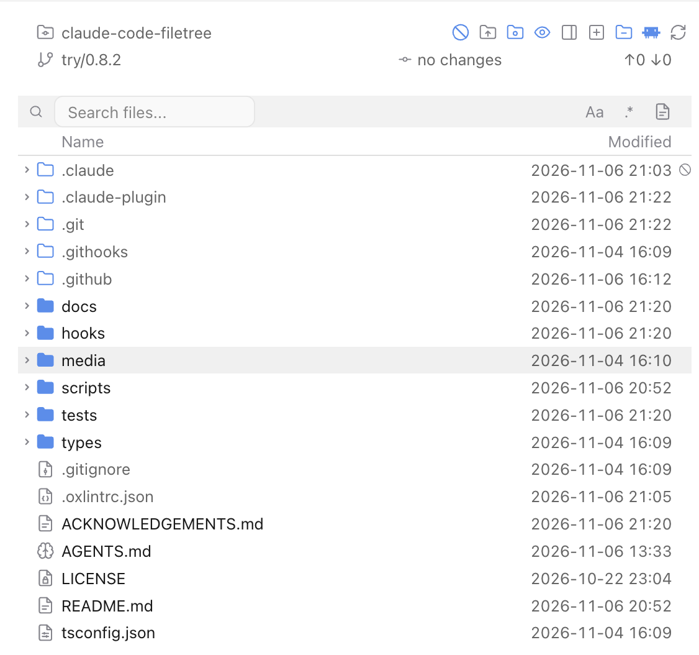

<h1 align="center">Claude Code Filetree</h1>

<p align="center">
  Ein Dateibaum im IDE-Stil für Claude Code, der zeigt, was Claude tut und an welcher Stelle in Dateien
</p>

<p align="center">
  
  
  
  
</p>

<details open>
<summary><b>Claude Code CLI</b></summary>

<p align="center">
  
</p>

</details>

<details>
<summary><b>Claude Code in der Desktop-App</b></summary>

<p align="center">
  
</p>

</details>

**Wichtige Funktionen:**

* Alle Dateien in einem Verzeichnis anzeigen und durch sie navigieren (mit Git-Status und nvim-Tastenbelegungen)
* Animationen zeigen, wo Claude liest/arbeitet
* Tastaturkürzel:
   * Verzeichnisse mit `z` navigieren (ähnlich zoxide)
   * Suchen mit `s` oder `i` (im hervorgehobenen Ordner) oder `q` (in Dateiinhalten)
   * Dateien mit `d` vergleichen oder alle geänderten Dateien in einem Ordner
* Funktionen mit Terminal im Vordergrund: Dateivorschau, Treemap der Verzeichnisgröße und mehr

---

## Installation

Das Repository ist sein eigener Plugin-Marketplace. Führe dies im Terminal aus:

```bash
claude plugin marketplace add data-goblin/claude-code-filetree
claude plugin install filetree@claude-code-filetree
```

Oder innerhalb einer Claude-Code-Sitzung:

```text
/plugin marketplace add data-goblin/claude-code-filetree
/plugin install filetree@claude-code-filetree
```

Bei Claude Code älter als 2.1.287 schlägt die Installation mit `Unrecognized key: "options"` fehl: führe `claude update` aus und installiere erneut.

## Funktionen

- Dateibaum des aktuellen Arbeitsverzeichnisses oder eines angehefteten Ordners, mit Spalten für Git, Größe, Zeilenzahl und Datum ([tree](docs/tree.md))
- Alles einklappen und bis zu drei Ebenen tief wieder ausklappen ([tree](docs/tree.md))
- Symlink-Pfeile, ein Gehirn bei Agenten-Anweisungsdateien sowie Nerd-Font-, einfache oder Text-Glyphen ([tree](docs/tree.md))
- Suche nach Namen auch in ungeöffneten Ordnern, mit Groß-/Kleinschreibung oder regulärem Ausdruck, auf einen Ordner begrenzt ([search](docs/search.md))
- Suche in Dateien mit `git grep` oder `grep -r`, und Treffer an ihrer Zeile öffnen ([search](docs/search.md))
- Mit `z` im zoxide-Stil zu jedem Ordner springen ([search](docs/search.md))
- Git-Status pro Datei und Ordner, Zeilenzahlen bei geänderten Dateien sowie der Branch mit ahead/behind ([git](docs/git.md))
- Git- und GitHub-Befehle, die Claude ausführt, erscheinen als Statuszeile ([git](docs/git.md))
- Claudes Lese-, Schreib- und Commit-Vorgänge shimmern im Baum, und automatisches Einklappen schließt die geöffneten Ordner wieder ([activity](docs/activity.md))
- Die Einstellung Activity shimmer schaltet das Shimmern in allen Sitzungen ab; die Clawd-Schaltfläche im Header der Desktop-App schaltet es um ([activity](docs/activity.md))
- Dateiverweise mit Zeilenangabe in Claudes Antworten werden Links zu dieser Zeile ([activity](docs/activity.md))
- Follow work verschiebt die Sitzung in das Repository, an dem Claude arbeitet ([activity](docs/activity.md))
- Mehrfachauswahl im IDE-Stil; die schattierten Zeilen gehen als Kontext an Claude: die ausgewählte Zeile oder bis zu 100 markierte Zeilen ([context](docs/context.md)):
  - Klick wählt eine Zeile aus und löscht die Markierungen
  - Bei markierten Zeilen bewegen j / k nur den Cursor, und `v` markiert oder demarkiert die Zeile darunter
  - Shift+Klick markiert den Bereich vom letzten Klick oder j/k-Zug, in Baumreihenfolge
  - Strg+Klick markiert oder demarkiert eine Zeile, ohne sie zu öffnen; unter macOS Alt+Klick
  - Doppelklick oder Enter öffnet eine Datei
  - die Schaltfläche zum Aufheben der Auswahl löscht alle markierten und ausgewählten Zeilen
  - markierte Zeilen zeigen den Auswahlhintergrund; `y`, `Y` und `u` kopieren die schattierten Zeilen
  - bei markierten Zeilen zeigt die Zeile unter dem Cursor in der Desktop-App eine Akzenttönung und im Terminal die Akzent-Cursor-Markierung
- Geteilte Vorschau von Code, Markdown, Bildern, Videoframes, PDF- und Word-Seiten ([preview and treemap](docs/preview-treemap.md))
- Treemap eines Ordners nach Bytes oder Zeilen, mit Claudes Aktivität hervorgehoben ([preview and treemap](docs/preview-treemap.md))
- Diff einer Datei oder aller geänderten Dateien in einem Ordner, im Bereich oder in deinem Diff-Werkzeug ([diff](docs/diff.md))
- Dateien in ihrer Standard-App öffnen, einen Editor in einem tmux- oder herdr-Bereich oder einen beliebigen Befehl ([open](docs/open.md))
- Dateien und Ordner vor Claudes Änderungen schützen und außerhalb des Repos geschriebene Dateien sehen ([guards](docs/guards.md))
- Tastaturgetrieben: vim-artige Bewegungen, ein Kürzel-Overlay sowie alt+l / alt+h im Terminal ([keys](docs/keys.md))
- `/filetree`-Befehle und wo der Bereich im Terminal und in der Desktop-App erscheint ([sidebar](docs/sidebar.md))


## Einstellungen

Alle Einstellungen stehen in `/config` unter filetree, mit jeweils eigener Beschreibung dort.

```yaml
Claude activity:  reads and writes | writes | reads | none
Activity shimmer: on | off
Follow Claude:    on | off
Jump moves Claude: tree and Claude | tree
Right-click copies: relative | absolute
Follow work:      on | off
Open at start:    on | off
Focus on open:    on | off
Right column:     date | age | size | loc | files
Date format:      year-month-day | day-month | month-day
Clock:            24h | 12h
Long file:        500 | a line count | off
Remote branch:    off | on
Hints:            on | off
Search spacing:   on | off
Column headers:   on | off
Auto-collapse:    off | on
Shortcuts:        auto | always | off
Open with:        empty | editor | preview | a command with {path} and {dir}
Binary files:     Open with | default app
Edit with:        empty | a command with {path} and {line}
Diff with:        empty | a command such as "hunk diff --" or "lazygit -f"
Diff groups:      folder | kind | off
Terminal target:  auto | pane right | pane below | tab | workspace
Ignore:           names to hide, such as ".cache .tmp"
Preview pane:     bottom | top
Treemap:          auto | image | cells | off
Palette:          key=#hex pairs over the terminal colors
Glyphs:           auto | nerd | plain | text
```

Im Terminal färbt der Akzent Ordner, die Wurzel, den Cursor, Suchtreffer und die oberen Kästen der Zellen-Treemap ein. Er ist das hellblau des Terminals bei dunklem Claude-Theme bzw. dessen Blau bei hellem. `accent=#hex` in Palette setzt für alle eine andere Farbe.

Follow work ist unter [Claude activity](docs/activity.md) beschrieben.

Open at start gilt für jede neue Sitzung, auch nach `/clear`. Wenn du den Baum mit `/filetree` öffnest oder schließt, gilt diese Wahl bis zum nächsten `/clear`. Danach ist der Baum je nach Open at start geöffnet oder geschlossen.

## Voraussetzungen

```yaml
required:  Claude Code 2.1.306 oder neuer, git
optional:
  inotifywait:            Live-Aktualisierungen unter Linux (inotify-tools)
  magick oder ffmpeg:     Bilder außer PNG, Videoframes
  pdftoppm oder gs:       PDF-Seiten
  soffice:                Word- und Office-Seiten
  pandoc, pdftotext:      Dokumenttext in tmux, herdr und anderen Terminals
  tmux oder herdr:        ein Editor oder Diff-Werkzeug in einem neuen Bereich
  Nerd Fonts 3.2+:        Icons für Glyphs auto; ohne oder mit älterer Font werden einfache Unicode-Zeichen gezeichnet
pictures:  Ghostty oder kitty, außerhalb von tmux und herdr, unter Linux und macOS
```

## Hinweise

- Die Desktop-App hat keine geteilte Vorschau und keine Treemap
- Die Desktop-App lässt höchstens vier Zeilen gleichzeitig shimmern; weitere leuchtende Zeilen erscheinen in ihrer Farbe ohne Shimmer, während das Terminal alle shimmern lässt. Flutet der Bereich trotzdem, schaltet die Clawd-Schaltfläche im Header oder die Einstellung Activity shimmer das Shimmern ab
- Die Desktop-App zeichnet höchstens 150 Zeilen um den Cursor herum, weniger bei tiefen Zeilen, langen Pfaden oder Git-Änderungen; eine Notiz zählt die ausgelassenen Zeilen
- GIFs und Videos zeigen ein einzelnes Standbild
- Unter Windows werden Ordnergrößen über Dateiauflistungen bestimmt, und die Treemap zeichnet eine Ebene
- Zeilenklicks benötigen herdr 0.9.1 oder neuer; führe `herdr update` aus

## Mitmachen

Öffne Pull Requests gegen einen Release-Branch, nicht gegen `main`:

- Fehlerbehebungen: den Patch-Branch, etwa `release/0.8.2`
- Funktionen: den Minor-Branch, etwa `release/0.9.0`

Behalte die Version dieses Branches bei.

Aktiviere die Git-Hooks einmal pro Clone. Der Pre-Commit-Hook führt in Sekunden die schnellen Prüfungen aus: grep-Regeln, Typen, oxlint und `claude plugin validate`, wenn sich Manifeste ändern. Der Pre-Push-Hook prüft die Version gegen den Release-Branch und führt die Plugin-Tests aus:

```bash
git config core.hooksPath .githooks
```

Dieselben Prüfungen laufen in CI auf macOS, Windows und Linux bei jedem Push, der das Plugin berührt.

## Lizenz

[MIT](LICENSE). Die Treemap-Beschriftungen verwenden Glyphen aus [Terminus Font](https://terminus-font.sourceforge.net/) von Dimitar Zhekov (Lat2-Terminus16, SIL Open Font License 1.1).

*Dieses Projekt ist inspiriert von meiner Omarchy-App [FileBlade](https://github.com/data-goblin/fileblade)*

## Quelle und Lizenz

- Originalautor: data-goblin
- Originalrepository: https://github.com/data-goblin/claude-code-filetree
- Lizenz: MIT
- Deutsche Übersetzung und UI-Lokalisierung: Projekt claude-code-mods-de
