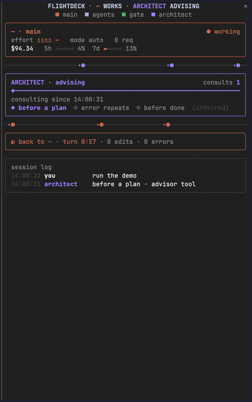

# Flightdeck

[](https://github.com/scasella/claude-flightdeck/releases/latest)
[](LICENSE)
[](https://claude.com/blog/claude-code-mods)
[](https://statuslin.es/mods/flightdeck)

**Ein Claude-Code-Mod, das ein Live-Agenten-Dashboard in dein Terminal bringt**: Kontext und Kosten, eine Advisor-Zeitleiste, jede Berechtigungsprüfung und deine Subagenten als Karten oder Schwimmspuren. Jede Zahl stammt aus einem echten Sitzungsereignis, und nichts verlässt deinen Rechner.

<p align="center">
  
</p>

<p align="center">
  <a href="#install">Install</a> · <a href="#what-you-see">Was du siehst</a> · <a href="#what-it-can-reach">Was es erreichen kann</a> · <a href="#configure">Konfiguration</a> · <a href="#troubleshooting">Fehlerbehebung</a> · <a href="CHANGELOG.md">Neuigkeiten</a>
</p>

## Install

Innerhalb von Claude Code (2.1.289 oder neuer):

```
/plugin marketplace add scasella/claude-flightdeck
/plugin install flightdeck@claude-flightdeck
/reload-plugins
/flightdeck
```

<details>
<summary><strong>Vom Terminal oder aus einem Clone</strong></summary>

```sh
claude plugin marketplace add scasella/claude-flightdeck
claude plugin install flightdeck@claude-flightdeck
```

Oder lade es für eine Sitzung direkt aus einem Clone:

```sh
git clone https://github.com/scasella/claude-flightdeck
claude --plugin-dir ./claude-flightdeck
```

</details>

Das Installationsprogramm meldet vielleicht, dass Konfigurationsoptionen nicht gesetzt sind; die Standardwerte sind in Ordnung, und [`/config`](#configure) ändert sie.

Mods sind eine Early-Access-Funktion von Claude Code, und ihre API kann sich zwischen Releases ändern. Wenn etwas bricht, siehe [Fehlerbehebung](#troubleshooting).

## Was du siehst

https://github.com/user-attachments/assets/9ad0fcc3-c81c-427a-a743-f7b6c49f5885

<p align="center">
  
</p>

| Neben dem Transkript angedockt | Direkt über dem Prompt |
| --- | --- |
|  | <br><br>Auf dem Hauptbildschirm ohne Vollbild ist der Bereich eine Zusammenfassung von höchstens 8 Zeilen; bis zu 3 Agenten kommen hinzu, wenn die Sitzung Subagenten hat. |

| Bereich | Zeigt | Quelle |
| --- | --- | --- |
| **main** | Modell, Aufwand, Berechtigungsmodus, Anzahl Anfragen; ein Kontext-Messer mit Komprimierungen (⟲ oder ⟲~, falls [geschätzt](#was-wird-geschlossen-nicht-gemessen)), gemessen gegen das Komprimierungsfenster, wenn die Sitzung in einem kleineren als dem des Modells komprimiert (`autoCompactWindow` oder das von Claude Code selbst); Kosten und die ersten beiden Ratenlimit-Fenster, falls dein Plan sie meldet, mit der Zeit bis zum jeweiligen Zurücksetzen (↻) ab 56 Spalten; die Zeit bis zum ersten Token bei der letzten Haupt-Schleifen-Anfrage | `turn.step`, `session.measure`, `session.compact`, `$.session.usage()` (bei jeder Haupt-Schleifen-Anfrage und seine lokale `summary`-Aufschlüsselung, einmal pro Modell, für das Komprimierungsfenster); der Berechtigungsmodus aus `classic.UserPromptSubmit` und `agent.spawn` |
| **architect** | Konsultationen auf einer Zeitleiste, ob eine läuft, wie lange die letzte dauerte; optional der Zeitpunkt jeder Konsultation; die erste Zeile des Rats eines Subagenten-Architekten | ein Spawn eines passenden Agententyps oder ein passendes Server-Werkzeug in den Assistant-Zeilen |
| **gate** | eine Zelle pro Berechtigungsprüfung: grün ohne Nachfrage erlaubt, blau vom Auto-Modus-Klassifikator oder von dir entschieden und dann ausgeführt, bernstein ausstehend, rot ✗ verweigert, gedimmt, wenn innerhalb eines Subagenten geschehen. Summen und eine Aufschlüsselung nach Werkzeugfamilie mit maskierten Zugangsdaten | `tool.check`, entschieden durch das umgebende `tool.call` |
| **agents** | Karten nebeneinander, solange sie passen: Aufgabe, Typ, live Kontext- und Ausgabe-Token, Schritte, eine laufende Uhr, `max_tokens` in Rot. Darüber hinaus Schwimmspuren auf einer gemeinsamen Zeitachse | `agent.spawn`, `turn.step`, `tool.call`, `turn.complete` |
| **loops** | Modell-Schleifen, die zu keiner Karte passen: Workflow-Agenten, Komprimierungen, Speicher-Forks | `turn.step`-IDs, die keine Karte beansprucht |
| **receipt** | der laufende Zug oder der letzte: Dauer, Agenten, Änderungen, Fehler, hinzugekommene Kosten | `turn.start`, `turn.complete` |
| **log** | Prompts, Spawns, Abschlüsse, Konsultationen, Änderungen, Fehler und Ablehnungen; auf einen Agenten gefiltert, während du sein Transkript ansiehst | alle der oben genannten |

Verbinder animieren nur, wenn Arbeit fließt: ein Zug läuft, ein Agent läuft oder eine Konsultation ist offen. Bereiche ohne Inhalt nehmen keinen Platz ein, eine Sitzung ohne Subagenten zeigt also nur das Hauptfeld und das Log.

## Verwendung

| Befehl | Tut |
| --- | --- |
| `/flightdeck` | den Bereich öffnen |
| `/flightdeck close` | ihn schließen |
| `/flightdeck reset` | Agenten, Prüfungen, Konsultationen, Log und Zug löschen (Kosten, Ratenlimits und Komprimierungen bleiben) |
| `/flightdeck layout auto\|compact\|wide\|mini` | das Layout für diese Sitzung überschreiben |

Fokussiere den Bereich mit `ctrl+x tab`, dann:

| Taste | Tut |
| --- | --- |
| `1`, `2`, … | eine Agentenkarte oder -spur aufklappen: die volle Aufgabe, die letzten 3 Werkzeugaufrufe, den Anfang seiner Antwort |
| `f` `s` `o` | die Datei-/Shell-/sonstige Aufschlüsselung des Gates öffnen: die letzten 5 Prüfungen und ihre Urteile |

`/clear` setzt den Bereich zusammen mit dem Gespräch zurück.

## Wo es läuft

- **Vollbild-Terminal:** neben dem Transkript angedockt; ab 110 Spalten zwei Spaltenbreiten.
- **Hauptbildschirm-Terminal:** direkt über dem Prompt, als 8-Zeilen-Zusammenfassung.
- **Desktop-App, VS Code, mobil:** dieselben Bereiche, dazu die Agenten als SVG-Zeitleiste. VS Code und mobile können nicht animieren, Verbinder und Uhren sind dort statisch. (Die VS-Code-Erweiterung zeigt möglicherweise noch gar keinen Bereich: siehe [Fehlerbehebung](#troubleshooting).)

Mit `openOnStart` öffnet sich der Bereich bei Sitzungsbeginn von selbst, in Terminals mit mindestens 144 Spalten; darunter öffnet ihn `/flightdeck`. Die Farben stammen aus deinem Claude-Code-Theme, helle, dunkle und farbenblinde Themes sind alle lesbar.

## Was es erreichen kann

Flightdeck schaut nur zu. Jeder Hook lässt sein Ereignis unverändert weiter: Es verweigert, schreibt oder verzögert nie einen Werkzeugaufruf, einen Prompt oder einen Subagenten.

| Es sieht | Über |
| --- | --- |
| Name und Eingabe jedes Werkzeugaufrufs, und ob er fehlgeschlagen ist | `tool.call` |
| jedes Berechtigungsurteil | `tool.check` |
| Subagenten-Spawns, deren Modellanfragen und Token-Nutzung sowie ihre Endantworten | `agent.spawn`, `turn.step`, `turn.complete` |
| die ersten 70 Zeichen deiner Prompts, für das Log | `turn.start` |
| Kontext-, Kosten- und Ratenlimit-Ablesungen | `session.measure`, `$.session.usage()` |
| die Kontext-Aufschlüsselung, die `/context` zeigt (seine Kategorien, Speicherdateipfade, MCP-Werkzeuge, Agenten und Skills), einmal pro Modell lokal geschätzt; es behält nur das Komprimierungsfenster daraus | `$.session.usage({ breakdown: 'summary' })` |
| Advisor-Werkzeugaufrufe in den Assistant-Antworten (ihr Inhalt ist verschlüsselt) | `session.append` |

Was es behält: kurze Zusammenfassungen (ein Werkzeugname plus Pfad oder Befehl, der Anfang jedes Prompts, die Aufgabe und Antwort eines Agenten, der Rat des Architekten, alles mit maskierten Zugangsdaten) im Sitzungszustand, der mit der Sitzung endet. Es stellt **keine** Netzwerkanfragen, startet keine Prozesse, liest und schreibt keine Dateien, speichert nichts über Sitzungen hinweg und ruft kein Modell auf. `claude plugin validate .` gibt genau aus, welche Hooks und Aufrufe es hat.

## Was geschlossen wird, nicht gemessen

- **Architekt-Zeitpunkte.** „Vor einem Plan“ heißt: noch keine Änderungen in diesem Zug, „Fehler wiederholt sich“ heißt: 2+ Fehler der Hauptschleife nacheinander, „vor Fertigstellung“ heißt: es wurden Änderungen vorgenommen. Sie sind mit `(inferred)` markiert; schalte sie mit `moments: false` ab.
- **Komprimierungen unter dem eingebauten Wächter.** Wo Claude Codes Wächter `session.compact` von Flightdeck fernhält (siehe [Fehlerbehebung](#troubleshooting)), wird die Zahl geschätzt. Claude Code meldet erst nach der ersten Antwort nach einer neuen Sitzung, eines `/clear` oder einer Komprimierung keine Kontextfüllung. Eine Haupt-Schleifen-Anfrage, die nach einer Antwort keine Füllung findet, zählt also als Komprimierung. Das Hauptfeld zeigt `⟲~1`, mit `(estimated)`, wenn Platz ist, und das Log sagt `context compacted (estimated)`. Ein Zurückspulen zu deinem ersten Prompt liest sich genauso, zählt also ebenfalls. Wo immer `session.compact` läuft, ersetzt seine Zahl die Schätzung.
- **Serverseitiger Rat ist verschlüsselt.** Bei einem Server-Werkzeug wie Claude Codes `advisor` zählt und zeitet der Bereich die Konsultation, kann aber nicht zeigen, was gesagt wurde.
- **Kontext pro Agent ist die gesamte Eingabe der letzten Anfrage** (nicht im Cache + Cache-Lesen + Cache-Schreiben). Er ist als `ctx` markiert, nicht als Kosten: Die API hat keine Kosten pro Agent.
- **Andere Schleifen** können einen Workflow-Agenten nicht von einem Komprimierungs-Fork unterscheiden; beides sind Modellschleifen, die keine Karte beansprucht.
- **Der erste Schritt eines Hintergrund-Agenten** kann eintreffen, bevor seine Karte existiert, seine Nutzung erscheint also möglicherweise einen Schritt zu spät.
- **Kontext gegen das Komprimierungsfenster.** Wenn die Sitzung in einem kleineren Fenster als dem des Modells komprimiert, messen der Messer, `tokens/window` und die Statuszeile `ctx N%` gegen dieses Fenster und lesen daher höher als Claudes eigener Statuszeilen-Prozentwert (und der von claude-hud), die gegen das Modellfenster messen. Die automatische Komprimierung läuft kurz vor 100 %, an ihrer Schwelle innerhalb dieses Fensters.
- **Zeit bis zum ersten Token.** `ttft` wird an Flightdecks eigenem `turn.step`-Hook gemessen, enthält also alles darunter: Hooks anderer Plugins, die Engine, das Netzwerk und jede Wiederholung. Wenn das Denken des Modells nicht gestreamt wird, kommt das erste Stück danach an, `ttft` enthält also das Denken. Gemessen, nicht geschlossen, aber nicht die eigene Zahl der API. Es gibt keine Ausgaberate: die gemeldeten Token enthalten Denken, eine Rate über den sichtbaren Strom wäre also keine echte Geschwindigkeit.

## Konfiguration

In `/config` oder unter `pluginConfigs[<id>].options` in deiner Benutzer-`settings.json`, wobei `<id>` angibt, wie Claude Code das Plugin geladen hat: `flightdeck@claude-flightdeck` bei Installation aus dem Marketplace, `flightdeck` (oder `flightdeck@inline`) mit `--plugin-dir`. Ein Eintrag unter einem anderen Schlüssel oder in Projekteinstellungen (`.claude/settings.json`) wird ohne Warnung ignoriert. Vom Terminal aus listet `claude plugin configure flightdeck@claude-flightdeck` die Optionen und die nicht gesetzten auf und speichert sie mit `--values-stdin`.

| Option | Standard | Bedeutung |
| --- | --- | --- |
| `architectPattern` | `advisor\|architect` | Regex ohne Groß-/Kleinschreibung für Agententypen und Server-Werkzeuge, die als Architekt zählen |
| `matchDescriptions` | `false` | auch Agentenbeschreibungen abgleichen, nicht nur Typnamen |
| `architectLabel` | `ARCHITECT` | Name des Architekten im Bereich |
| `gateLabel` | `GATE` | Name des Berechtigungsbereichs |
| `panels` | `main,architect,gate,agents,loops,receipt,log` | welche Bereiche erscheinen, in dieser Reihenfolge |
| `layout` | `auto` | `mini`, `compact`, `wide` oder `auto` (mini direkt, ab 110 Spalten breit angedockt) |
| `maxCards` | `3` | Karten nebeneinander, bevor Schwimmspuren kommen (1–6); weniger, wenn der Bereich zu schmal ist |
| `paneColumns` | `66` | Spalten, die der angedockte Bereich anfordert, 40 oder mehr. Claude Code begrenzt das Dock auf 45% des Terminals, und eine Breite, auf die du es in dieser oder einer früheren Sitzung gezogen hast, gewinnt. Das breite Layout beginnt bei 110, braucht also ein Terminal mit etwa 245 Spalten oder `layout: wide` |
| `motion` | `while-active` | `off` hält Verbinder still |
| `moments` | `true` | die geschlossenen Konsultations-Zeitpunkte anzeigen |
| `palette` | `theme` | `pastel` nutzt feste, für dunkle Terminals abgestimmte Farben |
| `openOnStart` | `true` | beim Sitzungsstart fragen, ob der Bereich geöffnet werden soll |
| `statusLine` | `true` | Kontext, laufende Agenten, Konsultationen und Ablehnungen in der Statuszeile |

## Fehlerbehebung

**Der Bereich erscheint nicht.**
- Prüfe, ob `claude --version` 2.1.289 oder neuer ist, führe dann `/reload-plugins` und `/flightdeck` aus. In einer älteren Version sagt das Transkript `flightdeck: hooks module did not load: …`.
- Unter 144 Spalten setzt Claude Code einen Bereich, den niemand angefordert hat, nicht; `/flightdeck` öffnet ihn bei jeder Breite.
- Suche im Transkript nach einer gedimmten Zeile, die mit `flightdeck:` beginnt. Sie nennt den gescheiterten Hook oder den Grund, warum der Bereich verweigert wurde. Bitte [öffne ein Issue](https://github.com/scasella/claude-flightdeck/issues) damit.
- Zeigt der Bereich nur `draw failed (…)`, hat sein Zeichen-Hook eine Ausnahme geworfen; nimm diese Zeile ebenfalls ins Issue auf.

**In der VS-Code-Erweiterung erscheint nichts.** In einem Bericht lief der Build 2.1.296 Flightdecks Hooks, zeigte aber keinen Bereich, und für ein anderes Mod ebenfalls keinen ([#5](https://github.com/scasella/claude-flightdeck/issues/5)). Führe stattdessen `claude` im integrierten Terminal von VS Code aus, dann `/flightdeck`: ein integriertes Terminal ist meist schmaler als die 144 Spalten, die der Bereich zum automatischen Öffnen braucht.

**Bei einer Team- oder Enterprise-Anmeldung fehlt der Berechtigungsmodus oder ist veraltet, und Komprimierungen werden geschätzt.** Auf einem Rechner mit verwalteten Einstellungen oder in einer Sitzung mit Team- oder Enterprise-`/login` lädt Claude Code einen eingebauten Wächter, `cc-plugin-sec-default`, der niemals die Hooks eines nutzerinstallierten Plugins bei `classic.*`-Ereignissen oder `session.compact` ausführt (siehe „Know which hooks of a user's mod don't run“ in [Manage mods for your organization](https://code.claude.com/docs/en/plugins/mods/admin)). Kein anderes Ereignis, das ein Nutzer-Plugin hooken kann, trägt den Berechtigungsmodus außer dem Start eines Subagenten. Das Hauptfeld zeigt also keinen Modus, bis ein Subagent startet, und dann den Modus, wie er bei diesem Start war. Bis dahin schreibt das Gate bei Aufrufen, die der Klassifikator freigegeben hat, im Auto-Modus `you`. Komprimierungen werden stattdessen aus dem Kontext gezählt, den Claude Code bei jeder Anfrage meldet, daher markiert das Hauptfeld sie mit `⟲~` und das Log sagt `context compacted (estimated)` (siehe [Was geschlossen wird, nicht gemessen](#was-wird-geschlossen-nicht-gemessen)). Ab 2.1.299 zeigt `/plugin` einen Hinweis, der diese beiden Hooks nennt. Der Rest des Bereichs funktioniert. Ein Administrator kann die Hooks ausführen lassen, indem er Flightdeck als eines der eigenen Mods der Organisation installiert ([#23](https://github.com/scasella/claude-flightdeck/issues/23)).

**Optionen scheinen ignoriert zu werden.** Prüfe den Schlüssel in deiner Benutzer-`settings.json`: `pluginConfigs["flightdeck@claude-flightdeck"]` bei Installation, `pluginConfigs["flightdeck"]` mit `--plugin-dir`. Siehe [Konfiguration](#configure).

**Farben sehen falsch aus.** Setze `palette` in `/config` auf `pastel`.

**Es bewegt sich zu viel.** Setze `motion` auf `off`.

**Zähler sehen nach einem Update veraltet aus.** Führe `/flightdeck reset` aus.

## So funktioniert es

| Datei | Enthält |
| --- | --- |
| [`hooks/register.tsx`](hooks/register.tsx) | die Ereignis-Hooks, Zustandszugriff und eine Funktion pro Bereich |
| [`hooks/core.ts`](hooks/core.ts) | jeden Reducer, Formatter und Layout-Rule als reine Funktionen, das Verhalten ist direkt testbar |
| [`hooks/rail.tsx`](hooks/rail.tsx), [`hooks/elapsed.tsx`](hooks/elapsed.tsx) | Oberflächen-Module: animierte Verbinder und laufende Uhren, die nur sich selbst neu zeichnen, im Frame-Takt der jeweiligen Oberfläche |
| [`types/index.d.ts`](types/index.d.ts) | der Zustandsvertrag |
| [`tests/`](tests) | 65 Tests: reines Verhalten sowie Zeichnungen auf jeder Oberfläche bei 24–120 Spalten, wobei jede Breite von 24 bis 40 auf Überlaufen über das Feld hinaus geprüft wird |

Der Zustand liegt in `$.state`-Atomen. Jedes Lesen wird über Standardwerte gemergt, ein fehlendes oder älteres Feld zerstört also nie den Bereich; ein Update, das die Form des Zustands ändert, kann seine Zähler einmal zurücksetzen. Neu bei Mods? Beginne mit [Claude Code mods](https://claude.com/blog/claude-code-mods) und [Getting started with Claude Code mods](https://claude.dev/blog/getting-started-with-claude-code-mods/).

## Verwandte Projekte

Flightdeck arbeitet neben diesen und verdankt ihnen Ideen:

- [claude-hud](https://github.com/jarrodwatts/claude-hud): Kontext, Limits, Werkzeuge und Agenten in deiner Statuszeile. Nutze beide: das ist die Statuszeile, dies ist der Bereich.
- [zoetrope](https://github.com/furkankly/zoetrope): eine Claude-Code- oder Codex-Sitzung als lebendiger Flussgraph.
- [ccusage](https://github.com/ccusage/ccusage): Kostenberichte aus deinen Sitzungsprotokollen.
- [awesome-claude-code-mods](https://github.com/karanb192/awesome-claude-code-mods): das Verzeichnis der Claude-Code-Mods.

## Entwicklung

```sh
claude --plugin-dir .            # laden; Änderungen laden hot neu
claude plugin validate .
claude plugin test .
npx -p typescript tsc -p .       # nach dem ersten Laden, das .claude-plugin/types/ schreibt
```

Siehe [CONTRIBUTING.md](CONTRIBUTING.md). Änderungen stehen in [CHANGELOG.md](CHANGELOG.md).

## Lizenz

[MIT](LICENSE)

## Quelle und Lizenz

- Originalautor: scasella
- Originalrepository: https://github.com/scasella/claude-flightdeck
- Lizenz: MIT
- Deutsche Übersetzung und UI-Lokalisierung: Projekt claude-code-mods-de
