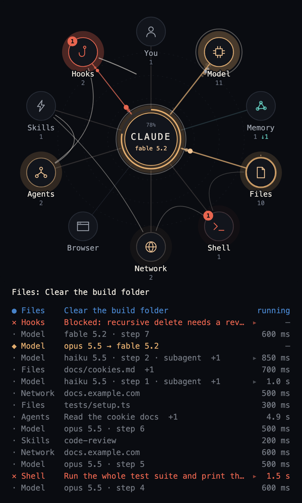

# Lot Map für Claude Code

`lot-map` ist ein Mod für Claude Code: eine Live-Karte der Arbeit in einem Fensterbereich neben dem Chat. Jeder Werkzeugaufruf, jeder Modellschritt, jeder Hook und jeder Skill sendet einen Impuls vom Zentrum zu seiner Station, sodass du Memory, Dateien, Shell, Web und Agenten bei der Arbeit siehst, statt eine Liste von Befehlen zu lesen.

Es läuft auf deinem Rechner und sendet nichts nach draußen. „Lokal" heißt nicht „blind": Wie jeder Mod, der Werkzeugaufrufen folgt, erhält es jeden Aufruf vollständig und entnimmt daraus nur Namen. [Was es liest und behält](PRIVACY.md) und [die Prüfungen, die es darauf verpflichten](PRINCIPLES.md).


*Eine erfundene Sitzung, wiedergegeben mit dem eigenen Zeichencode des Mods. [Video (MP4)](docs/demo.mp4). Oder [im Browser ausprobieren](https://alexeyw.github.io/lot-map/): Die Seite führt denselben Code aus und zeigt, was jeder Aufruf dem Mod überlässt und was dieser behält.*

## Installation

An der Eingabeaufforderung einer Terminalsitzung:

```
/plugin install lot-map --marketplace alexeyw/lot-map
```

Antworte mit `y`, um den Marketplace hinzuzufügen, und wähle dann einen Geltungsbereich. Von einer Shell aus:

```bash
claude plugin install lot-map --marketplace alexeyw/lot-map
```

Falls gemeldet wird, dass das Plugin in keinem Marketplace gefunden wurde, füge zuerst den Marketplace hinzu:

```bash
claude plugin marketplace add alexeyw/lot-map
claude plugin install lot-map@lot-map
```

In der Desktop-App: klicke auf **+** neben dem Eingabefeld, dann auf **Plugins**, auf **Add marketplace** mit `alexeyw/lot-map` und schließlich auf **Add plugin**.

Der Fensterbereich öffnet sich automatisch beim Start einer Sitzung; mit deaktiviertem `openAtStart` wartet er auf `/lot-map`. Im Terminal braucht er mindestens 144 Spalten, sonst gib `/lot-map` ein; ohne ausdrückliche Anfrage zeichnet er nur Text, also die Karte als Bild oder in Brailleschrift nur auf Wunsch: siehe [Im Terminal](#im-terminal). Er wurde mit Claude Code 2.1.321 unter macOS entwickelt und getestet; Nutzer berichten, dass er auch unter Windows und Linux funktioniert.

Bei einer Team- oder Enterprise-Anmeldung kann das Protokoll Meldungen wie `lot-map: its classic.PreToolUse hook was skipped` enthalten. Schalte `guardedHooks` aus, und sie verschwinden; [Optionen](#was-angezeigt-wird) erklärt, was die Karte dafür verliert.

## Aktualisieren

Von einer Shell aus:

```bash
claude plugin marketplace update lot-map
claude plugin update lot-map@lot-map
```

Starte danach eine neue Sitzung. Der erste Befehl ist nötig: Ohne ihn meldet der zweite die installierte Version als die neueste.

Was sich in welcher Version geändert hat, steht in [CHANGELOG.md](CHANGELOG.md).

## Was aufleuchtet

| Station | Wann |
| --- | --- |
| Du | deine Nachrichten, Fragen und an dich gesandte Dateien, die Aufgabenliste, der Plan und was du genehmigen sollst |
| Modell | jede Modellanfrage, Kontextkompaktierung |
| Memory | Claudes Memory-Ordner und alles, was du in den Optionen angibst |
| Dateien | Read, Write, Edit, Grep, Glob, die Code-Intelligenz eines Language Servers sowie Shell-Befehle, die ausschließlich mit Dateien arbeiten: Sie lesen, suchen, verschieben, löschen oder bearbeiten direkt (`cat`, `grep`, `mv`, `rm`, `sed`, `tee`, `find … -delete`) |
| Shell | jeder andere Shell-Befehl |
| Netzwerk | Web-Abrufe und -Suche, MCP-Server, auf claude.ai gespeicherte Arbeit (Artefakte, Projekte, Entwürfe) sowie Shell-Befehle, von denen bekannt ist, dass sie das Netz erreichen: `curl`, `gh`, `ssh`, `rsync`, `git push`, `npm install`, `docker pull` und ähnliche, auch innerhalb von `$(…)` |
| Browser | Browser-Werkzeuge |
| Agenten | Subagenten, Workflows, Zeitpläne und Warten auf Hintergrundarbeit; ihre eigenen Aufrufe starten von dieser Station |
| Skills | Skills, Werkzeugsuche sowie der Katalog für Skills, Plugins und Connectors |
| Hooks | Settings-Hooks, die einen Aufruf ablehnen, um Erlaubnis bitten, Kontext hinzufügen oder eine Pause einlegen |

Unter Windows wird das PowerShell-Werkzeug genauso gelesen wie Bash, mit PowerShells eigenen Namen: `Get-Content` und `Select-String` lassen Dateien aufleuchten, `Invoke-WebRequest` das Netzwerk. Ein über seinen vollen Pfad gestartetes Programm wird anhand seines Namens erkannt, auch wenn der Pfad Leerzeichen in Anführungszeichen enthält, und `CURL.EXE` gilt als `curl`.

Die Shell-Stationen richten sich nach dem Namen des Befehls, nicht nach seiner Wirkung: ein Skript, das selbst eine Verbindung öffnet, etwa `python -c „…"`, erscheint als Shell. Ein Befehl hinter `sudo`, `env`, `timeout`, `nohup`, `xargs` und ähnlichen wird als der Befehl gelesen, den er ausführt, und `find … -exec` als der Befehl, dessen Ausführung er verlangt. Ebenso ein Befehl innerhalb einer Schleife oder Bedingung (`for … do`, `if … then`, `while`, `!`, `{ … }`) und eine Zeile, die einer Shell oder `eval` übergeben wird (`bash -c „…"`). Der Text eines Here-Documents wird nicht gelesen, eine darüber geschriebene Datei erscheint also als Datei, egal was der Text enthält. Eine Zeile wird bis zu ihren ersten 8.000 Zeichen gelesen. `npx` gilt nur mit `-y` als Netzwerk, da es ohne diese Option meist bereits Installiertes ausführt.

Beim Beginn eines Aufrufs fliegt ein Impuls nach außen und kehrt am Ende zurück. Ablehnungen und Fehler färben sich rot.

## Die Karte lesen

- **Die Route.** Eine dünne Linie verbindet die letzten Stationen, die die Hauptschleife durchlaufen hat, in ihrer Reihenfolge; das neueste Teilstück zeichnet sich selbst. Ein Teilstück bleibt 40 Sekunden und verblasst dann über 20 weitere, sodass eine Minute nach Ende der Arbeit nur noch die Speichen übrig sind; ihre Dicke verrät, wo gearbeitet wurde. Modellschritte werden ausgelassen, sonst liefe jedes Teilstück durch Modell.
- **Abgenutzte Speichen.** Eine Speiche wird dicker und heller, je mehr ihre Station benutzt wird; am Ende einer Sitzung zeigt die Karte so, wo die Arbeit stattfand.
- **Wie lange.** Während eines Aufrufs wachsen zwei Uhrzeiger um eine Station: der innere dreht sich in einer Minute, der äußere in zehn.
- **Hintergrundarbeit.** Ein in den Hintergrund geschickter Befehl, ein Monitor, ein Hintergrund-Subagent oder ein Workflow bleibt nach Ende der auslösenden Runde auf seiner Station leuchten, mit wachsenden Uhrzeigern, bis die Aufgabe ihr Ende meldet. Eine fehlgeschlagene Aufgabe lässt den roten Punkt stehen. Die Meldung selbst erscheint nicht als deine Nachricht.
- **Mehrere gleichzeitig.** Gleichzeitig startende Aufrufe fliegen nebeneinander, und die Station zeigt ihre Anzahl, etwa `×3`.
- **Was schiefgelaufen ist.** Ein roter Punkt mit Zähler bleibt nach einem Fehler oder einer Ablehnung bis zu deiner nächsten Nachricht auf der Station.
- **Memory.** Es hat eine eigene Farbe. Ein gefüllter Impuls ist ein Memory, das Claude angefordert hat; ein hohler auf gestrichelter Linie kommt von einem Hook unaufgefordert. Unter der Station zählt die schlichte Zahl das Erste, `↓` das Zweite.
- **Das Kontextfenster.** Der Ring um das Zentrum füllt sich im Laufe der Sitzung, mit dem Prozentsatz über dem Namen. Bei 70 % wird er bernsteinfarben, bei 90 % rot.
- **Ein Modellwechsel.** Zentrum und Modell-Station leuchten einige Sekunden, und im Protokoll erscheint eine Zeile wie `opus 5.5 → fable 5.2`. Das passiert auch, wenn eine Sitzung mit einem anderen Modell beginnt als die letzte Sitzung im selben Ordner.
- **Subagenten.** Jeder noch arbeitende kreist als kleiner Punkt um die Agenten-Station, und seine Aufrufe starten dort.
- **Die Antwort.** Ein breiter Ring verlässt das Zentrum, sobald die Antwort bereit ist.

Unter der Karte stehen eine Zeile mit der aktuellen Tätigkeit und die letzten 16 Zeilen (bei `logRows` auf `fill` so viele, wie der Desktop-Fensterbereich hergibt): `●` läuft, `·` fertig, `✕` fehlgeschlagen oder blockiert, `◆` ein Modellwechsel. Aufeinanderfolgende abgeschlossene Aufrufe an derselben Station werden zu einer Zeile zusammengefasst, mit `+2` für die zwei weiteren, die sie vertritt. Ein noch laufender Aufruf wird nie durch spätere Einträge aus der Liste gedrängt: Er bleibt als letzte Zeile, bis er endet, damit Liste und Karte dasselbe sagen. Solche Zeilen nehmen höchstens die Hälfte der Liste ein; wenn mehr läuft, wird die letzte mit `+22` für den Rest markiert.

Jede Zeile ist eine einzelne Textzeile. Ihre Wörter werden am Rand des Fensterbereichs abgeschnitten; die Zeit steht rechts in einer Spalte, mit einem Bindestrich für Vorgänge ohne Dauer wie eine eintreffende Nachricht, und in der Zeile der Antwort die Dauer der ganzen Runde. Eine Zeile mit einer langen Beschriftung hat ein `▸` vor der Zeit: Drücke es, um die ganze Zeile zu lesen, und noch einmal, um sie zu schließen. Jeweils eine Zeile ist offen. Im Terminal enthält die Zeile der aktuellen Tätigkeit auch den Kontextprozentsatz und das Modell rechts, da es dort keine Zeichnung dafür gibt.

### Was jeder Aufruf zum Kontext hinzufügt

Der Ring zeigt, wie voll das Kontextfenster ist, nicht was es gefüllt hat. Mit `contextCost` steht in der Zeile eines Aufrufs nach seiner Zeit, um wie viele Tokens der Kontext mit seiner Antwort gewachsen ist: `85 ms +42k`. Auf der Karte ergänzt die Zahlenzeile jeder Station die Summe für die Sitzung: `9 · 180k`. Die Zahl nimmt die Farbe des Danebenstehenden an – der Zeit in der Zeile und des Zählers auf der Karte –, damit sie überall lesbar ist, im hellen wie im dunklen Design.

Es handelt sich um eine Schätzung. Claude Code teilt einem Mod mit, wie viele Tokens die letzte Antwort umfasst hat, so erkennt der Mod, wie stark der Kontext von einem Modellschritt zum nächsten gewachsen ist, und schreibt dies den Aufrufen zu, deren Antworten zu diesem Schritt gehörten. Das Wachstum schließt die eigenen Worte des Modells, von Hooks Hinzugefügtes und am Anfang einer Runde deine Nachricht ein.

- **Ein Schritt später.** Die Zahl eines Aufrufs erscheint erst, wenn der nächste Schritt beantwortet wurde, nicht wenn der Aufruf endet. Ein Aufruf im letzten Schritt einer Runde, vor einer unterbrochenen Runde oder vor einer Kompaktierung erhält nie eine; eine Kompaktierung, die den Kontext kleiner macht, trägt nirgends etwas ein.
- **Geteilt.** Zwei oder drei Aufrufe in einem Schritt teilen sich das Wachstum gleichmäßig, ihre Zahlen sind mit `~` markiert: `~+14k`. Bei mehr Aufrufen in einem Schritt bleibt ihre Zeilen ohne Zahl, da eine gleichmäßige Teilung einem langen Lesevorgang und einem kurzen Befehl denselben Wert geben würde; stammten alle von einer Station, erhält deren Summe trotzdem den Gesamtbetrag. Eine zusammengefasste Zeile addiert die Zahlen ihrer Aufrufe und wird mit `~` markiert, wenn manche keine haben.
- **Nur die Hauptschleife.** Ein Subagent füllt einen eigenen Kontext, den Claude Code nicht meldet: seine Aufrufe erhalten keine Zahl. Das Wachstum durch seine Antwort erscheint bei dem Aufruf der Hauptschleife, der ihn gestartet hat.

Die Summen stehen auf jeder Zeichnung der Karte: in der Desktop-App, in VS Code und im Terminalbild, die dieselbe Zeichnung verwenden, sowie auf der Braille-Karte, die die Summe einer Station nach ihrem Zähler schreibt, in der Farbe ihres Namens und mit dem Plus der Zeilenzahlen: `Files 9 +180k`. Ein Terminal, das nur die Zeilen zeigt, hat die Summen in seiner Zählerzeile, in derselben Schreibweise.

Die Braille-Karte zeichnet die Summen für alle Stationen oder für keine. Reicht ihr Raster nicht aus, um die breiteste Summe neben jedem Namen unterzubringen – in einem schmalen Fensterbereich oder bei langen Namen und großen Zahlen –, lässt sie alle weg, behält jeden Namen ganz, und die Zeilen behalten ihre Zahlen. Englische Namen mit Zahlen unter zehn passen ab 50 Spalten; mit größeren Zahlen an jeder Station brauchen sie bis zu 68.

| Bei der Arbeit | Subagenten | Ein Hook lehnt ab |
| --- | --- | --- |
|  |  |  |

| Modellwechsel | Nach der Antwort | Helle Farben |
| --- | --- | --- |
|  |  |  |

## Im Terminal

Ein Terminal zeigt nur die Zeilen. Mit `terminalView` auf `picture` erhält ein bildfähiges Terminal wie kitty oder Ghostty die Karte als Bild über den Zeilen, das sich wie in der Desktop-App bewegt. Claude Code muss im Vollbild zeichnen. Steht der Fensterbereich unter dem Gespräch statt daneben, zeichnet Claude Code auf dem Hauptbildschirm, und die Zeilen bleiben allein: Gib `/tui fullscreen` ein oder starte mit `CLAUDE_CODE_NO_FLICKER=1 claude`. Innerhalb von tmux setze `allow-passthrough on` und `focus-events on`. Jedes andere Terminal zeigt wie zuvor nur die Zeilen, ebenso ein Fensterbereich schmaler als 24 Spalten.

In iTerm2 braucht das Bild Version 3.7.8 oder neuer. Ältere Versionen behalten jedes zugesandte Bild bis zum Schließen des Tabs: In iTerm2 3.7.7 beanspruchte eine sich bewegende Karte etwa 2 MB pro Bild, 17 GB in fünf Minuten (#81). Dort bleibt das Bild aus, und eine Zeile über den Zeilen weist darauf hin; aktualisiere iTerm2 oder setze `terminalView` auf `braille`. Der Mod erkennt iTerm2 an `TERM_PROGRAM` und über ssh oder in tmux an `LC_TERMINAL`, die Version an `TERM_PROGRAM_VERSION` oder `LC_TERMINAL_VERSION`; ohne Versionsangabe bleibt das Bild aus.

Der Mod malt das Bild selbst, aus derselben Zeichnung wie die Desktop-App, mit Buchstaben aus den Bitmap-Schriften X.Org misc-fixed, die gemeinfrei sind; [FONTS.md](FONTS.md) erklärt ihre Herkunft. Er zeichnet bis zu fünf Bilder pro Sekunde, solange sich etwas auf der Karte bewegt. Der Kern atmet im Bild nur während eines laufenden Vorgangs, zehn Minuten lang gleichmäßig nach der letzten Änderung und dann ein Bild alle fünf Sekunden; im Ruhezustand steht das Bild, sobald die Spuren verblasst sind.

Bei `theme` auf `auto` richtet sich das Bild nach `COLORFGBG` des Terminals, was iTerm2, rxvt und Konsole setzen; ohne Angabe ist es dunkel, und auf einem hellen Terminal ohne Angabe setze `theme` auf `light`. Das Bild hat keinen eigenen Hintergrund, das Terminal scheint hindurch; weicht dessen Farbe vom Grau des Fensterbereichs ab, bleibt ein schwacher Rahmen um die Karte. `paneBackground` auf `transparent` entfernt das Grau, sodass das Terminal hinter Karte und Zeilen durchscheint, auch wenn es transparent ist; auf die Terminalfarbe als `#rrggbb` gesetzt, färbt es den Fensterbereich damit. `colors` mit `background=#rrggbb` gibt dem Bild dagegen einen eigenen Hintergrund.

Ein Terminal verrät auch nicht, wie hoch seine Zeichenzellen sind. Das tut `cellShape`: das Wievielfache der Höhe zur Breite, standardmäßig 2,4, wie iTerm2 Monaco 12 zeichnet, und etwa 2 für Menlo in kitty. Bleibt unter dem Bild ein leerer Streifen, erhöhe den Wert; ist der Streifen rechts, verringere ihn.

### Die Karte in Brailleschrift

Mit `terminalView` auf `braille` steht die Karte als Textzellen über den Zeilen: Brailleschrift für Speichen, Stationen und Zentrum, Buchstaben für die Namen. Sie braucht keine Bilder, nur eine Schrift mit Brailleschrift, funktioniert also in Windows Terminal und den meisten Linux-Terminals, wo `picture` nichts anzeigt. Sie ist nie ein automatischer Ersatz: Ein Terminal ohne Bildunterstützung behält die Zeilen, bis du selbst `braille` wählst.


Es ist dasselbe Brett, auf dieselbe Weise zu lesen, mit dem, was eine Zelle tragen kann:

- **Stationen.** Ein leerer Ring wurde noch nicht benutzt, ein Ring mit Punkt schon, und ein voller ist jetzt in Arbeit und pulsiert. Eine gerade fertige Station bleibt einige Sekunden hell. Rot bedeutet Fehler oder Ablehnung, und `!1` nach dem Namen zählt sie bis zu deiner nächsten Nachricht; `x3` gibt an, wie viele Aufrufe dort gleichzeitig laufen. Mit `contextCost` steht die Summe der Station nach ihrem Zähler, sofern das Raster für alle Stationen reicht: `Files 9 +180k`.
- **Speichen.** Eine Speiche nimmt beim ersten Aufruf die Farbe ihrer Station an und beim häufigen Gebrauch eine zweite Linie. Sie leuchtet beim Start eines Aufrufs auf; ein Impuls fliegt hinaus und bei dessen Ende zurück. Was ein Hook unaufgefordert beigesteuert hat, fliegt von seiner Station herein.
- **Das Zentrum.** Sein Umriss ist das Kontextfenster, das sich im Uhrzeigersinn von oben füllt, bei 70 % bernsteinfarben und bei 90 % rot wird, mit dem Prozentsatz über dem Namen und dem Modell darunter. Der Modellname leuchtet nach einem Wechsel einige Sekunden. Ein Ring verlässt das Zentrum, sobald die Antwort bereit ist.
- **Subagenten.** Jeder noch arbeitende kreist als Punkt um die Agenten-Station.

Was sie nicht zeichnet, da eine Zelle nur eine Farbe und ein Punkt alle verfügbaren Details trägt:

- die Route zwischen den Stationen und ihre verblassende Spur;
- die Uhrzeiger um eine arbeitende Station;
- die Symbole in den Stationen, die gestrichelten Umrisse und das Atmen des Zentrums;
- die Ringe, in denen ein Impuls landet und in denen das Modell wechselt;
- Impulse nebeneinander: gemeinsam startende Aufrufe fliegen als einer, und `x3` nennt die Anzahl;
- den zweiten Memory-Zähler `↓` für unaufgefordert von einem Hook Beigesteuertes: eine Zahl zählt beides;
- den Aufruf eines Subagenten, der von der Agenten-Station ausgeht: alle Aufrufe fliegen vom Zentrum;
- das Verblassen eines Leuchtens: eine Station ist hell, und dann ist sie es nicht mehr.

Ihre Farben sind die der Karte, wie in der Desktop-App. `theme` und `colors` gelten; bei `auto` ist sie je nach `COLORFGBG` hell oder dunkel, wie das Bild, und dunkel ohne Angabe, also setze auf einem hellen Terminal ohne Angabe `theme` auf `light`. `background` bedeutet hier dasselbe wie dort:

- `solid`, der Standard: Die Zellen stehen auf dem Hintergrund der Palette, die Wörter nehmen deren Textfarbe an, damit die Karte in jedem Fensterbereich lesbar ist. Der eigene Grund des Fensterbereichs kommt aus Claudes Design, das die Karte nicht abfragen kann; weicht dies vom Terminal ab, etwa ein helles Terminal unter dunklem Design, gibt es eine helle Karte in einem dunklen Bereich, wie beim Bild.
- `transparent`: Die Zellen haben keinen Grund und die Wörter die Farbe des Terminals. Wähle das, wenn Terminal und Claudes Design übereinstimmen: Dann sitzt die Karte ohne Rahmen im Fensterbereich. Bei Unterschieden sind die Wörter kaum lesbar. Mit ebenfalls auf `transparent` gesetztem `paneBackground` zeigen Karte und Fensterbereich das Terminal hinter sich.

`layout` dreht den Ring. Bei `motion` auf `reduced` fliegt, pulsiert und kreist nichts: Ein Aufruf lässt seine Station und Speiche aufleuchten, und die Subagenten stehen neben ihren Stationen.

Wie das Bild zeigt die Karte sich nur, wenn der Fensterbereich neben dem Gespräch steht. Unter Claudes Standard-Renderer steht er darunter und ist zu niedrig für die Karte, die Zeilen bleiben also allein: Gib `/tui fullscreen` ein oder starte mit `CLAUDE_CODE_NO_FLICKER=1 claude`. Die Karte braucht einen Fensterbereich von mindestens 50 Spalten und 25 Zeilen und nimmt bis zu 76 mal 21 ein; in einem kleineren Bereich bleiben die Zeilen allein. Sie wird nur neu gezeichnet, wenn sie anders aussieht: etwa achtmal pro Sekunde, während ein Impuls fliegt oder ein Subagent kreist, bei jedem Puls einer arbeitenden Station und gar nicht im Ruhezustand. Zehn Minuten nach der letzten Änderung erhält noch laufende Arbeit alle fünf Sekunden ein Bild.

## In VS Code

In der VS Code-Erweiterung ist der Fensterbereich kurz, und eine so breit wie der Bereich gezeichnete Karte passt nicht hinein. Dort und nur dort stehen drei Schaltflächen am Ende der Zeile der aktuellen Tätigkeit. **Zoom out** und **Zoom in** zeichnen die Karte in einer von sechs Breiten zwischen 160 und 400 Pixeln oder so breit wie der Bereich. **Hide map** klappt den Bereich auf diese eine Zeile zusammen, und **Show map** holt die Karte zurück. Deine Auswahl bleibt für die nächste Sitzung erhalten.

## Optionen

Die Installation bietet sie auf einem Bildschirm an. Später verwende in einem Terminal `/config` oder `claude plugin configure` und starte die Sitzung neu. Sie stehen unten in vier Gruppen. Alle haben einen Standardwert, und die Karte funktioniert auch ohne gesetzte Optionen.

### Aussehen

Jede davon mit einem Bild ihrer Werte: [So sehen die Optionen aus](docs/options.md).

| Option | Standard | Bedeutung |
| --- | --- | --- |
| `language` | `en` | `en`, `ru`, `es`, `fr`, `de`, `it` oder `pt` |
| `coreName` | `CLAUDE` | was der Kreis in der Mitte anzeigt, bis zu zehn Zeichen |
| `theme` | `auto` | die Farben der Karte: `dark`, `light` oder `auto`, das heißt dunkel auf dunklem und hell auf hellem Grund |
| `background` | `solid` | der eigene Hintergrund der Karte oder `transparent`, was den Fensterbereich dahinter durchscheinen lässt. Der Rand um die Beschriftungen behält die Hintergrundfarbe und erscheint auf andersfarbigem Grund als schwacher Heiligenschein |
| `paneBackground` | `theme` | womit der Fensterbereich selbst gemalt wird: `theme`, Claudes eigener; `transparent`, was das Terminal dahinter einschließlich Hintergrundbild und Unschärfe durchscheinen lässt; oder eine Farbe als `#rrggbb`, passend zu einem undurchsichtigen Terminal. Ein Grund, der das nicht kann, behält seinen eigenen. Siehe [Im Terminal](#im-terminal) |
| `colors` | keine | eigene Farben, jede als `name=#rrggbb`; siehe [Eigene Farben](#eigene-farben) |
| `layout` | `you-top` | wo du auf der Karte stehst: `you-top` oder `you-bottom`, was den Ring eine halbe Umdrehung dreht, sodass du unten und Netzwerk und Browser oben sind |
| `motion` | `full` | `full` oder `reduced`: nichts fliegt, breitet sich aus oder dreht sich. Ein Aufruf lässt seine Station aufleuchten und seine Speiche blinken, die Route erhält weiter ihr Teilstück, und nur diese verblassen; die Uhrzeiger um eine laufende Station bleiben und bewegen sich wie an einer Uhr |
| `textSize` | `footnote` | die Schriftgröße der Zeilen unter der Karte: `caption`, `footnote` oder `body`. Ein Terminal hat nur eine Größe und ignoriert die Option |
| `openAtStart` | `true` | ob sich der Fensterbereich beim Start einer Sitzung von selbst öffnet. Mit `false` bleibt er zu, bis du `/lot-map` eingibst; die Karte wird trotzdem ab dem ersten Aufruf der Sitzung geführt und ist beim Öffnen vollständig |
| `logRows` | `16` | wie viele Zeilen die Liste unter der Karte anzeigt: `16` oder `fill`, so viele, wie unter der Karte Platz sind, nie weniger als 16. Die ältesten nicht mehr passenden Zeilen werden unten, über den noch laufenden Aufrufen, abgeschnitten. Nur im angedockten Fensterbereich der Desktop-App; Terminal, Editor und Mobile-App behalten 16 |

### Was angezeigt wird

| Option | Standard | Bedeutung |
| --- | --- | --- |
| `hookReasons` | `false` | die erste Zeile einer Hook-Ablehnung anzeigen, bis zu 72 Zeichen; aus, sagt die Karte nur, welches Werkzeug gestoppt wurde |
| `guardedHooks` | `true` | bei einer Team- oder Enterprise-Anmeldung ausschalten, deren Protokoll Meldungen wie `lot-map: its classic.PreToolUse hook was skipped` enthält. Der Schutz einer Organisation hält Mods dort von fünf Ereignissen fern; mit dieser Option aus fügt der Mod dafür keine Hooks hinzu. Die Karte verliert dann die Hooks-Station, die Einträge eines Hooks, die Zeile eines eingegebenen Slash-Befehls und die Markierung einer Kompaktierung; ein von einem Hook abgelehnter Aufruf erhält weiter sein `✕`, als fehlgeschlagener und nicht als blockierter Aufruf |
| `subagentNames` | `false` | ein Modellschritt eines Subagenten nennt, um welchen es sich handelt, anhand der wenigen Worte, mit denen er gestartet wurde, bis zu 40 Zeichen; aus, sagt er nur, dass es ein Subagent ist |
| `contextCost` | `false` | jede Zeile nennt ungefähr, um wie viele Tokens der Kontext mit der Antwort ihres Aufrufs gewachsen ist, und die Karte ergänzt die Summe jeder Station um ihren Zähler. Eine Schätzung, einen Schritt später angezeigt; siehe [Was jeder Aufruf zum Kontext hinzufügt](#was-jeder-aufruf-zum-kontext-hinzufügt) |
| `contextWindow` | `model` | woran Ring und Prozentsatz den Kontext messen: `model`, das ganze Fenster des Modells, wie es die Statuszeile tut; oder `compaction`, das Fenster für die automatische Kompaktierung, etwa eines mit `autoCompactWindow` gesetzten, das kleiner ist als das des Modells. Ohne solches oder bei abgeschalteter automatischer Kompaktierung zeigt `compaction` dasselbe wie `model`. Das Fenster wird beim ersten Modellschritt einer Sitzung, nach einer Kompaktierung und bei einem Modellwechsel gelesen; mit ausgeschaltetem `guardedHooks` nicht nach einer Kompaktierung |

### Memory und Server

| Option | Standard | Bedeutung |
| --- | --- | --- |
| `memoryServers` | `memory` | MCP-Server, deren Werkzeuge Memory aufleuchten lassen |
| `memoryCommands` | keine | Shell-Befehle oder Skripte, die Memory aufleuchten lassen; ein Name zählt, wenn er der Befehl selbst ist oder mit ihm und `-`, `_` oder `.` beginnt, sodass `recall` auch `recall-sync.py` meint |
| `memorySubcommands` | keine | Wörter nach einem Memory-Befehl, die die Karte anzeigen darf, etwa `add` oder `search`; ohne sie gilt der Befehl unter seinem eigenen Namen |
| `memoryPaths` | keine | Teile eines Pfads, die eine Datei zu einer Memory-Datei machen |
| `memoryLabels` | keine | Kurznamen für Memory-Werkzeuge, jeweils als `tool=name` |
| `serverStations` | keine | die Werkzeuge eines MCP-Servers auf eine Station deiner Wahl legen, jeweils als `server=station`, mit `files`, `shell`, `web`, `browser`, `agents`, `skills` oder `you`; die Zeile liest sich weiter als `server: tool`. Deine Einstellung hat Vorrang vor den eigenen Zuordnungen des Mods für bekannte Server. Memory behält `memoryServers`, was gewinnt, wenn ein Server in beiden steht; eine unbekannte Station wird ignoriert |
| `hookRecords` | `false` | einschalten, wenn einer deiner Hooks Memory-Einträge wie `[#123]` nummeriert hinzufügt; sie erscheinen auf Memory nur mit ihrer Nummer. Eine solche Zahl im Text eines beliebigen Hooks zählt, nicht nur die eines Memory-Hooks |

### Nur im Terminal

| Option | Standard | Bedeutung |
| --- | --- | --- |
| `terminalView` | `text` | wie die Karte im Terminal aussieht: `text`, nur die Zeilen; `picture`, das Bild der Karte darüber in einem bildfähigen Terminal, in iTerm2 ab 3.7.8; oder `braille`, die Karte darüber in Brailleschrift, in jedem Terminal mit passender Schrift. Siehe [Im Terminal](#im-terminal) |
| `cellShape` | `2.4` | für das Terminalbild: das Wievielfache der Höhe einer Terminalzelle zu ihrer Breite, von 1,2 bis 4, damit das Bild sein Feld ausfüllt; siehe [Im Terminal](#im-terminal) |

Zum Beispiel russische Beschriftungen und dein eigener Memory-Server:

```bash
echo '{"language":"ru","memoryServers":"my-memory"}' | claude plugin configure lot-map@lot-map --values-stdin
```

Die Karte selbst in einem Terminal ohne Bildunterstützung:

```bash
echo '{"terminalView":"braille"}' | claude plugin configure lot-map@lot-map --values-stdin
```

Keine Meldungen über übersprungene Hooks bei einer Team- oder Enterprise-Anmeldung:

```bash
echo '{"guardedHooks":"false"}' | claude plugin configure lot-map@lot-map --values-stdin
```

Jeder Wert wird als Zeichenkette geschrieben, auch `"false"` und `"2.4"`, und Listen werden mit Kommas geschrieben.

| Russische Beschriftungen | `layout` auf `you-bottom` |
| --- | --- |
|  |  |

## Eigene Farben

`colors` ersetzt die Farben der Karte eine nach der anderen. Setze eine, einige oder alle dreizehn; was du weglässt, bleibt wie es ist.

```bash
echo '{"theme":"dark","colors":"accent=#7fb4ff,active=#b8d6ff,text=#e6edf7"}' | claude plugin configure lot-map@lot-map --values-stdin
```

| Name | Was es einfärbt |
| --- | --- |
| `background` | der Grund der Karte und der Rand um die Beschriftungen |
| `node` | das Innere einer Station und des Zentrums |
| `line`, `spoke` | die gestrichelten Umrisse und die unbeschäftigten Speichen |
| `text`, `label`, `faint` | der Name im Zentrum und hell leuchtende Beschriftungen, die übrigen Beschriftungen, die Zähler |
| `accent`, `active` | die Hauptfarbe und eine arbeitende Station |
| `error` | Fehler und Ablehnungen |
| `memory`, `memoryActive` | die Memory-Station und ihre Speiche |
| `route` | die Route zwischen den Stationen |


- Angenommen werden nur `#rgb` und `#rrggbb`. Alles andere und jeder andere Name gelten als nicht gesetzt.
- Bleibt `theme` auf `auto`, gilt eine eigene Farbe auch auf hellem Grund, und der Rest wird wie zuvor neu gemalt. Bei einer vollständig eigenen Palette setze `theme` auf `dark` oder `light`.
- Ist `background` auf `transparent` gesetzt, gib hier trotzdem für `background` die Farbe deines Fensterbereichs an: Der Rand um die Beschriftungen übernimmt sie, und der Heiligenschein verschwindet.

## Was sie anzeigt und was sie behält

Der Mod sendet keine Netzwerkanfragen, liest keine Dateien, startet keine Prozesse, ruft kein Modell auf und fügt dem Gespräch nichts hinzu. Seine Zeilen leben nur für die Dauer der Sitzung. Das Gleiche auf einer Seite: [Datenschutz](PRIVACY.md).

Wie jeder Mod, der Werkzeugaufrufen folgt, erhält er die vollständige Eingabe jedes Aufrufs, einschließlich Befehlszeilen und des in Dateien geschriebenen Textes. Er entnimmt daraus nur Namen; der entsprechende Code ist `classify` in `hooks/classify.ts`. Ein von diesem Repository hinzugefügter Marketplace folgt seinem `main`-Branch, eine Aktualisierung bringt also alles, was dort liegt: Lies bei Bedarf den Unterschied vor dem Aktualisieren.

Standardmäßig fragt er Claude Code nach einer Sache: wie voll das Kontextfenster nach jedem Modellschritt ist. Mit `contextCost` behält er aus derselben Antwort auch, wie viele Tokens das sind, und schreibt eine Zahl in jede Zeile und Station; dafür liest er nichts Weiteres. Mit `contextWindow` auf `compaction` fragt er zusätzlich, wie sich der Kontext aufteilt – beim ersten Modellschritt einer Sitzung und erneut nach einer Kompaktierung oder einem Modellwechsel – und entnimmt der Antwort nur die Größe des Fensters für die automatische Kompaktierung. Zwischen Sitzungen behält er eine Sache: den Namen des zuletzt verwendeten Modells in jedem Ordner, um einen Wechsel anzeigen zu können. Alles wird unter dem vollen Pfad des Ordners in Claudes eigenem Speicher für das Plugin abgelegt.

Was seine Hooks tun. Der Mod hört auf den Beginn der Sitzung, Prompts, Runden, Modellschritte, Werkzeugaufrufe, Skills, Kompaktierungen, mit `subagentNames` auch auf den Beginn eines Subagenten, sowie auf drei Ereignisse von Settings-Hooks: `PreToolUse`, wo er sieht, ob ein Hook den Aufruf abgelehnt, um Erlaubnis gebeten oder eine Pause eingelegt hat, und `UserPromptSubmit` sowie `SessionStart`, wo er den von einem Hook hinzugefügten Kontext sieht. Jeder seiner Hooks gibt das Ereignis so weiter, wie es ankam, und gibt die Antwort unverändert zurück: Er verändert keine Eingabe, kein Ergebnis, keinen Kontext und keine Erlaubnisentscheidung und trifft keine eigenen. Sein einziger Befehl, `/lot-map`, öffnet den Fensterbereich.

Eine Beschriftung enthält nur einen Namen, niemals Inhalt:

- eine Datei: die letzten beiden Teile ihres Pfads;
- eine Webadresse: nur den Host, ohne Anmeldung, Passwort, Pfad oder Abfrage; eine mehrdeutige Adresse zeigt nur ihr Schema;
- ein Shell-Befehl oder ein Monitor: die kurze Beschreibung, die Claude dafür geschrieben hat, oder den Namen des Befehls, nie die Befehlszeile. Die Beschreibung stammt vom Modell, und der Mod zeigt sie unverändert;
- eine Suche: den Namen des Werkzeugs bei `Grep` und `Glob`, die Wörter `web search` bei einer Websuche und `loading tools` bei einer Werkzeugsuche, in der Sprache der Karte, nie das Muster oder die Abfrage;
- ein Memory-Aufruf: den Namen des Werkzeugs und eine Datensatznummer oder kurze Kennung, nie den Text oder die Abfrage;
- ein Memory-Befehl: seinen Namen und das folgende Wort nur, wenn du dieses Wort in `memorySubcommands` aufgeführt hast;
- ein Subagent: die kurze Beschreibung, mit der er gestartet wurde; mit `subagentNames` auch deren erste 40 Zeichen bei den Modellschritten dieses Subagenten;
- die Meldung einer Hintergrundaufgabe: dass sie beendet ist und ob sie scheiterte, nie ihre Zusammenfassung oder Ausgabe;
- die Ablehnung eines Hooks: den Namen des Werkzeugs, das er gestoppt hat. Die erste Zeile erscheint nur mit `hookReasons`, da eine Ablehnung zitieren kann, was der Hook gefunden hat.

Steuerzeichen werden aus jeder Beschriftung entfernt, bevor sie gezeichnet wird.

Ein Fehler auf der Karte erreicht nie einen Werkzeugaufruf oder eine Modellrunde.

## Entwicklung

```bash
claude plugin test .
claude plugin validate .
```

Die Wörter liegen in `hooks/text.ts`; eine neue Sprache ist eine weitere Tabelle dort und ein weiterer Wert von `language` in `.claude-plugin/plugin.json`.

Das Terminalbild entsteht in drei Dateien: `hooks/scene.ts` liest die Zeichnung von `drawMap`, `hooks/raster.ts` malt sie, und `hooks/png.ts` verpackt die Pixel für das Terminal. Ein Test malt jede Art von Zeichnung und schlägt fehl, wenn der Maler etwas nicht kennt; eine Änderung an der Zeichnung, die mehr von SVG braucht, zeigt sich dort zuerst. Ein anderer Test mit dem Namen `the terminal picture's font has every letter the map writes, in every language` benennt die Buchstaben, die eine neue Sprache in `hooks/font.ts` ergänzen muss; [FONTS.md](FONTS.md) erklärt, wie man diese Datei neu erstellt.

Die Braille-Karte wird von `hooks/braille.ts` gezeichnet: einer zweiten Zeichnung desselben Bretts, die ihre Stationen aus `STATIONS` und ihre Zeiten aus `hooks/draw.ts` bezieht. Tests in `hooks/braille.test.tsx` prüfen sie für jede Station unter beiden Layouts, und einer in `hooks/lot-map.test.tsx` die Namen jeder Sprache. Etwas Neues auf der Karte wird entweder dort ebenfalls gezeichnet oder zur Liste des von Braille Ausgelassenen hinzugefügt, unter [Im Terminal](#die-karte-in-brailleschrift): das `INVENTORY` in `hooks/braille.test.tsx` hat eine Zeile für alles, was die erste Zeichnung zeigt, ein Test verpflichtet beide Zeichnungen darauf, und `scripts/check-surface.mjs` hält diese Liste an denselben Zeilen fest.

Bevor du eine Änderung sendest, lies [CONTRIBUTING.md](CONTRIBUTING.md). Welche Zusagen der Mod macht und welche Prüfungen hinter jedem Punkt stehen, steht in [PRINCIPLES.md](PRINCIPLES.md).

## Lizenz

[MIT](LICENSE)

## Quelle und Lizenz

- Originalautor: alexeyw
- Originalrepository: https://github.com/alexeyw/lot-map
- Lizenz: MIT
- Deutsche Übersetzung und UI-Lokalisierung: Projekt claude-code-mods-de
