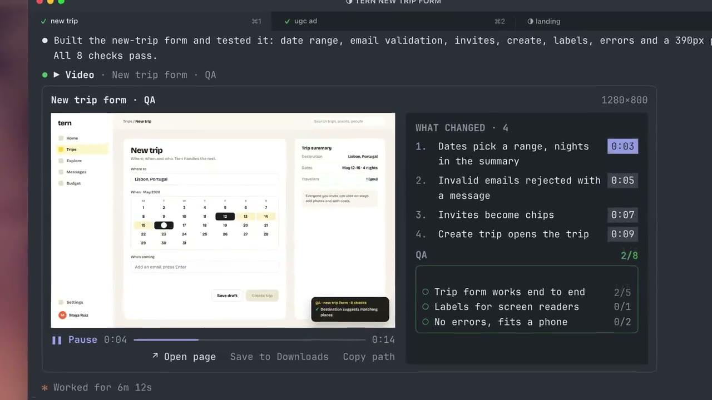
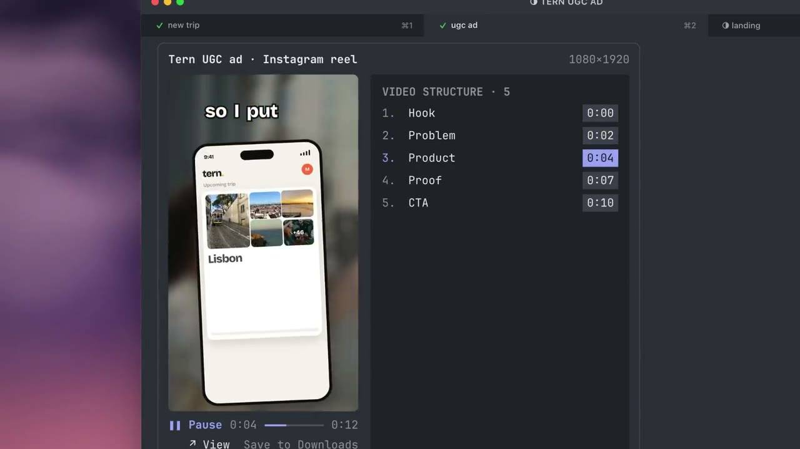

<p align="center">
  
</p>

<h1 align="center">claude-show-your-work</h1>

<p align="center">Sieh dir die Arbeit deines Agenten an, prüfe sie und arbeite iterativ weiter, ohne das Terminal zu verlassen.<br>Bilder, Videos und visuelles QA für Claude Code.</p>

<p align="center">
  <a href="https://github.com/iamumeransari/claude-show-your-work/stargazers"></a>
  <a href="#install"></a>
  <a href="#install"></a>
  <a href="LICENSE"></a>
</p>

## Install

Führe diese beiden Befehle in Claude Code aus:

```
/plugin marketplace add https://github.com/iamumeransari/claude-show-your-work.git#releases
/plugin install show-your-work@iamumeransari
```

Das Plugin unterstützt Ghostty und kitty unter macOS und Linux mit Claude Code 2.1.286 oder neuer. Für Videos und Ton ist zusätzlich ffmpeg nötig: Installiere es mit deinem Paketmanager (`brew install ffmpeg` unter macOS) oder bitte Claude, es zu installieren. HTML-Seiten brauchen Chrome, Chromium oder den Browser von Playwright, PDFs brauchen poppler (`brew install poppler`).

Nach Abschluss der Installation führt dich eine kurze Einführung durch das Plugin. Führe jederzeit `/show-your-work` aus, um deine Einstellungen zu ändern.

## Verwendung

Claude zeigt dir seine Arbeit im Chat, sobald es etwas Visuelles erstellt oder verändert. Du kannst auch ausdrücklich danach fragen:

- „Gib mir vier Richtungen für den Hero-Bereich der Startseite und zeige sie nebeneinander."
- „Baue das Anmeldeformular, teste es und zeig mir die Aufzeichnung."
- „Behebe den Umschalter für die Abrechnung und zeig mir den Zustand vorher und nachher."

### Visuelles QA mit Vorher-nachher-Aufzeichnungen

<p align="center"></p>

Wenn Claude ein Feature baut oder einen Fehler behebt, testet es die Änderung mit Playwright, zeichnet den Ablauf auf und spielt die Aufzeichnung im Chat ab. Alles, was du zur Prüfung brauchst, ist an einem Ort:

- **Vorher und nachher:** Bei jeder Änderung – von einem neuen Feature bis zur Fehlerbehebung – zeichnet Claude dieselben Schritte in der alten und in der neuen Version auf. Anschließend spielt Compare beide synchron nebeneinander ab.
- **Änderungsmarkierungen:** Jede von Claude vorgenommene Änderung steht neben dem Video mit ihrem Zeitstempel; ein Klick springt direkt zu dem Moment, in dem sie erscheint.
- **Live-Prüfungen:** Jede Testprüfung wird grün oder rot, sobald das Video sie erreicht. So siehst du genau, wo die Korrektur wirkt und wo noch etwas scheitert.
- **Ein Ort für die Prüfung:** Du musst keinen Browser öffnen, die Tests nicht erneut ausführen und keine Protokolle lesen – die Aufzeichnung und ihre Ergebnisse stehen direkt im Chat.

### Bilder

<p align="center">
  
  
</p>

Was auch immer Claude entwirft, siehst du direkt im Chat: Landingpages, App-Bildschirme, Komponenten, Designkonzepte, Folien, Diagramme und generierte Bilder. Frag nach mehreren Richtungen, und sie erscheinen nebeneinander; dann kannst du die gewünschte weiter ausarbeiten.

- **Richtungen vergleichen:** Mehrere Konzepte erscheinen gemeinsam, sodass du auf einen Blick eines auswählen kannst, statt Dateien einzeln zu öffnen.
- **Jede Version bleibt erhalten:** Jede neue Version landet im selben Player; mit der Historie kannst du durch alle früheren Entwürfe zurückblättern.
- **Vorher und nachher:** Wechsle zwischen dem alten und dem neuen Entwurf oder stelle sie nebeneinander, um genau zu sehen, was sich geändert hat.

### Video

<p align="center">
  
  
</p>

Über das Produkt-QA hinaus kann Claude dir von fast allem, woran es arbeitet, ein Video zeigen. Du baust eine Website und willst sehen, wie sie sich beim Scrollen von oben nach unten anfühlt? Frag einfach danach, und die Aufzeichnung läuft im Chat – mit allen Animationen.

Du drehst einen Werbespot, eine Animation oder ein Launch-Video? Jeder Schnitt läuft direkt im Chat, in einem vollständig ausgestatteten Video-Player:

- **Video-Steuerung:** Abspielen, pausieren, durch die Zeitleiste ziehen und vor- oder zurückspringen. Ein Video mit Ton wird mit Ton abgespielt; Mute schaltet den Ton für die Sitzung aus.
- **Zeitstempel:** Die Seitenleiste führt dich Schritt für Schritt durch das Video. Jeder Schritt hat einen Zeitstempel, ein Klick führt direkt zu dieser Stelle.
- **Versionen vergleichen:** Erstellt Claude eine neue Version eines Videos, öffnet sie im selben Player. Du kannst in der Historie zwischen Entwürfen wechseln oder die alte und neue Version synchron nebeneinander abspielen.
- **Schnellfunktionen:** Öffne das Video in QuickTime Player für eine größere Ansicht oder speichere es mit einem Klick direkt in deinen Downloads-Ordner.

## Terminals

show-your-work unterstützt Ghostty und kitty unter macOS und Linux. Dort funktionieren Bilder sofort.

- **Rex und die Herdr-App:** Bilder und Videos werden gezeichnet, aber Claude Code aktiviert sie dort nur, wenn es mit `CLAUDE_CODE_FORCE_TERMINAL_IMAGES=1` startet. Die Schaltfläche „Turn on pictures" in der Meldung fügt deiner Shell-Profil-Datei eine Zeile hinzu, die dies nur in diesem Terminal setzt, und kopiert einen Befehl zum erneuten Öffnen des Chats.
- **Warp, WezTerm und Konsole:** Diese unterstützen das kitty-Grafikprotokoll, aber nicht die Unicode-Platzhalter, mit denen Claude Code Bilder zeichnet, daher können Bilder dort noch nicht angezeigt werden.
- **Andere Terminals auf Basis von Ghostty oder kitty:** Claude Code erkennt sie nicht und lässt Bilder aus. Starte es mit `CLAUDE_CODE_FORCE_TERMINAL_IMAGES=1` (die Meldung kopiert einen entsprechenden Befehl) oder füge `export CLAUDE_CODE_FORCE_TERMINAL_IMAGES=1` zu deinem Shell-Profil hinzu.
- **tmux:** Funktioniert innerhalb von Ghostty oder kitty. Claude Code lässt Bilder in tmux aus, sofern es nicht mit `CLAUDE_CODE_FORCE_TERMINAL_IMAGES=1` startet; beim ersten Mal aktiviert das Plugin das für neue tmux-Fenster und die Meldung kopiert einen Befehl, der den Chat damit erneut öffnet. Das Plugin aktiviert außerdem `allow-passthrough` für sein eigenes Fenster und leitet die Bilder weiter. An deiner tmux-Konfiguration wird nichts geändert.

Die Versionen 0.6.7 bis 0.6.9 boten in Warp, WezTerm und Konsole eine Schaltfläche „Turn on pictures", die eine Zeile zum Shell-Profil hinzufügte. Dadurch wurden Bilder als Raster aus Kästchen gezeichnet, deshalb entfernt das Plugin diese Zeile inzwischen selbst.

## FAQ

<details>
<summary><b>Kann Claude Code Bilder im Terminal anzeigen?</b></summary>

Ja, mit dem Plugin show-your-work kann Claude Code Bilder im Terminal anzeigen. Nach der Installation zeigt Claude Screenshots, Entwürfe, Diagramme und andere Bilder direkt im Chat. Es funktioniert in Ghostty und kitty.

</details>

<details>
<summary><b>Kann Claude Code Videos im Terminal abspielen?</b></summary>

Ja, mit dem Plugin show-your-work kann Claude Code Videos im Terminal abspielen. Es spielt Bildschirmaufzeichnungen, Animationen, Werbespots und Launch-Videos innerhalb des Claude-Code-Chats ab. Dazu gehört ein umfangreicher Video-Player mit Zeitleistensteuerung, Sprungfunktionen, anklickbaren Zeitstempeln und Vergleichen nebeneinander.

</details>

<details>
<summary><b>Wie sehe ich, was Claude Code gebaut hat, ohne einen Browser zu öffnen?</b></summary>

Installiere das Plugin show-your-work. Immer wenn Claude etwas Visuelles erstellt oder verändert, macht es einen Screenshot oder eine Aufzeichnung und zeigt dir das Ergebnis im Chat. Du musst nicht in einen Browser wechseln und die Seite selbst suchen.

</details>

<details>
<summary><b>Kann Claude Code meine App testen und mir eine Aufzeichnung zeigen?</b></summary>

Ja, mit dem Plugin show-your-work kann Claude Code deine App testen und dir eine Aufzeichnung zeigen. Claude testet die Features, die es baut, mit Playwright, zeichnet jeden Ablauf auf und spielt die Aufzeichnung im Chat ab. Die Schritte stehen mit Zeitstempeln neben dem Video. Jede Prüfung wird grün oder rot, sobald das Video sie erreicht.

</details>

<details>
<summary><b>Kann Claude Code mir Vorher und Nachher einer Änderung oder Fehlerbehebung zeigen?</b></summary>

Ja, mit dem Plugin show-your-work kann Claude Code dir Vorher und Nachher einer Änderung oder Fehlerbehebung zeigen. Claude zeichnet dieselben Playwright-Schritte in der alten und in der neuen Version auf. Compare spielt beide Aufzeichnungen synchron nebeneinander ab. Jede Prüfung wird grün oder rot, sobald das Video sie erreicht.

</details>

<details>
<summary><b>Gibt es ein Claude-Code-Plugin für visuelles QA?</b></summary>

Ja, show-your-work ist ein Claude-Code-Plugin für visuelles QA. Es zeichnet Claudes Playwright-Testabläufe auf und spielt sie im Chat ab. Jede Aufzeichnung hat anklickbare Änderungsmarkierungen und Prüfungen, die während des Videos grün oder rot werden. Bei Änderungen und Fehlerbehebungen spielt es den Zustand vorher und nachher synchron nebeneinander ab.

</details>

<details>
<summary><b>Wie prüfe ich, ob Claude Code einen Fehler wirklich behoben hat?</b></summary>

Am einfachsten lässt du die Korrektur mit show-your-work aufzeichnen. Bitte Claude, den Fehler zu beheben und dir den Zustand vorher und nachher zu zeigen. Die alte und die neue Version laufen synchron nebeneinander, wobei die Prüfungen, die jetzt bestehen, grün markiert sind.

</details>

<details>
<summary><b>Worin unterscheidet sich show-your-work vom bloßen Anzeigen von Bildern im Terminal?</b></summary>

show-your-work geht über das Anzeigen von Bildern im Terminal hinaus. Seine große Stärke ist visuelles QA: Es spielt synchronisierte Playwright-Aufzeichnungen von vorher und nachher ab, listet Änderungen auf, zu denen du springen kannst, und lässt jede Prüfung während des Videos grün oder rot werden. So kannst du ein Feature oder eine Korrektur prüfen, ohne Claude Code zu verlassen.

</details>

<details>
<summary><b>Verbraucht das Anzeigen von Bildern und Videos Tokens?</b></summary>

Nein, show-your-work verbraucht kaum zusätzliche Tokens, weil es von Grund auf sparsam mit Tokens und Speicher umgeht. Bilder und Videos werden mit dem kitty-Grafikprotokoll direkt in dein Terminal gezeichnet, ohne Tokens zu verwenden. Videos werden ebenfalls effizient dekodiert und gestreamt, sodass nur sehr wenig Speicher belegt wird.

</details>

<details>
<summary><b>In welchen Terminals funktioniert es?</b></summary>

Das Plugin show-your-work unterstützt Ghostty und kitty unter macOS und Linux.

</details>

<details>
<summary><b>Ist es kostenlos?</b></summary>

Ja, show-your-work ist kostenlos und Open Source unter der MIT-Lizenz.

</details>

<details>
<summary><b>Muss ich das Plugin selbst aktualisieren, wenn neue Features und Korrekturen erscheinen?</b></summary>

Nein, du musst es nicht selbst aktualisieren. Das Plugin aktualisiert sich selbst, sodass du nie zurückbleibst. Während der Einführung kannst du zwischen den Stable- und Latest-Releases wählen, oder jederzeit mit `/show-your-work`.

</details>

<details>
<summary><b>Wie sehe ich die Einführung erneut?</b></summary>

Führe `/show-your-work tour` aus, um die Einführung erneut zu sehen. Sie behandelt Aufzeichnungen, Vorher und Nachher, die Versionshistorie und die Einstellungen.

</details>

<details>
<summary><b>Belegt es viel Speicherplatz?</b></summary>

Nein, es belegt nicht viel Speicherplatz. Neueste Bilder und Videos bleiben erhalten, damit du zurückblättern kannst; die ältesten werden gelöscht, sobald sie zusammen etwa 1 GB ergeben.

</details>

<details>
<summary><b>Sammelt es Daten?</b></summary>

Du entscheidest, ob anonyme Nutzungsdaten geteilt werden. Diese Entscheidung kannst du während der Einführung treffen oder jederzeit mit `/show-your-work` ändern. Es werden niemals sensible Daten erfasst. Details findest du in der [Datenschutzerklärung](PRIVACY.md).

</details>

<details>
<summary><b>Was führt das Plugin auf meinem Computer aus, speichert es und womit verbindet es sich?</b></summary>

Hier ist alles, was das Plugin auf deinem Computer tut, damit du genau weißt, was du installierst. Deine Bilder und Videos verlassen niemals deinen Rechner.

Um Bilder und Videos vorzubereiten, verwendet es `ffmpeg` und `ffprobe` (ein Video in Einzelbilder zerlegen und seine Länge auslesen) sowie unter macOS `sips` (ein Bild in PNG umwandeln). Bei einem Video mit Ton spielt `ffplay` (Teil von ffmpeg) den Ton ab, und unter macOS liest `osascript`, wie lange Lautsprecher oder Kopfhörer für die Wiedergabe brauchen, damit das Bild auf den Ton wartet. Wenn du View, Show in Finder oder Save to Downloads drückst, öffnet es die Datei mit `open` unter macOS bzw. `xdg-open` unter Linux. Unter macOS hilft `mdfind` dem Befehl `/img`, ein eingefügtes Bild zu finden. Um eine HTML-Seite oder ein Markdown- oder Mermaid-Dokument anzuzeigen, rendert es dieses in einem versteckten Chrome oder Chromium mit einem temporären Profil (niemals deine Anmeldedaten); für PDFs verwendet es poppler mit `pdftoppm` und `pdfinfo`.

Ein paar kurze Skripte laufen mit `sh` und `perl`. Sie finden `ffmpeg` und dein Home-Verzeichnis, lesen die Zellgröße des Terminals, damit Bilder hineinpassen, räumen den temporären Ordner des Plugins auf, öffnen unter Linux einen Betrachter und wechseln zwischen den Kanälen Stable und Latest. Außerdem verwendet es `cp`, `mkdir`, `rm`, `cat` und `touch` für eigene temporäre Dateien sowie `claude plugin`, um seine eigenen Aktualisierungen aus diesem Repository zu installieren – höchstens einmal pro Tag. Du kannst Aktualisierungen abschalten. Nach dem Umzug des Plugins in das Claude-Code-Plugin-Verzeichnis wird der Updater abgeschaltet, da Claude Code ihn dann selbst aktuell hält.

Es speichert diese Dateien:

- Video-Einzelbilder und konvertierte Bilder liegen in einem temporären Ordner (`$TMPDIR/claude-show-your-work-<your user id>`); alles älter als eine Woche wird aufgeräumt.
- Eine Kopie jeder Datei, die Claude dir zeigt, liegt in `.show-your-work/` in deinem Projekt, damit du Versionen zurückverfolgen kannst.
- Save to Downloads legt eine Kopie in `~/Downloads` ab.
- Falls dein Shell-Profil die Zeile eines älteren „Turn on pictures" enthält (siehe [Terminals](#terminals)), entfernt es genau diese Zeile.
- Mit `SHOW_YOUR_WORK_DEBUG=1` schreibt es eine `debug.log` in den temporären Ordner.

Einmal täglich liest es die neueste Versionsnummer des Plugins von `raw.githubusercontent.com`.

Ist die Nutzungsdatenfreigabe in `/show-your-work` aktiviert, sendet es anonyme Nutzungszähler an `us.i.posthog.com`. Dazu gehören Ereignisnamen und Zähler sowie die Versionen von Plugin und Claude Code, dein Terminal, dein Betriebssystem und ob ffmpeg installiert ist – unter einer zufälligen Installations-ID. Dateinamen, Pfade, Prompts, eingegebener Text oder deine IP-Adresse sind nie enthalten. Der Schlüssel im Code ist PostHogs öffentlicher Schlüssel, mit dem nur Ereignisse gesendet werden können.

Innerhalb von Claude Code verwendet es diese Hooks:

- `prompt.submit` sendet eine kurze Zeile mit deiner Nachricht und teilt Claude mit, dass dieses Terminal Bilder anzeigen kann (oder warum nicht). Dies geschieht einmal pro Sitzung, erneut nach einer Kompaktierung und wenn sich dies ändert.
- `prompt.submit` schließt die Einstellungen, wenn du eine Nachricht sendest, und merkt sich die Namen eingefügter Bilder, damit `/img` sie finden kann. Deine Nachricht wird nicht verändert.
- `tool.call` verarbeitet die eigenen Werkzeuge des Plugins: `show_image`, `show_video`, `show_html`, `show_audio` und `show_document`. Andere Werkzeuge werden nie angefasst.
- `command.run` führt `/img`, `/page`, `/audio`, `/doc` und `/show-your-work` aus. Direkt nach der Installation führt es einmal `/show-your-work tour` aus, um dich herumzuführen.
- `ui.render` zeichnet den Player, die Meldungen, die Einstellungen und die Einführung des Plugins.
- `session.start` und `session.end` richten zu Beginn den temporären Ordner und das Terminal ein und senden am Ende ausstehende Nutzungszähler. Innerhalb von tmux starten und stoppen sie außerdem die Bildweiterleitung für den Plugin-Fensterbereich (siehe [Terminals](#terminals)).

</details>

## Feedback

Um einen Fehler zu melden oder eine Änderung vorzuschlagen, [öffne ein Issue](https://github.com/iamumeransari/claude-show-your-work/issues).

## Für Entwickler

<details>
<summary>Werkzeuge, Einstellungen und lokale Entwicklung</summary>

Das Plugin gibt Claude fünf Werkzeuge: `show_image`, `show_video`, `show_html` (ein Schnappschuss einer HTML-Seite), `show_audio` (MP3 und WAV, mit Wellenform) und `show_document` (PDF, Markdown und Mermaid, Seite für Seite). Ein einfacher Aufruf braucht nur einen Pfad. Für einen Vorher-nachher-Vergleich übergibt Claude zusätzlich die alte Datei und die Testergebnisse:

```jsonc
{
  "path": "qa/after.webm",          // der Ablauf in der behobenen Version
  "compare": "qa/before.webm",      // dieselben Schritte in der alten Version
  "title": "Pricing page",
  "url": "http://localhost:3000/pricing",
  "changes": [                      // was sich geändert hat und in welcher Sekunde es erscheint
    { "title": "Annual toggle sets prices", "at": 3.2 },
    { "title": "Plan buttons line up", "at": 5.4 }
  ],
  "summary": [                      // die Testergebnisse, höchstens drei Zeilen
    { "label": "Billing: toggle works", "ok": true, "passed": 1, "total": 1 },
    { "label": "Layout: plans, buttons", "ok": true, "passed": 3, "total": 3 }
  ]
}
```

Videos werden mit bis zu 12 Bildern pro Sekunde in Einzelbilder zerlegt, in der Breite, in der sie das Fenster anzeigt (höchstens 2400 px), mit einem Limit von 3.600 Bildern (fünf Minuten bei voller Rate). Um eine Datei selbst zu öffnen, führe `/img path/to/file.png` aus.

Um am Plugin zu arbeiten, bearbeite die Module in `hooks/` (`register.tsx` ist der Einstiegspunkt) und führe `/reload-plugins` aus, um deine Änderungen zu laden. Vor dem Senden einer Änderung führe `claude plugin validate .` und `claude plugin test .` aus.

</details>

## Status

show-your-work wird aktiv gepflegt. Es ist das erste Plugin, das Bilder, Videos und automatisiertes visuelles QA mit Playwright-Aufzeichnungen in das Claude-Code-Terminal bringt. Sein Launch-Video wurde mehr als 275.000 Mal angesehen. Seitdem ist es die beliebte Wahl für Entwickler, die sehen wollen, was Claude baut, ohne das Terminal zu verlassen. Es ist in einigen der größten Claude-Code-Plugin-Kataloge gelistet und gehört derzeit zu den trendigen Plugins für Claude Code.

Wenn du möchtest, dass Claude Code dir Screenshots, Bildschirmaufzeichnungen oder Vorher-nachher-Vergleiche seiner Arbeit zeigt, ohne das Terminal zu verlassen, ist dieses Plugin genau dafür gemacht.

## Lizenz

[MIT](LICENSE). Die Fotografien in den Beispielen stammen von [Unsplash](https://unsplash.com) und werden unter der Unsplash-Lizenz verwendet. [Datenschutz](PRIVACY.md).

<p align="center"><a href="#install"></a></p>

## Quelle und Lizenz

- Originalautor: iamumeransari
- Originalrepository: https://github.com/iamumeransari/claude-show-your-work
- Lizenz: MIT
- Deutsche Übersetzung und UI-Lokalisierung: Projekt claude-code-mods-de
