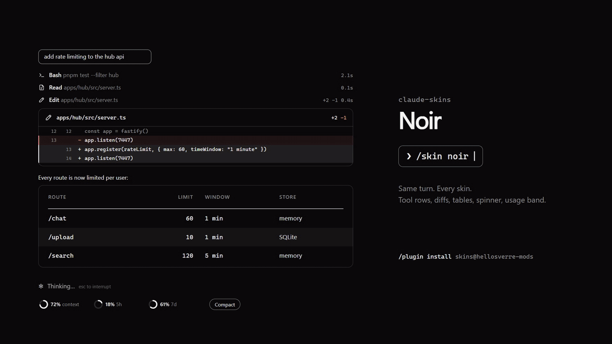

<h1 align="center">
  <picture>
    <source media="(prefers-color-scheme: light)" srcset="docs/brand/banner-light.svg">
    
  </picture>
</h1>

<p align="center">
  <a href="https://github.com/hellosverre/claude-skins/releases/latest"></a>
  <a href="LICENSE"></a>
  
</p>

<p align="center">Werkzeugaufrufe mit Symbolen und Laufzeiten, Änderungen als Diff-Karten, Tabellen, Code und Mermaid-Diagramme als Karten,<br>eine live Nutzungsleiste und sechzehn Skins, die du neu färben oder von Claude entwerfen lassen kannst.</p>



## Install

Erfordert Claude Code **2.1.287** oder neuer, im Terminal oder im Code-Tab der Desktop-App. Führe beide Befehle in Claude Code aus:

```
/plugin marketplace add hellosverre/claude-skins
```

```
/plugin install skins@hellosverre-mods
```

Starte Claude Code neu. Der Skin **noir** ist aktiv; gib `/skin` ein, um ihn zu wechseln.

Du suchst weitere Mods? `/plugin install mod-store@hellosverre-mods`, dann durchsucht und installiert `/mods` rund 2.700 davon aus einem Fensterbereich und zeigt vorher, worauf jeder zugreifen kann.

## Update

skins prüft einmal täglich, ob es eine neue Version gibt, und zeigt eine Meldung, wenn du zurückliegst. Zum Aktualisieren:

```bash
claude plugin marketplace update hellosverre-mods
```

```bash
claude plugin update skins@hellosverre-mods
```

Starte danach Claude Code neu. Bereits offene Sitzungen behalten die Version, mit der sie begonnen haben.

## Uninstall

```bash
claude plugin uninstall skins@hellosverre-mods
```

Wenn du installiert bleiben, aber zur ursprünglichen Darstellung von Claude Code zurückkehren willst, führe `/skin off` aus.

## Verwendung

`/skin help` listet alle Befehle in Claude Code auf; `/skin list` zeigt alle Skins und Einstellungen.

**Skins**

| Befehl | Was er tut |
|---|---|
| `/skin` | Einstellungen: Skin mit Live-Vorschau wählen, Teile ein-/ausschalten, jede Farbe neu färben |
| `/skin <name>` | Skin wechseln (Namen unten) |
| `/skin list` | Alle Skins, einschließlich deiner, und alle Einstellungen |
| `/skin help` | Alle Befehle in einer Tabelle |
| `/skin off` · `on` | Zurück zur ursprünglichen Darstellung von Claude Code oder skins wieder einschalten |
| `/skin gallery` | Jedes vom Skin gezeichnete Element, nummeriert, um darauf zu verweisen |
| `/skin pin` · `unpin` · `share` | Diesem Ordner ein eigenes Aussehen geben, es entfernen oder zum Standard machen |
| `/skin copy` · `copy code` | Claudes letzte Antwort oder nur den letzten Codeblock kopieren |
| `/skin calm` · `calm off` | Keine Bewegung, eine Zeile pro Werkzeugzeile, schreibgeschützte Ausgabe eingefaltet, Fehler immer vollständig; `calm off` stellt den vorherigen Zustand wieder her |

Integrierte Skins: `noir`, `tokyo-night`, `dracula`, `catppuccin`, `rose-pine`, `nord`, `gruvbox`,
`kanagawa`, `everforest`, `one-dark`, `solarized`, `night-owl`, `ayu`, `github`, `mono`, `terminal`.

**Optionen**

| Befehl | Was er tut |
|---|---|
| `/skin tables on/text/off` | Tabellen als Karten, auf dem Desktop als auswählbarer Text oder in der ursprünglichen Darstellung von Claude Code |
| `/skin prompt left/right/plain` | Im Terminal, auf welcher Seite der Umriss deines Prompts sitzt, oder ein einfacher führender Marker. Auf dem Desktop bleiben Claudes eigene Nachrichten mit Kopieren und Zurückspulen erhalten |
| `/skin words claude/skin` | Wessen Wörter Spinner und Rundenfuß anzeigen: die von Claude Code oder die des Skins (Standard) |
| `/skin icons unicode/ascii` | Das Symbolset und reine ASCII-Diagramme im Terminal |

**Teile**, jeweils mit `/skin <part> on` oder `off` geschaltet:

| Teil | Was er tut |
|---|---|
| `rail` | Die farbige Leiste neben Werkzeugzeilen |
| `shimmer` | Der Lichtstreifen über dem Wort des Spinners |
| `band` | Die Nutzungsanzeigen über dem Prompt |
| `countdown` | Die verbleibende Zeit bis zum jeweiligen Limit in der Leiste |
| `compact` | Die Schaltfläche Compact in der Leiste, mit einem Hinweis ab 70 % Kontext (standardmäßig an) |
| `clip` | Die eigene Shell-Ausgabe von Claude Code auf Anfang und Ende kürzen |
| `markdown` | Hinweise und Aufgabenlisten gezeichnet |
| `quiet` | Lesevorgänge, Suchen und schreibgeschützte Befehle auf eine Zeile gefaltet |
| `charts` | Mermaid-Blöcke als Diagramme |
| `math` | Mathematische Formeln gesetzt |
| `commands` | Ausgabe von Slash-Befehlen als Tabellen und Karten |
| `shell` | Shell-Ausgabe als Karte |
| `highlight` | Codeblöcke in den Farben des Skins hervorgehoben |
| `hints` | Claude mitteilen, dass hier Diagramme gezeichnet werden |
| `links` | URLs und Pfade als Links |
| `copy` | Kopier-Schaltflächen auf Karten |
| `fold` | Lange Blöcke hinter `▾ N more` falten |
| `expand` | Jede Folge von Lese- und Suchvorgängen öffnen statt der einen Zeile `Read 3 · Search 2 ▸`; standardmäßig aus |

**Mit Claude einen entwerfen.** Frage „mach mir einen Skin, der sich wie ein Sonnenuntergang anfühlt“. skins gibt Claude ein `design`-Werkzeug, damit es den Skin baut und anwendet, während du zuschaust. Wird ein integrierter Skin neu gefärbt, wird er als dein eigener `my-<skin>` gespeichert. Auswahlen werden über Sitzungen hinweg gemerkt.

## Vorschau

Gezeichnet vom eigenen Kartencode des Mods (`scripts/previews.ts`), keine Screenshots.

<picture>
  <source media="(prefers-color-scheme: light)" srcset="docs/previews/hero-light.svg">
  
</picture>

<picture>
  <source media="(prefers-color-scheme: light)" srcset="docs/previews/spinners-light.svg">
  
</picture>

<picture>
  <source media="(prefers-color-scheme: light)" srcset="docs/previews/terminal-light.svg">
  
</picture>

<picture>
  <source media="(prefers-color-scheme: light)" srcset="docs/previews/code-light.svg">
  
</picture>

<picture>
  <source media="(prefers-color-scheme: light)" srcset="docs/previews/usage-light.svg">
  
</picture>

## Was es neu zeichnet

| Teil | Desktop-App | Terminal |
|---|---|---|
| Werkzeugaufrufe | Symbol je Art, Spinner während der Ausführung, geänderte Zeilen, benötigte Zeit. `▸` öffnet die Zeile: die Eingabe des Aufrufs vollständig und seine Antwort (der Text eines Lesevorgangs mit Zeilennummern, die Treffer einer Suche, die Shell-Karte, der Diff); ein fehlgeschlagener Aufruf öffnet sich selbstständig | Ein Knoten auf der Leiste der Runde, mit demselben `▸` |
| Änderungen | Diff-Karte mit `+N −M` und nummerierten Zeilen | Claudes eigener Diff |
| Shell-Befehle | Terminal-Karte mit Status, stderr getrennt, lange Ausgabe gefaltet; Pfade, Zahlen sowie Wörter für Fehler, Warnung und Erfolg eingefärbt | Karte mit dem Befehl, der Ausgabe in derselben Farbgebung, `✓` oder `✗ exit N`, stderr in Rot unter eigener Beschriftung, jeder Datenstrom auf 8 + 4 Zeilen gefaltet (`/skin shell off` für Claudes eigene Darstellung) |
| Ruhige Ausgabe (standardmäßig aus) | Lesevorgänge, Suchen und schreibgeschützte Befehle werden auf eine Zeile gefaltet; ein Fehler behält seine Fehlerzeile | Ebenso |
| Tabellen | Karte mit Kopfzeilenlinie, Zebrastreifen und Farbfeldern | Zellraster mit Kopfleiste |
| Diagramme | ` ```mermaid ` als Karte: Flussdiagramm, xy, Kreis, Gantt, Zeitachse, Reise, Kanban, Mindmap, Quadranten, Radar, Sankey, gitGraph, Treemap, Packet, Block, Architektur, C4 | Dieselben siebzehn in Zellen gezeichnet, mit ASCII bei `/skin icons ascii` |
| Formeln | `$$…$$`, `\[…\]` und ` ```math ` als gesetzte Karte: Brüche, Wurzeln, Summen und Integrale mit Grenzen, Matrizen, ausgerichtete Zeilen; ` $…$ ` inline wird zu Unicode | Brüche und Grenzen in Zellen gestapelt, inline ` $…$ ` als Unicode |
| Befehlsausgabe | `/cost`, `/context` und Plugin-Ausgabe: Tabellen, Code und `key: value`-Folgen als Karten | Ebenso als Zellraster |
| Hinweise und Aufgabenlisten | `> [!NOTE]` als Kasten mit Titel, `- [ ]` mit Häkchen und Zähler der erledigten Punkte | Ebenso |
| Codeblöcke | Karte mit Sprache, Zeilennummern, Hervorhebung; Shell-Blöcke behalten die Schaltfläche Run | Gerahmt, die Sprache auf dem Rahmen, hervorgehoben in den Farben des Skins: TS/JS, JSON, Shells, PowerShell, Python, Rust, Go, C/C++, C#, F#, Java, YAML, TOML, HTML/XML, CSS, SQL, Diff, Markdown, Lua (`/skin highlight off` für Claudes eigene Darstellung) |
| Spinner | Animiertes Symbol pro Phase | Das Wort des Skins mit einem Lichtstreifen |
| Über dem Prompt | Ringe für Kontext und Planlimit, Schaltfläche Compact, Hinweis ab 70 % | Balkenanzeigen, dieselbe Schaltfläche |
| Deine Prompts | Die von Claude Code, sodass Kopieren, Zurückspulen und Auswahl erhalten bleiben | Abgerundeter Umriss oder einfacher Marker |
| Links und Dateien | URLs sind die Links der App; Werkzeugzeilen färben in dieser Runde erstellte (`ok`) oder geänderte (`warn`) Dateien | URLs im Fließtext sind OSC-8-Links, wo das Terminal sie zeichnet (`FORCE_HYPERLINK=1` oder `0` überschreibt die Erkennung), anderswo Klartext; Pfade mit `:line`, Zahlen und Versionen eingefärbt, Dateien dieser Runde in `ok` oder `warn` in Zeilen und Fließtext |
| Diff-Blöcke | ` ```diff ` als Diff-Karte, mit Kopieren und `new only` (der Code nach der Änderung) | Nummerierte alte und neue Zeilen, `+` und `-` in den Farben des Skins, der Code hervorgehoben in der Sprache, die sein `+++`-Pfad oder ein Tag ` ```diff-fsharp ` angibt, dieselben zwei Kopien |
| Nebeneinander | Zwei oder mehr Tabellen oder Diagramme in einer Reihe teilen sie sich, wenn jede 75 Spalten erhält; sonst gestapelt | Tabellen und Diagramme in einer Reihe stehen nebeneinander, solange ihre natürlichen Breiten passen; sonst gestapelt |
| Lange Blöcke | Codekarten nach 24 Zeilen dort abgeschnitten, mit `▾ N more` | Code nach 24 Zeilen, Tabellen nach 14 Zeilen und Shell-Ausgabe nach 8 + 4 Zeilen hinter `▾ N more` / `▴ less` gefaltet |

Jede Karte hat eine Kopier-Schaltfläche (Tabellen zusätzlich `as text`, die Tabelle wie gezeichnet; eine Antwort mit mehreren Blöcken endet mit `copy reply`) und animiert einmal beim ersten Zeichnen, mit Rücksicht auf reduzierte Bewegung. Nur die Darstellung ändert sich: das gespeicherte Gespräch und das, was das Modell liest, bleiben unberührt. Agenten, Planmodus und die Berechtigungsabfrage behalten die ursprüngliche Darstellung von Claude Code.

**Diagrammhinweise.** Solange Diagramme aktiv sind, erhält Claude eine kurze, nur für das Modell bestimmte Notiz (etwa 130 Tokens, geschätzt aus ihren 458 Zeichen), dass ` ```mermaid `-Blöcke hier gezeichnet werden, damit es zu einem Diagramm greift, wenn eines besser lesbar ist. Nie bei headless-Läufen mit `claude -p`. `/skin hints off` entfernt die Notiz und lässt Diagramme weiter zeichnen.

**Hell und dunkel.** Jeder Skin hat beide Varianten und folgt dem Design von Claude Code. Bei `auto` folgt er deinem Terminal (`COLORFGBG`) oder dem System. Erzwinge eine Variante mit `SKINS_THEME=light` oder `SKINS_THEME=dark`.

**Die Farben deines Terminals.** Der Skin `terminal` malt das Terminal mit seiner eigenen 16-Farb-Palette (`ansi256(0)` bis `ansi256(15)`) und folgt damit jedem Design des Terminals, hell oder dunkel. Fließtext und Tabellenstreifen nutzen die Designfarben von Claude Code; wähle in `/config` ein ANSI-Design, damit auch diese dem Terminal folgen. Die Desktop-App hat keine Terminalpalette und zeichnet es als `noir`.

## Für andere Mods

skins ergänzt `$.skins.markdown` um `$`. Es zeichnet Markdown so, wie skins eine Antwort zeichnet, im Skin der jeweiligen Person. Es antwortet mit einem Baum oder `undefined`, wenn skins aus ist oder der Text nichts enthält, was es zeichnet, und wirft bei einem fehlerhaften Argument. Es zeichnet keine Kopier- oder Faltsteuerungen, weil ein Klick nicht von einem Mod-Baum in einen anderen wechseln kann. Führe `skins` unter `dependencies` in deiner `plugin.json` auf, dann legt Claude Code seine Typen in dein `.claude-plugin/types/`.

```tsx
let drawn
try {
  drawn = await $.skins.markdown({ surface: e.surface, text, columns: e.props.bodyColumns })
} catch {}
return drawn ?? <Markdown text={text} />
```

## Kompatibilität

Manuell geprüft unter Windows (Terminal und Desktop-App, 0.3.0) und unter Linux ausgeführt (Terminal, 0.5.0, Claude Code 2.1.288, 168 Engine-Tests). [CI](.github/workflows/ci.yml) führt die Tests, die Manifestprüfung und die Typprüfung unter Linux, Windows und macOS aus. macOS, VS Code und Mobil wurden nicht manuell angesehen. Die Matrix aus Oberfläche und Betriebssystem sowie die Renderzeiten je Zeile stehen in [docs/compat.md](docs/compat.md). Zum Messen auf deinem Rechner:

```bash
scripts/bench.sh
```

## Bekannte Einschränkungen

| Was | Was du stattdessen bekommst | Wo |
|---|---|---|
| Eine geöffnete Zeile für das Lesen eines Bildes, einer PDF oder eines Notebooks, einen Hintergrundbefehl oder eine Antwort, die es nicht lesen kann | Claudes eigene Zeile, in der geöffneten Zeile gezeichnet | `bodyOf` in [`hooks/detail.ts`](hooks/detail.ts); Test „an opened image Read is Claude Code's own drawing…“ |
| Agenten, Planmodus, Aufgaben, die Berechtigungsabfrage | Claudes eigene Zeilen und Dialoge | `kindOf` in [`hooks/tools.ts`](hooks/tools.ts); Test „tools a skin cannot redraw faithfully keep their own row“ |
| Änderungen im Terminal, fehlgeschlagene Änderungen überall | Claudes eigener Diff | [`hooks/register.tsx`](hooks/register.tsx) `ToolResult`; Test „on the desktop an edit is a diff card…“ |
| Codeblöcke im Terminal in einer Sprache, die der Hervorheber nicht kennt | Claudes eigenes Markdown | `languageOf` in [`hooks/highlight.ts`](hooks/highlight.ts); Test „a fence in a language it does not know keeps Claude Code's markdown“ |
| Shell-Blöcke (` ```bash `) auf dem Desktop | Der eigene Block der App, damit die Schaltfläche Run erhalten bleibt | Test „on the desktop a shell fence keeps the app's own block“ |
| Sequenz-, Zustands-, Klassen- und ER-Diagramme auf dem Desktop | Eine Code-Karte: nur das mitgelieferte Layout des Terminals zeichnet sie | `artKind` in [`hooks/mermaid-art.ts`](hooks/mermaid-art.ts), `parseMermaid` in [`hooks/mermaid.ts`](hooks/mermaid.ts) |
| Koreanische, chinesische, japanische oder andere breite Zeichen in der Knoten-ID oder einem Zustandsnamen eines Terminal-Diagramms (`A[開始] --> 請求`) | Der Code: das mitgelieferte Layout lässt solche Knoten weg. Breite Beschriftungen werden als Grafik gezeichnet | `drawsWide` in [`hooks/mermaid-art.ts`](hooks/mermaid-art.ts); Test „a diagram the renderer cannot lay out with wide characters falls back to code“ |
| Ein zu breites oder zu langes Diagramm (über 80 Zeilen oder 8.000 Zeichen im Terminal) | Zeilen für Flussdiagramm, xy und Kreis, sonst der Code | Test „a diagram too wide for the terminal falls back to rows…“ |
| Ein Antwortblock über 9.000 Zeichen, ein Prompt über 4.000 | Claudes eigene Zeichnung der gesamten Nachricht | `MAX_MARKDOWN`, `MAX_PROMPT` in [`hooks/register.tsx`](hooks/register.tsx) |
| Codekarten nach 80 Zeilen | Die ersten 80 und ein Hinweis `N more lines`; Kopieren erfasst alles | `MAX_LINES` in [`hooks/svg-code.ts`](hooks/svg-code.ts) |
| TeX-Befehle, die der Parser nicht kennt | Wie geschrieben gezeichnet, `\name` | [`hooks/math.ts`](hooks/math.ts) |
| Shell-Ausgabe im Terminal gegenüber dem Desktop | Die Terminal-Karte nennt den Befehl und faltet jeden Datenstrom auf 8 + 4 Zeilen; die Desktop-Karte sagt `Output` und faltet beide Ströme zusammen auf 6 + 6 | [`hooks/shell-rows.tsx`](hooks/shell-rows.tsx), [`hooks/svg-terminal.ts`](hooks/svg-terminal.ts) |
| Ein fehlgeschlagener Shell-Aufruf, der Fehlertext statt seines Protokolls zurückgibt | stdout und stderr kommen zusammengeführt an, daher wird der gesamte Text als stderr gezeichnet | `shellResultOf` in [`hooks/shell.ts`](hooks/shell.ts) |
| Ein in den Hintergrund geschickter Befehl oder eine Ausgabe, die ein Bild ist | Claudes eigene Zeile, die sagt, wohin es ging, oder das Bild zeichnet | `keepsOwnRow` in [`hooks/shell.ts`](hooks/shell.ts); Test „/skin shell off gives shell output back…“ |
| Shell-Karten und Werkzeuglaufzeiten nach `/resume` | Kein Befehl im Kopf und keine Zeit: beides wird während des Aufrufs aufgezeichnet | `commandAtom`, `durationAtom` in [`hooks/register.tsx`](hooks/register.tsx) |
| Fehler von Slash-Befehlen und die eigene Ausgabe von `/skin` | Claudes eigene Zeile | Test „slash-command output with key: value lines is a table, prose keeps its row“ |
| `/skin calm` und der Spinner von Claude Code | Calm gibt den Spinner an Claude Code zurück, dessen eigener Spinner weiter läuft | `Spinner` in [`hooks/register.tsx`](hooks/register.tsx) |
| Der Einstellungsbereich auf Mobilgeräten | Eine Zeile mit dem Hinweis, Terminal oder Desktop-App zu verwenden | `Pane` in [`hooks/register.tsx`](hooks/register.tsx) |
| Dateipfade als Links | Eingefärbt, nicht klickbar: `Link` der Engine nimmt nur `https:` und `http://localhost` | `safeHref` in [`hooks/links.ts`](hooks/links.ts) |
| Falten auf dem Desktop | Codekarten falten; Tabellenkarten und die Shell-Karte behalten ihre volle Höhe oder ihr eigenes 6 + 6-Falten | [`hooks/fold.tsx`](hooks/fold.tsx) |
| Symbole und die Leiste | Symbole nur auf dem Desktop (das Terminal Zeichnet kein `Svg`); die Leiste nur im Terminal | `lookOf` in [`hooks/register.tsx`](hooks/register.tsx) |

## Im Vergleich

Andere Mods, die das Aussehen des Gesprächs verändern, nach ihren READMEs vom 2026-10-10. Leer bedeutet, dass die README nichts dazu sagt.

| | skins | [Prismantis](https://github.com/NahumLitvin/prismantis) | [glint](https://github.com/manikosto/glint) | [tweakcc](https://github.com/Piebald-AI/tweakcc) | [claude-gfm-render](https://github.com/briangtn/claude-gfm-render) | [ccstatusline](https://github.com/sirmalloc/ccstatusline) |
|---|---|---|---|---|---|---|
| Wie | Function-hooks-Plugin | Function-hooks-Plugin | Function-hooks-Plugin, ein Prismantis-Fork | Patches das JavaScript von Claude Code; nach jedem Update erneut anwenden | Function-hooks-Mod | Statuszeilen-Befehl |
| Claude Code | 2.1.287+ | 2.1.287+ | 2.1.289+ | Geprüft auf 2.1.162 | 2.1.286+ | |
| Genannte Plattformen | Windows manuell, Linux per Tests; CI auf Linux, Windows, macOS ([compat](docs/compat.md)) | macOS-Terminal manuell; CI auf macOS, Linux, Windows | | Windows, macOS, Linux | Terminal und Desktop-App | Windows-Anleitung in den Docs |
| Themes | 16, jede Farbe neu färben oder von Claude entwerfen lassen | 15 und `mono`, 20 Farbplätze | 15 | Eigene, für die ganze Oberfläche von Claude Code | | Powerline-Themes |
| Färbt Claudes eigene Oberfläche neu | Nein | Nein | Nein | **Ja** | Nein | Nein |
| Werkzeugzeilen | Symbole, Laufzeiten, Leiste; **öffnen für Eingabe und Antwort** | 4 Stile | | | Nein | Nein |
| Schreibgeschützte Ausgabe verborgen | `/skin quiet` | `toolOutput: quiet` | | | Nein | Nein |
| Änderungs-Diffs | Karte auf dem Desktop, Engine-Diff in offener Zeile im Terminal | Claudes eigener | | | Nein | Nein |
| ` ```diff `-Blöcke | Diff-Karte oder nummerierte Zeilen, Kopie `new only` | | Nummeriert, `⧉ new only` | | | Nein |
| Shell-Ausgabe | Karte auf beiden Oberflächen, Pfade, Zahlen und Fehler eingefärbt | In expandierten Gruppen umrahmt | | | Nein | Nein |
| Code-Hervorhebung im Terminal | 20 Sprachfamilien in den Farben des Skins | Prism, zwei Dutzend Sprachen | 20+ Sprachen | | | Nein |
| Tabellen | Karte oder Zellraster, nebeneinander mit Diagrammen | 4 Stile, nebeneinander mit Diagrammen | | 4 Formate | Nein | Nein |
| Mermaid | 17 Arten; Sequenz, Zustand, Klasse, ER nur im Terminal | Flussdiagramm, Sequenz, Zustand, Klasse, ER, xy; kein Kreis | Flussdiagramm, Sequenz, xy | | Flussdiagramm, Sequenz, Zustand, Klasse, ER, xy; SVG auf dem Desktop | Nein |
| Formeln | Karte auf dem Desktop, gestapelte Zellen im Terminal | Satzbild in kitty und Ghostty via RaTeX, anderswo Text | | | Nicht behandelt | Nein |
| Links | URLs als OSC-8-Links; Dateien dieser Runde eingefärbt | Links und nackte URLs klickbar | **URLs und Dateipfade klickbar**; geänderte Dateien eingefärbt, Link-Leiste | | | Nein |
| Lange Blöcke gefaltet | Code, Tabellen, Shell-Ausgabe (`/skin fold`) | | Code, Listen, Tabellen | | | Nein |
| Text von rechts nach links | Nein | **Hebräisch und Arabisch** | Hebräisch und Arabisch | | | Nein |
| Nutzungsanzeigen | Kontext- und Planlimits über dem Prompt | | | | Nein | **Viele Widgets**, Powerline |
| Wörter des Spinners | Die des Skins, mit Schimmer | | | **Eigene Verben und Animationen** | Nein | Nein |
| Kopieren | Karten, Tabellen als Markdown oder wie gezeichnet, `copy reply`, `/skin copy` | Schaltflächen, `/prismantis copy`, HTML-Tabellen | Code, Tabellen, Diagramme, Listen, Zitate | | | Nein |
| API für andere Mods | `$.skins.markdown` | `$.prismantis.markdown` | | | | Nein |

Wo sie besser sind: **tweakcc** färbt alle von Claude Code neu, nicht nur das, was ein Hook zeichnen kann – um den Preis, die Binary zu patchen. **Prismantis** behandelt Text von rechts nach links, kopiert Tabellen als HTML und setzt Formeln als Bilder. **glint** macht Dateipfade klickbar und behält eine Leiste mit den Links der letzten Antwort. **ccstatusline** hat eine wesentlich tiefere Statuszeile. **claude-gfm-render** zeichnet Sequenz- und andere Diagramme auf dem Desktop als SVG, wo skins auf eine Code-Karte zurückfällt. Was skins als Nächstes plant, steht in [ROADMAP.md](ROADMAP.md).

## Datenschutz

skins zeichnet und merkt sich, sonst nichts. Es liest das Sitzungsverzeichnis, deine Kontext- und Planauslastung, die Designeinstellung sowie `SKINS_THEME` / `COLORFGBG` und speichert seine Einstellungen im Mod-Speicher. Sein einziger Netzwerkaufruf ist die tägliche Versionsprüfung: ein GET der [`plugin.json`](.claude-plugin/plugin.json) dieses Repositories auf `raw.githubusercontent.com`, ohne etwas zu senden. Bei `auto` fragt es das Betriebssystem nach hellem oder dunklem Modus (`defaults` unter macOS, `gsettings` unter GNOME). Es kompaktiert oder kopiert nur, wenn du die Schaltfläche drückst. Prüfe es selbst mit `claude plugin validate .`.

## Mitgelieferter Code

Terminal-Diagramme werden von [beautiful-mermaid](https://github.com/lukilabs/beautiful-mermaid) (MIT) angeordnet, gebündelt in `hooks/vendor/mermaid-ascii.js` mit der Lizenz im Kopf. Zum Neubauen:

```bash
cd scripts/vendor && npm install && npm run build
```

## Entwicklung

```bash
git clone https://github.com/hellosverre/claude-skins && cd claude-skins
```

```bash
claude --plugin-dir .
```

Das Speichern einer Datei lädt den Mod in der laufenden Sitzung neu. Tests: `claude plugin test .`. Vorschauen: `npx tsx scripts/previews.ts`. Ein neuer integrierter Skin ist eine Datei: kopiere `hooks/themes/nord.ts`, ändere Farben und Wörter und ergänze eine Zeile in `hooks/themes/index.ts`.

## Weitere Mods

- [redgreen](https://github.com/hellosverre/redgreen): Testergebnisse in einem Fensterbereich neben dem Chat
- [smart-compact](https://github.com/hellosverre/smart-compact): kompaktiert nach einem Commit, grünen Tests, vor Ablauf des Prompt-Caches oder auf Anfrage von Claude
- [mod-store](https://github.com/hellosverre/mod-store): Mods durchsuchen, suchen und aus einem Fensterbereich installieren (2.700 Stück)

## Lizenz

MIT

## Quelle und Lizenz

- Originalautor: hellosverre
- Originalrepository: https://github.com/hellosverre/claude-skins
- Lizenz: MIT
- Deutsche Übersetzung und UI-Lokalisierung: Projekt claude-code-mods-de
