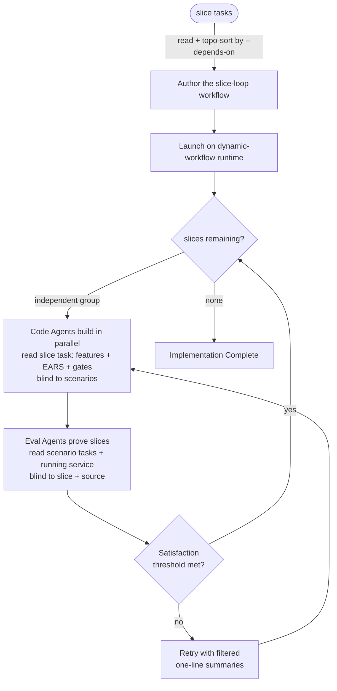
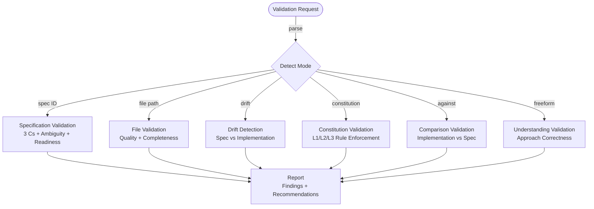
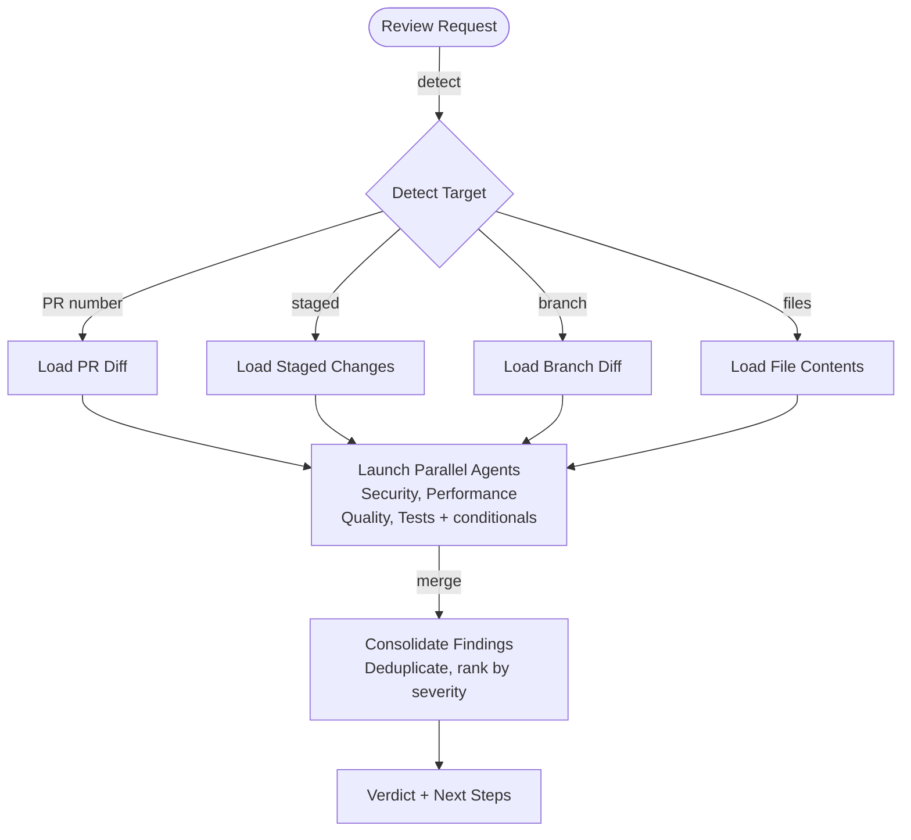
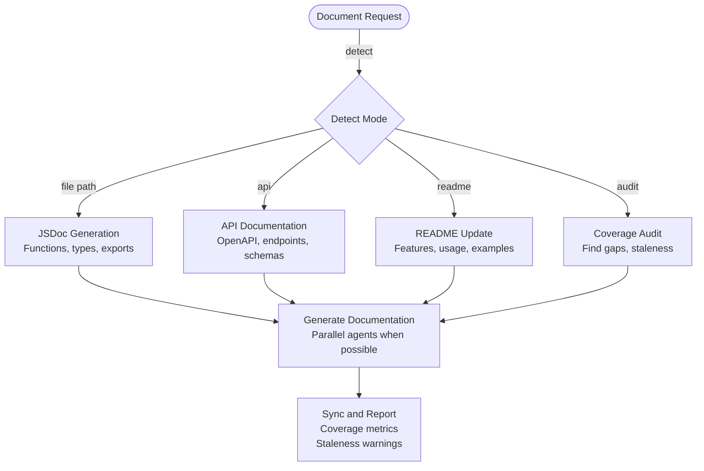
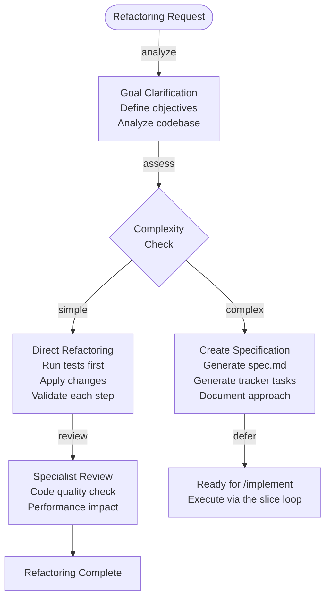

# Start Plugin - The Agentic Startup

**Workflow orchestration plugin for spec-driven development in Claude Code.**

The `start` plugin provides ten user-invocable workflow Skills, five autonomous Skills, und three Ausgabe styles to transform how you build software mit Claude Code.

**For quick starten, workflow guide, und Skill selection, see the [main README](../../README.md).**

---

## Table of Contents

- [User-Invocable Skills](#user-invocable-skills) — specify, implement, validate, test, review, document, analyze, refactor, debug, constitution
- [Autonomous Skills](#autonomous-skills) — 5 Kontext-activated Skills
- [Documentation Structure](#documentation-structure) — specs, domain, patterns, interfaces
- [Output Styles](#output-styles) — The Garage, The Startup, The ScaleUp
- [Typical Development Workflow](#typical-development-workflow) — primary und maintenance flows
- [Skills in Action](#skills-in-action) — real-world examples
- [Templates](#templates) — PRD, SDD, Plan, Scenario
- [Philosophy](#philosophy) — spec-driven development principles

---

## User-Invocable Skills

These Skills are invoked by the user via slash commands (e.g., `/specify`). Unlike autonomous Skills which activate automatisch based on Kontext, user-invocable Skills wait for explicit invocation.

### `/specify <description>`

Create comprehensive specifications von brief descriptions through deep research und specialist Agent coordination, producing a narrative plan plus the slice Aufgaben `/implement` runs.

**Purpose:** Transform ideas in implementation-ready specifications mit product requirements, solution design, und a plan — one `spec.md` plus the implementation Aufgaben in the tracker

**Verwendung:**
```bash
/specify Build a real-time notification system with WebSocket support
/specify 001  # Resume existing specification work
```

**Key Funktionen:**
- **Auto-incrementing Spec IDs** - Automatically creates numbered directories (001, 002, etc.)
- **Resume Capability** - Can resume work on existing specifications by ID
- **Sliced Plan** - Slices the work in self-contained slice Aufgaben, jede correlating features (ACs), EARS behavior, und quality gates, mit holdout scenarios as separate scenario child Aufgaben
- **Dependency-ordered** - slices declare `--depends-on` jede other; that graph is the parallelization contract `/implement` verwendet
- **Pattern Documentation** - Automatically documents discovered patterns in `docs/patterns/`
- **Interface Documentation** - Captures external service contracts in `docs/interfaces/`
- **Domain Documentation** - Records business rules in `docs/domain/`
- **Quality Gates** - Requires user approval between major phases

**Each slice's code brief correlates three facets:**

| Facet | Source | Role |
|-------|--------|------|
| **Funktionen** (acceptance criteria) | Voraussetzungen part | what the slice delivers |
| **Behavior** (EARS) | Solution part | how it must behave |
| **Quality Gates** | derived | checkable conditions |

Its **acceptance scenarios** are separate scenario child Aufgaben (holdout evidence) — how es ist proven.

<details>
<summary><strong>View Details</strong></summary>

**What you get:** One document, `.start/specs/[NNN]-[name]/spec.md`, in three parts, jede closed by its own approval gate:

- **Voraussetzungen** - User stories, feature specifications, success criteria, non-functional requirements
- **Solution** - Technical architecture, system components, data Modelle, technology stack
- **Plan** - The target state und the phases mit their outcomes; the implementation Aufgaben (phases → slices → scenario child Aufgaben) live in **.tracker/**

Its Ledger part holds the öffnen Fragen, assumptions, decision log, und accepted review trade-offs.


</details>

---

### `/implement <spec-id>`

Execute a specification by läuft its slice Aufgaben on Claude Code's dynamic-workflow runtime.

**Purpose:** Transform validated specifications in working code through one loop — jede slice built by a code Agent und proven by an eval Agent, mit an information barrier between them und erneut versuchen to a satisfaction threshold.

**Verwendung:**
```bash
/implement 001
/implement path/to/custom/spec/
```

**So funktioniert es:**

`/implement` liest the spec's slice Aufgaben von the tracker und topologically sorts them by `--depends-on`. It dann authors und runs one dynamic workflow:

| Step | What happens |
|------|--------------|
| **Read** | Read the slice Aufgaben (`task.js graph`); jede carries a code brief (features + EARS + gates) mit its holdout scenarios as scenario child Aufgaben |
| **Launch** | Write the workflow script von the Skill's loop contract und ausführen it via the Workflow Werkzeug; independent slices ausführen concurrently |
| **Loop** | Per phase: code Agenten build its slices — one Agent for a phase whose slices depend on jede other in a chain, one per slice for slices that can ausführen in parallel (they lesen the slice Aufgaben, blind to the scenarios) → one eval Agent proves the phase mit a holdout script kept outside the Projekt (it liest the scenario Aufgaben, blind to the slices + source) → erneut versuchen mit filtered summaries until threshold oder max iterations |

**Key Funktionen:**
- **One loop, emergent scale** - A 1-slice plan is a short loop; a 40-slice plan fans out. No tier oder strategy to wählen
- **Structural information barrier** - The barrier is which Aufgabe jede Agent liest: code Agent → slice Aufgabe; eval Agent → scenario child Aufgaben
- **Resumability** - The dynamic-workflow runtime resumes completed Agenten von Cache within a Sitzung
- **Drift Detection** - Runs `Skill(start:validate)` drift prüft
- **Constitution Enforcement** - L1/L2 violations block completion
- **Real-time Updates** - `/workflows` zeigt live per-slice progress

<details>
<summary><strong>View Details — the slice loop</strong></summary>

Reads the spec's slice Aufgaben von the tracker und topologically sorts them by `--depends-on`. Runs a dynamic workflow written von the Skill's loop contract. Each phase goes through a barriered code→eval loop: code Agenten build its slices (reading the slice Aufgaben' features + EARS + gates und AGENTS.md, aber nie their scenario child Aufgaben), one eval Agent proves the phase against those scenario Aufgaben mit a holdout script it keeps outside the Projekt (accessing the läuft service und, for UI scenarios, a real Browser, aber nie the slices oder the source), und filtered one-line failure summaries feed the nächste erneut versuchen until the satisfaction threshold oder max iterations. A phase whose slices form a dependency chain is built by one code Agent; slices that can ausführen in parallel get one Agent jede, concurrently.



</details>

---

### `/validate <target>`

Validate specifications, implementations, oder understanding through intelligent Kontext detection und the 3 Cs framework (Completeness, Consistency, Correctness).

**Purpose:** Quality gate that works at any lifecycle stage - during specification, vorher implementation, oder danach completion

**Verwendung:**
```bash
/validate 001                                          # Validate spec by ID
/validate .start/specs/001/spec.md                      # Validate specific file
/validate Check the auth implementation against SDD    # Compare implementation to spec
/validate drift                                        # Check for spec-implementation drift
/validate constitution                                 # Validate constitution compliance
/validate Is my caching approach correct?              # Validate understanding
```

**Key Funktionen:**
- **Intelligent Mode Detection** - Automatically determines validation type von Eingabe
- **The 3 Cs Framework** - Checks Completeness, Consistency, und Correctness
- **Ambiguity Detection** - Scans for vague language ("should", "various", "etc.")
- **Cross-Document Traceability** - Verifies requirements to solution to manifest alignment
- **Drift Detection** - Checks spec-implementation alignment
- **Constitution Enforcement** - Validates L1/L2/L3 governance rules
- **Advisory Only** - Provides recommendations ohne blocking
- **Comparison Validation** - Compares implementations against specifications

<details>
<summary><strong>View Details</strong></summary>

**Six validation modes** automatisch detected von Eingabe:

| Input Type | Mode | What Gets Validated |
|------------|------|---------------------|
| Spec ID (`005`) | Specification | Full spec quality und readiness |
| File Pfad (`src/auth.ts`) | File | Individual Datei quality |
| `drift` oder `check drift` | Drift Detection | Spec-implementation alignment |
| `constitution` | Constitution | Governance rule compliance |
| "Check X against Y" | Comparison | Implementation vs specification |
| Freeform Text | Understanding | Approach correctness |

**The 3 Cs Framework:**

1. **Completeness** - All sections filled, nein `[NEEDS CLARIFICATION]` markers, checklists complete
2. **Consistency** - Cross-document traceability, terminology alignment, nein contradictions
3. **Correctness** - ADRs confirmed, dependencies valid, acceptance criteria testable



</details>

---

### `/test [target]`

Run tests mit strict code ownership enforcement — nein "pre-existing failures" excuses allowed.

**Purpose:** Discover und execute tests, ensure the codebase is left in a passing state, und enforce ownership of any failures encountered

**Verwendung:**
```bash
/test                            # Run full test suite
/test all                        # Run full test suite (explicit)
/test src/auth/                  # Run tests for specific path
/test baseline                   # Capture current test state
```

**Key Funktionen:**
- **Test Discovery** - Automatically finds test runner, config, und test Dateien
- **Code Ownership** - If tests fail, you own the fix — nein blaming pre-existing Issues
- **Baseline Capture** - Record aktuell passing/failing state vorher ändert
- **Multi-Agent Parallel** - Can distribute test suites across parallel Agenten
- **Targeted Execution** - Run specific test Dateien, directories, oder the full suite

<details>
<summary><strong>View Details</strong></summary>

**The Ownership Mandate:**

When tests fail, the Skill enforces strict ownership:
- No "these were pre-existing failures"
- No "nicht caused by my ändert"
- No leaving failing tests for the user

**Test Modes:**

| Input | Mode | What Happens |
|-------|------|--------------|
| (empty) oder `all` | Full Suite | Discovers und runs alle tests |
| File/Verzeichnis Pfad | Targeted | Runs tests for specific scope |
| `baseline` | Capture | Records aktuell test state for comparison |


</details>

---

### `/review [target]`

Multi-agent code review mit specialized perspectives läuft in parallel.

**Purpose:** Comprehensive code review vorher merging, mit specialized Agenten examining different concerns simultaneously

**Verwendung:**
```bash
/review                          # Review staged changes
/review 123                      # Review PR number
/review feature/auth             # Review branch changes
/review src/auth/ src/users/     # Review specific files/directories
/review staged                   # Explicitly review staged changes
```

**Key Funktionen:**
- **Parallel Specialists** - Security, Performance, Quality, und Test Agenten review simultaneously
- **Conditional Perspectives** - Concurrency, Dependencies, Compatibility, Accessibility activate when relevant
- **Target Auto-Detection** - Detects PR number, staged ändert, Datei Pfad, oder Branch diffs
- **Confidence Scoring** - Each finding includes confidence level (HIGH/MEDIUM/LOW)
- **Severity Classification** - CRITICAL, HIGH, MEDIUM, LOW findings
- **Standard oder Team Mode** - Fire-and-forget Subagenten oder persistent teammates mit coordination

<details>
<summary><strong>View Details</strong></summary>

**Core Review Perspectives (immer active):**

| Perspective | Focus Areas |
|-------------|-------------|
| **Security** | SQL injection, XSS, hardcoded secrets, auth bypasses, Eingabe validation |
| **Performance** | N+1 queries, missing indexes, memory leaks, inefficient algorithms |
| **Quality** | Code complexity, naming, SOLID principles, Fehler handling, duplication |
| **Tests** | Coverage gaps, missing edge cases, test quality, assertion completeness |

**Conditional Perspectives (activated when relevant):**

| Perspective | Trigger |
|-------------|---------|
| **Concurrency** | async/await, Promise, threading detected |
| **Dependencies** | Dependency Datei ändert |
| **Compatibility** | Public API oder schema ändert |
| **Accessibility** | Frontend component ändert |
| **Constitution** | CONSTITUTION.md exists in Projekt |



</details>

---

### `/document [target]`

Generate und sync documentation including API docs, READMEs, JSDoc comments, und documentation audits.

**Purpose:** Keep documentation aktuell mit code, generate missing docs, und identify staleness

**Verwendung:**
```bash
/document src/api/               # Generate API documentation
/document readme                 # Update project README
/document src/utils/             # Add JSDoc to code files
/document audit                  # Audit documentation coverage
```

**Key Funktionen:**
- **Multiple Documentation Modes** - Code, API, README, Audit, Module
- **Staleness Detection** - Identifies outdated documentation
- **Coverage Metrics** - Reports documentation completeness percentage
- **OpenAPI Generation** - Creates OpenAPI/Swagger specs von API code
- **Multi-Agent Parallel** - Multiple documentation Agenten work simultaneously

<details>
<summary><strong>View Details</strong></summary>

**Documentation Modes:**

| Input | Mode | Output |
|-------|------|--------|
| File/Verzeichnis Pfad | Code | JSDoc/TSDoc comments |
| `api` | API | OpenAPI spec, endpoint docs |
| `readme` | README | README.md updates |
| `audit` | Audit | Coverage report |

**Staleness Detection:**

The Skill automatisch detects when documentation is outdated by:
- Comparing doc timestamps to code ändert
- Checking if documented APIs still match implementation
- Identifying undocumented neu exports



</details>

---

### `/analyze <area>`

Discover und document business rules, technical patterns, und system interfaces through iterative exploration.

**Purpose:** Extract organizational knowledge von existing codebase und create reusable documentation

**Verwendung:**
```bash
/analyze security patterns in authentication
/analyze business rules for user permissions
/analyze technical patterns in our microservices architecture
```

<details>
<summary><strong>View Details</strong></summary>

Uses cyclical discovery-documentation-review workflow to extract organizational knowledge. Specialist Agenten explore the codebase to identify patterns, rules, und interfaces across business, technical, security, performance, integration, data, testing, und deployment areas. Documentation is automatisch organized in `docs/domain/`, `docs/patterns/`, und `docs/interfaces/` directories.


</details>

---

### `/refactor <description>`

Improve code quality while strictly preserving alle existing behavior through test-validated incremental ändert.

**Purpose:** Safe, systematic refactoring mit automatic rollback on test failures

**Verwendung:**
```bash
/refactor Simplify the authentication middleware for better testability
/refactor Improve the WebSocket connection manager
```

<details>
<summary><strong>View Details</strong></summary>

Strictly preserves behavior through test-validated incremental ändert. All tests must pass vorher refactoring begins und danach jede ändern. Automatic rollback on test failures. For simple refactorings, applies ändert directly mit continuous validation. For complex refactorings, creates specification documents und defers to `/implement` for planned execution.



</details>

---

### `/debug <description>`

Diagnose und resolve bugs through conversational investigation mit systematic root cause analysis.

**Purpose:** Natural language debugging partner that helps identify und fix Issues through dialogue, nicht rigid procedures

**Verwendung:**
```bash
/debug The API returns 500 errors when uploading large files
/debug Tests are failing intermittently on CI but pass locally
/debug Users report slow page loads after the latest deployment
```

**Key Funktionen:**
- **Conversational Flow** - Natural dialogue, nicht rigid checklists oder procedures
- **Progressive Disclosure** - Starts mit summary, reveals details on request
- **Observable Actions Only** - Reports nur what was actually checked und found
- **User-Driven** - Proposes nächste steps, lets user guide the direction
- **Hypothesis Tracking** - Forms und tests ranked hypotheses systematically
- **Evidence-Based** - Never fabricates reasoning; alle conclusions backed by evidence

<details>
<summary><strong>View Details</strong></summary>

Uses a conversational approach through five natural phases: understand the problem, narrow it down, find the root cause, fix und verify, wrap up. The debugger reports nur observable actions ("I checked X und found Y") und nie fabricates reasoning. Users can ask "what did you prüfen?" at any point und receive honest, verifiable answers.


**The Four Commandments:**
1. **Conversational, nicht procedural** - It's a dialogue, nicht a checklist
2. **Observable nur** - "I looked at X und found Y" nicht "Das ist probably..."
3. **Progressive disclosure** - Start brief, expand on request
4. **User in control** - "Want me to...?" nicht "I will jetzt..."

</details>

---

### `/constitution [focus-areas]`

Create oder aktualisieren a Projekt constitution mit governance rules through discovery-based pattern analysis.

**Purpose:** Establish checkable Projekt rules that are enforced during implementation, review, und validation

**Verwendung:**
```bash
/constitution                                    # Create new constitution via codebase discovery
/constitution security and testing               # Focus on specific areas
/constitution Add API patterns                   # Update existing constitution
```

**Key Funktionen:**
- **Discovery-Based Rules** - Analyzes actual codebase patterns, nie assumes frameworks
- **L1/L2/L3 Level System** - L1 (blocking + autofix), L2 (blocking, manuell), L3 (advisory)
- **Three-Layer Enforcement** - Checked during specify (SDD), implement, und review
- **Pattern + Check Rules** - Supports regex patterns und semantic LLM-interpreted prüft
- **Graceful Degradation** - System works normally if nein constitution exists

<details>
<summary><strong>View Details</strong></summary>

Creates `CONSTITUTION.md` at Projekt root (like README, LICENSE, CODE_OF_CONDUCT). The constitution defines checkable guardrails that detect violations during development.

**Key Distinction:**
- **CLAUDE.md** = Project Beschreibung, AI guidance ("Use React mit TypeScript")
- **CONSTITUTION.md** = Checkable rules that catch violations ("No barrel exports")

**Level Definitions:**

| Level | Name | Blocking | Autofix | Use Case |
|-------|------|----------|---------|----------|
| **L1** | Must | Yes | AI automatisch-corrects | Security, correctness, critical architecture |
| **L2** | Should | Yes | No | Important rules requiring human judgment |
| **L3** | May | No | No | Style preferences, suggestions |

**Rule Format Example:**

```markdown
### No Hardcoded Secrets

\```yaml
level: L1
pattern: "(api_key|secret|password)\\s*[:=]\\s*['\"][^'\"]{8,}['\"]"
scope: "**/*.{ts,js}"
exclude: "**/*.test.*, .env.example"
message: Hardcoded secret detected. Use environment variables.
\```

Secrets must never be committed to source control.
```

**Three-Layer Enforcement:**

| Phase | Command | Enforcement |
|-------|---------|-------------|
| **Planning** | `/specify` (SDD) | SDD must nicht violate constitutional principles |
| **Task** | `/implement` | Task ordering respects constitutional priorities |
| **Implementation** | `/implement` | Generated code checked; L1/L2 violations block completion |


</details>

---

### Installation

Install The Agentic Startup framework mit the interactive installer:

```bash
npx the-startup
```

**What it does:**
- Supports both Claude marketplace installs und Datei-based installs for other harnesses
- Prompts for plugin multi-select
- Prompts for harness + installation Pfad when using Datei installieren mode
- Copies Datei-install artifacts von the remote GitHub Repository

**Flags:**
- `--help` - Show Nutzung information

**Hinweis:** Output styles are selected via `/config` — see [Output Styles](#output-styles).

---

## Autonomous Skills

The `start` plugin includes five autonomous Skills that activate automatisch based on Kontext. You nie need to explicitly invoke them — they work when needed.

### Specification Skills

| Skill | Purpose |
|-------|---------|
| `specify-meta` | Spec Verzeichnis creation, README tracking, phase transitions |
| `specify-requirements` | Product requirements template, validation, requirements gathering |
| `specify-solution` | Solution design template, architecture design, ADR management |
| `specify-plan` | Authors the narrative plan + the slice und scenario Aufgaben in the tracker |

### Implementation Skills

| Skill | Purpose |
|-------|---------|
| `implement` | Runs the slice loop as a dynamic workflow — barriered code→eval erneut versuchen per slice |

---

## Documentation Structure

Das Plugin encourages structured knowledge management:

```
.start/
└── specs/
    └── [3-digit-number]-[feature-name]/
        ├── spec.md                          # Requirements, Solution, Plan parts + Ledger
        ├── review.md                        # Solution review report
        ├── events.jsonl                     # Event log the dashboard replays
        └── .tracker/                        # Implementation tasks (phase → slices → scenarios)

docs/
├── domain/                                  # Business rules
│   ├── user-permissions.md
│   ├── order-workflow.md
│   └── pricing-rules.md
│
├── patterns/                                # Technical patterns
│   ├── authentication-flow.md
│   ├── caching-strategy.md
│   └── error-handling.md
│
└── interfaces/                              # External integrations
    ├── stripe-payments.md
    ├── sendgrid-webhooks.md
    └── oauth-providers.md
```

### Auto-Documentation

The `document` Skill's Capture perspective automatisch creates Dateien in the correct location when patterns, interfaces, oder domain rules are discovered during:
- Specification creation (`/specify`)
- Implementation (`/implement`)
- Analysis (`/analyze`)

### Deduplication

The capture workflow immer prüft existing documentation vorher creating neu Dateien, preventing duplicates.

---

## Output Styles

The `start` plugin ships three Ausgabe styles — one register per company stage. A style ändert how
Claude communicates und how much process it applies, nicht what it knows. All three behalten Claude Code's
built-in engineering instructions (`keep-coding-instructions: true`), und a style shapes the main
Gespräch nur — Subagenten und das Plugin's workflows are unaffected.

Pick the register that matches who the work is for:

| Style | Register | Reach for it when |
|-------|----------|-------------------|
| **The Garage** | Pre-startup — build the least thing that works, say the least about it | Prototypes und spikes; nothing is load-bearing yet, you are finding out whether the thing works |
| **The Startup** | Solo — one engineer, one Agent, nein ceremony | Es ist just you; nein delegation, nein plan-for-approval theater, nein Status for third parties |
| **The ScaleUp** | Coordinated — work that moves through other people | Someone who was nicht in the Gespräch will lesen what you schreiben und touch what you ändern; delegate und leave a trail |

### Activating a style

The `/output-style` Befehl was removed in Claude Code v2.1.91. Current ways to auswählen:

- **Interactive:** `/config` → Output style.
- **Direct:** `/config outputStyle=The Startup` (Claude Code v2.1.181+).
- **Pinned for a Projekt** (shared mit the team via git) in `.claude/settings.json`:

  ```json
  { "outputStyle": "The Garage" }
  ```

  Use `.claude/settings.local.json` for a personal per-project choice, oder `~/.claude/settings.json`
  for alle Projekte. Precedence: local > Projekt > user. A ändern takes effect on the nächste Sitzung
  (oder danach `/clear`).

Dieses Plugin deliberately does **nicht** force a style (`force-for-plugin` is unset on alle three): the
stage is your call, und a forced style would override both your `/config` selection und any settings
pin for as long as das Plugin is aktiviert.

---

## Typical Development Workflow

### Setup (Optional)

```
/constitution ──> Create project governance rules
                  L1/L2/L3 rules auto-enforced in BUILD flow
                  CONSTITUTION.md at project root
```

### Primary Workflow: Specify > Validate > Implement > Review

```
/specify ──> /validate ──> /implement ──> /review
   |              |              |              |
Create specs  Check quality  slice loop    Code review
PRD+SDD+Plan  3 Cs framework  code↔eval     Security+Perf
   |              |              |              |
Constitution  Constitution   Constitution   Constitution
checked on    mode available + drift enforced compliance
SDD

Optional: /document after implementation for documentation sync
```

*If `CONSTITUTION.md` exists, rules are automatisch checked at jede stage.*

**1. Create Specification**

```bash
/specify Add real-time notification system with WebSocket support
```

**What happens:**
- Creates `.start/specs/001-notification-system/`
- Generates spec.md und the tracker Aufgaben
- Documents discovered patterns/interfaces
- Optional: Creates `spec/001-notification-system` git Branch

**2. Validate Before Implementation (Recommended)**

```bash
/validate 001
```

**What happens:**
- Checks completeness, consistency, correctness (3 Cs)
- Detects ambiguities und vague language
- Security scanning for common vulnerabilities
- Verifies cross-document traceability

**3. Execute Implementation**

```bash
/implement 001
```

**What happens:**
- Optional: Creates `feature/001-notification-system` git Branch
- Runs the slice loop as a dynamic workflow
- Per slice: a code Agent builds it, an eval Agent proves it against holdout scenario Aufgaben
- Retries mit filtered failure summaries until the satisfaction threshold is met
- Optional: Creates PR at completion

**4. Review Before Merge**

```bash
/review
```

**What happens:**
- Parallel specialists review (Security, Performance, Quality, Tests + conditionals)
- Generates consolidated report mit severity rankings

**5. Generate Documentation (Optional)**

```bash
/document src/notifications/
```

**What happens:**
- Adds JSDoc/TSDoc comments
- Updates README if needed
- Reports documentation coverage

---

### Maintenance Workflows

**Understand Existing Code**

```bash
/analyze security patterns in authentication
```

Documents findings in `docs/patterns/`, `docs/domain/`, `docs/interfaces/`

**Refactoring**

```bash
/refactor Restructure the authentication module for better testability
```

For architectural ändert - creates specs, plans migration, handles breaking ändert.

**Fix Bugs**

```bash
/debug The notification system stops working after 100 concurrent users
```

Conversational investigation mit observable evidence und user-driven direction.

**Audit Documentation**

```bash
/document audit
```

Reports documentation coverage und identifies stale oder missing docs.

---

## Skills in Action

### Example: Knowledge Capture via Document Skill

**Scenario:** During implementation, an Agent discovers a pattern

```
Agent output: "I implemented a retry mechanism with exponential backoff for API calls"
```

**What happens automatisch:**
1. Document Skill's Capture perspective activates
2. Checks `docs/patterns/` for existing erneut versuchen patterns
3. Not found — Creates `docs/patterns/api-retry-strategy.md`
4. Uses pattern template
5. Reports: "Created docs/patterns/api-retry-strategy.md"

**You didn't have to:** Manually request documentation oder specify the Pfad

---

## Templates

Rich templates for structured documentation, co-located mit their Skills:

```
plugins/start/skills/
├── specify-meta/template.md             # spec.md structure: Requirements, Solution, Plan, Ledger
├── specify-plan/templates/scenario.md   # Holdout scenario-task body template
└── document/templates/                  # Knowledge capture templates
    ├── domain-template.md               # Business rules
    ├── pattern-template.md              # Technical patterns
    └── interface-template.md            # External integrations
```

**Verwendung:** Automatically used by `/specify` und `/document` when creating documentation

---

## Philosophy

### Spec-Driven Development

**The problem:** Funktionen built ohne leeren requirements lead to technical debt, rework, und inconsistency.

**Our approach:**

1. **Specify First** - Comprehensive specifications vorher code
2. **Review & Refine** - Validate mit stakeholders
3. **Implement mit Confidence** - Execute validated plans
4. **Document & Learn** - Capture patterns for reuse

### Core Principles

- **Measure twice, cut once** - Upfront planning saves Zeit
- **Documentation as code** - Specs evolve mit your codebase
- **Parallel execution** - Multiple specialists, leeren boundaries
- **Quality gates** - DOR/DOD enforce standards
- **Progressive disclosure** - Load details nur when needed

---

## Further Reading

- **[Main README](../../README.md)** - Project overview und installation

## Quelle und Lizenz

- Originalautor: rsmdt
- Originalrepository: https://github.com/rsmdt/the-startup
- Lizenz: MIT
- Deutsche Übersetzung und UI-Lokalisierung: Projekt claude-code-mods-de
