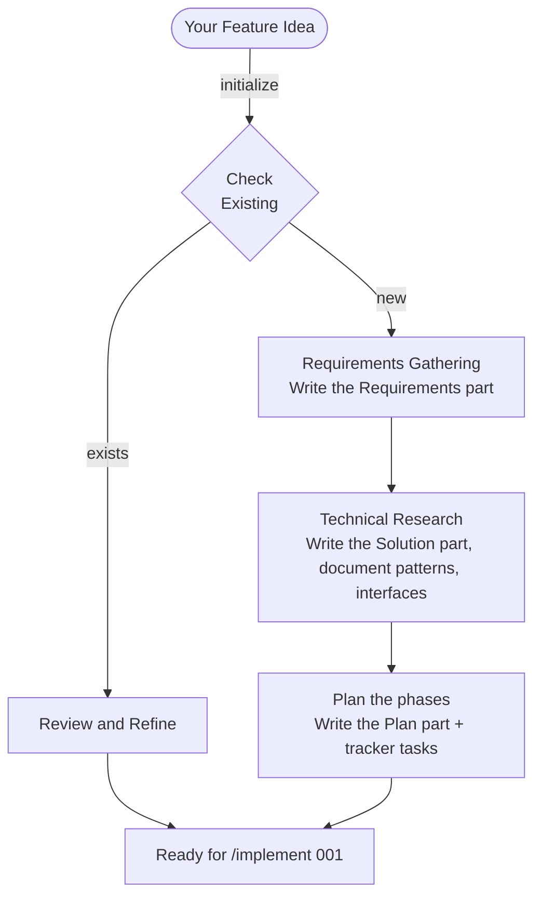
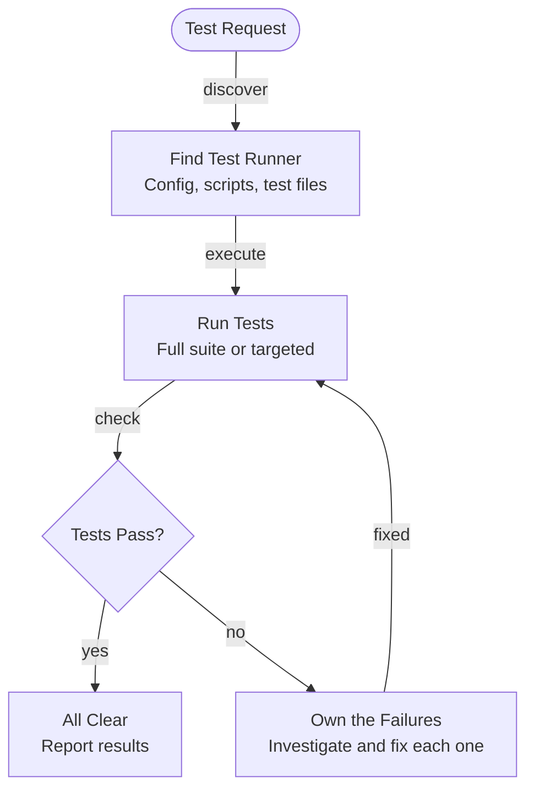
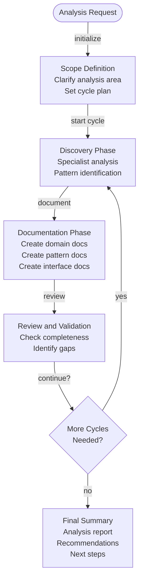
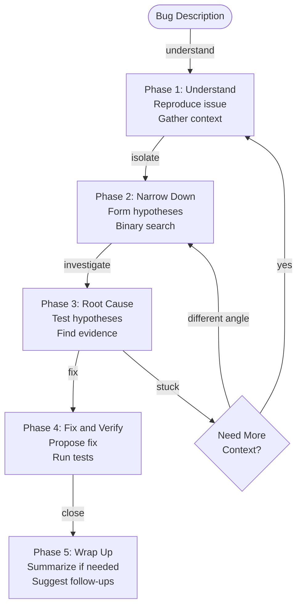
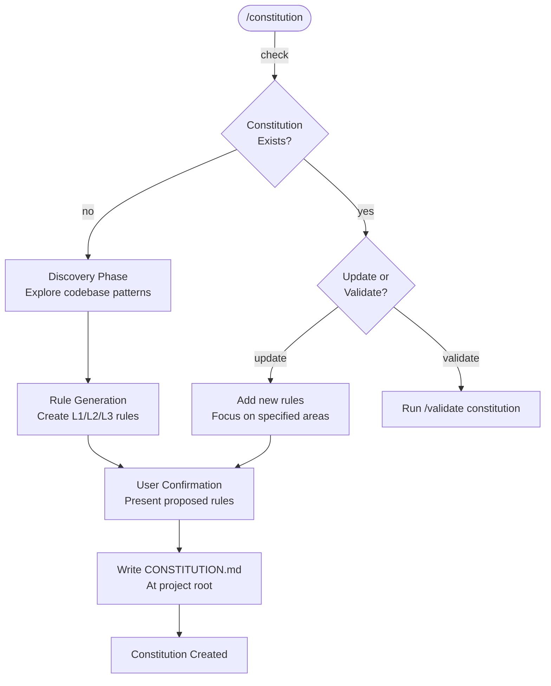

# Start Plugin - The Agentic Startup

**Workflow-Orchestrierungs-Plugin für spec-getriebene Entwicklung in Claude Code.**

Das Plugin `start` bietet zehn vom Benutzer aufrufbare Workflow-Skills, fünf autonome Skills und drei Ausgabe-Styles, um die Art zu verändern, wie du Software mit Claude Code baust.

**Für den schnellen Einstieg, den Workflow-Leitfaden und die Skill-Auswahl siehe die [Haupt-README](../../README.md).**

---

## Inhaltsverzeichnis

- [Vom Benutzer aufrufbare Skills](#user-invocable-skills) — specify, implement, validate, test, review, document, analyze, refactor, debug, constitution
- [Autonome Skills](#autonomous-skills) — 5 kontextaktivierte Skills
- [Dokumentationsstruktur](#documentation-structure) — Specs, Domain, Patterns, Interfaces
- [Ausgabe-Styles](#output-styles) — The Garage, The Startup, The ScaleUp
- [Typischer Entwicklungsworkflow](#typical-development-workflow) — Haupt- und Wartungsabläufe
- [Skills in Aktion](#skills-in-action) — Beispiele aus der Praxis
- [Vorlagen](#templates) — PRD, SDD, Plan, Szenario
- [Philosophie](#philosophy) — Prinzipien der spec-getriebenen Entwicklung

---

## Vom Benutzer aufrufbare Skills

Diese Skills werden vom Benutzer per Slash-Befehl aufgerufen (z. B. `/specify`). Anders als autonome Skills, die automatisch anhand des Kontexts aktiv werden, warten sie auf einen expliziten Aufruf.

### `/specify <description>`

Erstelle umfassende Spezifikationen aus kurzen Beschreibungen durch intensive Recherche und die Koordination von Spezialisten-Agenten; das Ergebnis ist ein narrativer Plan plus die Slice-Aufgaben, die `/implement` ausführt.

**Zweck:** Ideen in implementierungsreife Spezifikationen überführen – mit Produktanforderungen, Lösungsdesign und einem Plan: eine `spec.md` plus die Implementierungsaufgaben im Tracker.

**Verwendung:**
```bash
/specify Build a real-time notification system with WebSocket support
/specify 001  # Resume existing specification work
```

**Wichtige Funktionen:**
- **Automatisch inkrementierende Spec-IDs** – erstellt nummerierte Verzeichnisse (001, 002 usw.)
- **Fortsetzen** – Arbeit an bestehenden Spezifikationen kann über die ID fortgesetzt werden
- **Slice-Plan** – zerlegt die Arbeit in in sich geschlossene Slice-Aufgaben, die jeweils Merkmale (ACs), EARS-Verhalten und Qualitäts-Gates miteinander verknüpfen, mit Holdout-Szenarien als eigenen Szenario-Kinderaufgaben
- **Abhängigkeitsreihenfolge** – Slices deklarieren gegenseitig `--depends-on`; dieser Graph ist der Parallelisierungsvertrag, den `/implement` nutzt
- **Pattern-Dokumentation** – gefundene Muster werden automatisch in `docs/patterns/` dokumentiert
- **Interface-Dokumentation** – Verträge externer Dienste werden in `docs/interfaces/` festgehalten
- **Domain-Dokumentation** – Geschäftsregeln werden in `docs/domain/` erfasst
- **Qualitäts-Gates** – erfordern die Zustimmung des Benutzers zwischen den Hauptphasen

**Der Code-Brief jedes Slices verknüpft drei Facetten:**

| Facette | Quelle | Rolle |
|-------|--------|------|
| **Merkmale** (Akzeptanzkriterien) | Anforderungsteil | was der Slice liefert |
| **Verhalten** (EARS) | Lösungsteil | wie es sich verhalten muss |
| **Qualitäts-Gates** | abgeleitet | prüfbare Bedingungen |

Seine **Akzeptanzszenarien** sind eigene Szenario-Kinderaufgaben (Holdout-Belege) – daran wird der Nachweis geführt.

<details>
<summary><strong>Details anzeigen</strong></summary>

**Du erhältst:** Ein Dokument, `.start/specs/[NNN]-[name]/spec.md`, in drei Teilen, die jeweils durch ein eigenes Freigabe-Gate abgeschlossen werden:

- **Anforderungen** – User Stories, Merkmalsspezifikationen, Erfolgskriterien, nichtfunktionale Anforderungen
- **Lösung** – technische Architektur, Systemkomponenten, Datenmodelle, Technologie-Stack
- **Plan** – Zielzustand und Phasen mit ihren Ergebnissen; die Implementierungsaufgaben (Phasen → Slices → Szenario-Kinderaufgaben) liegen in **.tracker/**

Im Ledger-Teil stehen offene Fragen, Annahmen, das Entscheidungsprotokoll und akzeptierte Review-Kompromisse.



</details>

---

### `/implement <spec-id>`

Führe eine Spezifikation aus, indem ihre Slice-Aufgaben auf der Dynamic-Workflow-Laufzeit von Claude Code ausgeführt werden.

**Zweck:** Validierte Spezifikationen in funktionierenden Code überführen – in einem Zyklus, in dem jeder Slice von einem Code-Agenten gebaut und von einem Eval-Agenten nachgewiesen wird, mit einer Informationsbarriere zwischen ihnen und Wiederholungen bis zur Zufriedenheitsschwelle.

**Verwendung:**
```bash
/implement 001
/implement path/to/custom/spec/
```

**So funktioniert es:**

`/implement` liest die Slice-Aufgaben der Spezifikation aus dem Tracker und sortiert sie topologisch nach `--depends-on`. Danach verfasst es einen Dynamic Workflow und führt ihn aus:

| Schritt | Was passiert |
|------|--------------|
| **Lesen** | Die Slice-Aufgaben lesen (`task.js graph`); jede trägt einen Code-Brief (Merkmale + EARS + Gates) mit ihren Holdout-Szenarien als Szenario-Kinderaufgaben |
| **Starten** | Das Workflow-Skript aus dem Schleifenvertrag des Skills schreiben und über das Workflow-Werkzeug ausführen; unabhängige Slices laufen gleichzeitig |
| **Schleife** | Pro Phase: Code-Agenten bauen die Slices – ein Agent für eine Phase, deren Slices in einer Kette voneinander abhängen, einer pro Slice bei parallelisierbaren Slices (sie lesen die Slice-Aufgaben, ohne die Szenarien zu sehen) → ein Eval-Agent weist die Phase mit einem außerhalb des Projekts gehaltenen Holdout-Skript nach (er liest die Szenario-Aufgaben, ohne Slices + Quellcode zu sehen) → Wiederholung mit gefilterten Zusammenfassungen bis zur Schwelle oder maximalen Iterationen |

**Wichtige Funktionen:**
- **Ein Zyklus, emergent skalierbar** – ein 1-Slice-Plan ist eine kurze Schleife; ein 40-Slice-Plan fächelt auf. Es gibt keine Stufe oder Strategie zu wählen
- **Strukturelle Informationsbarriere** – die Barriere ist, welche Aufgabe jeder Agent liest: Code-Agent → Slice-Aufgabe; Eval-Agent → Szenario-Kinderaufgaben
- **Fortsetzbarkeit** – die Dynamic-Workflow-Laufzeit setzt abgeschlossene Agenten innerhalb einer Sitzung aus dem Cache fort
- **Drift-Erkennung** – führt Drift-Prüfungen von `Skill(start:validate)` aus
- **Constitution-Durchsetzung** – L1/L2-Verstöße blockieren den Abschluss
- **Echtzeit-Updates** – `/workflows` zeigt den Live-Fortschritt pro Slice

<details>
<summary><strong>Details anzeigen — die Slice-Schleife</strong></summary>

Liest die Slice-Aufgaben der Spezifikation aus dem Tracker und sortiert sie topologisch nach `--depends-on`. Führt einen Dynamic Workflow aus, der aus dem Schleifenvertrag des Skills geschrieben wurde. Jede Phase durchläuft eine durch eine Barriere getrennte Code→Eval-Schleife: Code-Agenten bauen ihre Slices (sie lesen Merkmale + EARS + Gates der Slice-Aufgaben und AGENTS.md, aber nie deren Szenario-Kinderaufgaben), ein Eval-Agent weist die Phase anhand dieser Szenario-Aufgaben mit einem Holdout-Skript nach, das er außerhalb des Projekts hält (er greift auf den laufenden Dienst und bei UI-Szenarien auf einen echten Browser zu, aber nie auf die Slices oder den Quellcode), und gefilterte einzeilige Fehlerzusammenfassungen speisen die nächste Wiederholung, bis die Zufriedenheitsschwelle oder die maximale Iterationszahl erreicht ist. Eine Phase, deren Slices eine Abhängigkeitskette bilden, wird von einem Code-Agenten gebaut; parallelisierbare Slices erhalten jeweils einen Agenten, gleichzeitig.


</details>

---

### `/validate <target>`

Validiere Spezifikationen, Implementierungen oder das Verständnis durch intelligente Kontexterkennung und das 3-Cs-Framework (Completeness, Consistency, Correctness).

**Zweck:** Qualitäts-Gate, das in jeder Lebenszyklusphase funktioniert – während der Spezifikation, vor der Implementierung oder nach Abschluss.

**Verwendung:**
```bash
/validate 001                                          # Validate spec by ID
/validate .start/specs/001/spec.md                      # Validate specific file
/validate Check the auth implementation against SDD    # Compare implementation to spec
/validate drift                                        # Check for spec-implementation drift
/validate constitution                                 # Validate constitution compliance
/validate Is my caching approach correct?              # Validate understanding
```

**Wichtige Funktionen:**
- **Intelligente Moduserkennung** – bestimmt den Validierungstyp automatisch aus der Eingabe
- **Das 3-Cs-Framework** – prüft Vollständigkeit, Konsistenz und Korrektheit
- **Erkennung von Mehrdeutigkeiten** – sucht nach vager Sprache („should", „various", „etc.")
- **Dokumentübergreifende Nachvollziehbarkeit** – prüft die Abstimmung von Anforderungen, Lösung und Manifest
- **Drift-Erkennung** – prüft die Übereinstimmung von Spezifikation und Implementierung
- **Constitution-Durchsetzung** – validiert die Governance-Regeln L1/L2/L3
- **Nur beratend** – gibt Empfehlungen, ohne zu blockieren
- **Vergleichsvalidierung** – vergleicht Implementierungen mit Spezifikationen

<details>
<summary><strong>Details anzeigen</strong></summary>

**Sechs Validierungsmodi**, die automatisch aus der Eingabe erkannt werden:

| Eingabetyp | Modus | Was validiert wird |
|------------|------|---------------------|
| Spec-ID (`005`) | Spezifikation | Gesamtqualität und Reife der Spec |
| Dateipfad (`src/auth.ts`) | Datei | Qualität einer einzelnen Datei |
| `drift` oder `check drift` | Drift-Erkennung | Abstimmung Spec ↔ Implementierung |
| `constitution` | Constitution | Einhaltung der Governance-Regeln |
| „Check X against Y" | Vergleich | Implementierung vs. Spezifikation |
| Freiformtext | Verständnis | Korrektheit des Ansatzes |

**Das 3-Cs-Framework:**

1. **Completeness (Vollständigkeit)** – alle Abschnitte gefüllt, keine `[NEEDS CLARIFICATION]`-Marker, Checklisten vollständig
2. **Consistency (Konsistenz)** – dokumentübergreifende Nachvollziehbarkeit, einheitliche Terminologie, keine Widersprüche
3. **Correctness (Korrektheit)** – ADRs bestätigt, Abhängigkeiten gültig, Akzeptanzkriterien testbar


</details>

---

### `/test [target]`

Führe Tests mit strikter Code-Ownership-Durchsetzung aus – Ausreden wie „vorbestehende Fehler" sind nicht erlaubt.

**Zweck:** Tests entdecken und ausführen, sicherstellen, dass die Codebasis in einem grünen Zustand bleibt, und die Verantwortung für alle auftretenden Fehler übernehmen.

**Verwendung:**
```bash
/test                            # Run full test suite
/test all                        # Run full test suite (explicit)
/test src/auth/                  # Run tests for specific path
/test baseline                   # Capture current test state
```

**Wichtige Funktionen:**
- **Test-Erkennung** – findet automatisch Test-Runner, Konfiguration und Testdateien
- **Code-Ownership** – wenn Tests fehlschlagen, gehört dir die Behebung – kein Verweis auf vorbestehende Probleme
- **Baseline-Erfassung** – hält den aktuell grünen/roten Zustand vor Änderungen fest
- **Multi-Agent-Parallel** – kann Testsuiten auf parallele Agenten verteilen
- **Gezielte Ausführung** – bestimmte Testdateien, Verzeichnisse oder die gesamte Suite ausführen

<details>
<summary><strong>Details anzeigen</strong></summary>

**Das Ownership-Gebot:**

Wenn Tests fehlschlagen, erzwingt der Skill strikte Verantwortung:
- Kein „das waren vorbestehende Fehler"
- Kein „nicht durch meine Änderungen verursacht"
- Keine fehlgeschlagenen Tests für den Benutzer zurücklassen

**Test-Modi:**

| Eingabe | Modus | Was passiert |
|-------|------|--------------|
| (leer) oder `all` | Gesamte Suite | Entdeckt und führt alle Tests aus |
| Datei-/Verzeichnispfad | Gezielt | Führt Tests für den jeweiligen Bereich aus |
| `baseline` | Erfassung | Hält den aktuellen Testzustand zum Vergleich fest |



</details>

---

### `/review [target]`

Multi-Agenten-Code-Review mit spezialisierten Perspektiven, die parallel laufen.

**Zweck:** Umfassendes Code-Review vor dem Merge, bei dem spezialisierte Agenten gleichzeitig unterschiedliche Aspekte prüfen.

**Verwendung:**
```bash
/review                          # Review staged changes
/review 123                      # Review PR number
/review feature/auth             # Review branch changes
/review src/auth/ src/users/     # Review specific files/directories
/review staged                   # Explicitly review staged changes
```

**Wichtige Funktionen:**
- **Parallele Spezialisten** – Sicherheits-, Performance-, Qualitäts- und Test-Agenten prüfen gleichzeitig
- **Bedingte Perspektiven** – Nebenläufigkeit, Abhängigkeiten, Kompatibilität und Barrierefreiheit werden bei Bedarf aktiviert
- **Automatische Zielerkennung** – erkennt PR-Nummer, gestagte Änderungen, Dateipfad oder Branch-Diffs
- **Konfidenzbewertung** – jeder Fund enthält eine Konfidenzstufe (HIGH/MEDIUM/LOW)
- **Schweregradklassifikation** – Funde mit CRITICAL, HIGH, MEDIUM, LOW
- **Standard- oder Team-Modus** – Fire-and-forget-Subagenten oder dauerhafte Teammitglieder mit Koordination

<details>
<summary><strong>Details anzeigen</strong></summary>

**Kern-Reviewperspektiven (immer aktiv):**

| Perspektive | Schwerpunkte |
|-------------|-------------|
| **Sicherheit** | SQL-Injection, XSS, hartcodierte Secrets, Auth-Umgehungen, Eingabevalidierung |
| **Performance** | N+1-Abfragen, fehlende Indizes, Speicherlecks, ineffiziente Algorithmen |
| **Qualität** | Code-Komplexität, Benennung, SOLID-Prinzipien, Fehlerbehandlung, Duplizierung |
| **Tests** | Abdeckungslücken, fehlende Randfälle, Testqualität, Vollständigkeit der Assertions |

**Bedingte Perspektiven (werden bei Bedarf aktiviert):**

| Perspektive | Auslöser |
|-------------|---------|
| **Nebenläufigkeit** | async/await, Promise, Threading erkannt |
| **Abhängigkeiten** | Änderungen an Abhängigkeitsdateien |
| **Kompatibilität** | Änderungen an öffentlicher API oder Schema |
| **Barrierefreiheit** | Änderungen an Frontend-Komponenten |
| **Constitution** | CONSTITUTION.md im Projekt vorhanden |


</details>

---

### `/document [target]`

Erzeuge und synchronisiere Dokumentation, einschließlich API-Dokumentation, READMEs, JSDoc-Kommentaren und Dokumentations-Audits.

**Zweck:** Dokumentation aktuell zum Code halten, fehlende Dokumentation erzeugen und veraltete Stellen erkennen.

**Verwendung:**
```bash
/document src/api/               # Generate API documentation
/document readme                 # Update project README
/document src/utils/             # Add JSDoc to code files
/document audit                  # Audit documentation coverage
```

**Wichtige Funktionen:**
- **Mehrere Dokumentationsmodi** – Code, API, README, Audit, Modul
- **Erkennung veralteter Dokumentation** – identifiziert veraltete Inhalte
- **Abdeckungsmetriken** – meldet den Prozentsatz der Dokumentationsabdeckung
- **OpenAPI-Generierung** – erstellt OpenAPI-/Swagger-Spezifikationen aus API-Code
- **Multi-Agent-Parallel** – mehrere Dokumentations-Agenten arbeiten gleichzeitig

<details>
<summary><strong>Details anzeigen</strong></summary>

**Dokumentationsmodi:**

| Eingabe | Modus | Ausgabe |
|-------|------|--------|
| Datei-/Verzeichnispfad | Code | JSDoc-/TSDoc-Kommentare |
| `api` | API | OpenAPI-Spezifikation, Endpunkt-Dokumentation |
| `readme` | README | Aktualisierungen der README.md |
| `audit` | Audit | Abdeckungsbericht |

**Erkennung veralteter Dokumentation:**

Der Skill erkennt automatisch veraltete Dokumentation durch:
- Vergleich der Dokumentations-Zeitstempel mit Code-Änderungen
- Prüfung, ob dokumentierte APIs noch zur Implementierung passen
- Identifizierung undokumentierter neuer Exporte


</details>

---

### `/analyze <area>`

Entdecke und dokumentiere Geschäftsregeln, technische Muster und System-Schnittstellen durch iterative Erkundung.

**Zweck:** Organisatorisches Wissen aus der bestehenden Codebasis extrahieren und wiederverwendbare Dokumentation erstellen.

**Verwendung:**
```bash
/analyze security patterns in authentication
/analyze business rules for user permissions
/analyze technical patterns in our microservices architecture
```

<details>
<summary><strong>Details anzeigen</strong></summary>

Verwendet einen zyklischen Entdeckungs-Dokumentations-Review-Ablauf, um organisatorisches Wissen zu extrahieren. Spezialisten-Agenten erkunden die Codebasis, um Muster, Regeln und Schnittstellen in den Bereichen Geschäft, Technik, Sicherheit, Performance, Integration, Daten, Tests und Deployment zu identifizieren. Die Dokumentation wird automatisch in `docs/domain/`, `docs/patterns/` und `docs/interfaces/` einsortiert.



</details>

---

### `/refactor <description>`

Verbessere die Codequalität, während strikt das gesamte bestehende Verhalten durch testvalidierte inkrementelle Änderungen erhalten bleibt.

**Zweck:** Sicheres, systematisches Refactoring mit automatischem Rollback bei Testfehlern.

**Verwendung:**
```bash
/refactor Simplify the authentication middleware for better testability
/refactor Improve the WebSocket connection manager
```

<details>
<summary><strong>Details anzeigen</strong></summary>

Erhält Verhalten strikt durch testvalidierte inkrementelle Änderungen. Alle Tests müssen vor dem Refactoring und nach jeder Änderung bestehen. Automatischer Rollback bei Testfehlern. Bei einfachen Refactorings werden Änderungen direkt mit fortlaufender Validierung vorgenommen. Bei komplexen Refactorings werden Spezifikationsdokumente erstellt und die Ausführung an `/implement` delegiert.


</details>

---

### `/debug <description>`

Diagnostiziere und behebe Fehler durch eine dialogbasierte Untersuchung mit systematischer Ursachenanalyse.

**Zweck:** Ein Debugging-Partner in natürlicher Sprache, der Probleme durch Dialoge statt starrer Abläufe findet und behebt.

**Verwendung:**
```bash
/debug The API returns 500 errors when uploading large files
/debug Tests are failing intermittently on CI but pass locally
/debug Users report slow page loads after the latest deployment
```

**Wichtige Funktionen:**
- **Dialogbasierter Ablauf** – natürliches Gespraech, keine starren Checklisten oder Prozeduren
- **Progressive Offenlegung** – beginnt mit einer Zusammenfassung, zeigt Details auf Anfrage
- **Nur beobachtbare Aktionen** – berichtet nur, was tatsaechlich geprüft und gefunden wurde
- **Vom Benutzer gesteuert** – schlaegt naechste Schritte vor, laesst den Benutzer die Richtung bestimmen
- **Hypothesenverfolgung** – bildet und testet systematisch priorisierte Hypothesen
- **Belegbasiert** – erfindet nie Begruendungen; alle Schlussfolgerungen sind belegt

<details>
<summary><strong>Details anzeigen</strong></summary>

Verwendet einen dialogbasierten Ansatz in fünf natürlichen Phasen: Problem verstehen, eingrenzen, Grundursache finden, beheben und prüfen, abschliessen. Der Debugger berichtet nur beobachtbare Aktionen („Ich habe X geprüft und Y gefunden") und erfindet nie Begruendungen. Benutzer koennen jederzeit fragen: „Was hast du geprüft?" und erhalten ehrliche, ueberpruefbare Antworten.



**Die vier Gebote:**
1. **Dialogisch, nicht prozedural** – es ist ein Gespraech, keine Checkliste
2. **Nur beobachtbar** – „Ich habe X angesehen und Y gefunden", nicht „Das ist wahrscheinlich…"
3. **Progressive Offenlegung** – kurz beginnen, auf Anfrage ausführen
4. **Benutzer hat die Kontrolle** – „Soll ich…?" statt „Ich mache jetzt…"

</details>

---

### `/constitution [focus-areas]`

Erstelle oder aktualisiere eine Projekt-Constitution mit Governance-Regeln durch musterbasierte Entdeckungsanalyse.

**Zweck:** Pruefbare Projektregeln festlegen, die bei Implementierung, Review und Validierung durchgesetzt werden.

**Verwendung:**
```bash
/constitution                                    # Create new constitution via codebase discovery
/constitution security and testing               # Focus on specific areas
/constitution Add API patterns                   # Update existing constitution
```

**Wichtige Funktionen:**
- **Regeln aus Entdeckung** – analysiert tatsächliche Muster in der Codebasis, nimmt keine Frameworks an
- **L1/L2/L3-Stufensystem** – L1 (blockierend + Autofix), L2 (blockierend, manuell), L3 (beratend)
- **Dreischichtige Durchsetzung** – geprüft bei specify (SDD), implement und review
- **Muster- und Pruefregeln** – unterstuetzt Regex-Muster und semantische, vom LLM interpretierte Prüfungen
- **Sanfte Degradation** – das System funktioniert normal, auch wenn keine Constitution existiert

<details>
<summary><strong>Details anzeigen</strong></summary>

Erzeugt `CONSTITUTION.md` im Projektstamm (wie README, LICENSE, CODE_OF_CONDUCT). Die Constitution definiert pruefbare Leitplanken, die Verstöße während der Entwicklung erkennen.

**Wesentlicher Unterschied:**
- **CLAUDE.md** = Projektbeschreibung, KI-Anleitung („React mit TypeScript verwenden")
- **CONSTITUTION.md** = pruefbare Regeln, die Verstöße abfangen („Keine Barrel-Exports")

**Stufendefinitionen:**

| Stufe | Name | Blockierend | Autofix | Anwendungsfall |
|-------|------|----------|---------|----------|
| **L1** | Must | Ja | KI korrigiert automatisch | Sicherheit, Korrektheit, kritische Architektur |
| **L2** | Should | Ja | Nein | Wichtige Regeln, die menschliches Urteilsvermoegen erfordern |
| **L3** | May | Nein | Nein | Stilpraeferenzen, Vorschläge |

**Beispiel für ein Regelformat:**

```markdown
### No Hardcoded Secrets

\```yaml
level: L1
pattern: "(api_key|secret|password)\s*[:=]\s*['\"][^'\"]{8,}['\"]"
scope: "**/*.{ts,js}"
exclude: "**/*.test.*, .env.example"
message: Hardcoded secret detected. Use environment variables.
\```

Secrets must never be committed to source control.
```

**Dreischichtige Durchsetzung:**

| Phase | Befehl | Durchsetzung |
|-------|---------|-------------|
| **Planung** | `/specify` (SDD) | SDD darf nicht gegen Verfassungsprinzipien verstoßen |
| **Aufgabe** | `/implement` | Aufgabenreihenfolge beachtet Verfassungsprioritaeten |
| **Implementierung** | `/implement` | Generierter Code geprüft; L1/L2-Verstöße blockieren Abschluss |



</details>

---

### Installation

Installiere das Framework The Agentic Startup mit dem interaktiven Installer:

```bash
npx the-startup
```

**Was er tut:**
- Unterstuetzt sowohl Claude-Marketplace-Installationen als auch dateibasierte Installationen für andere Harnesses
- Fragt nach der Mehrfachauswahl von Plugins
- Fragt bei dateibasiertem Installationsmodus nach Harness + Installationspfad
- Kopiert die dateibasierten Installationsartefakte aus dem entfernten GitHub-Repository

**Flags:**
- `--help` – Nutzungsinformationen anzeigen

**Hinweis:** Ausgabe-Styles werden ueber `/config` gewaehlt – siehe [Ausgabe-Styles](#output-styles).

---

## Autonome Skills

Das Plugin `start` enthält fünf autonome Skills, die automatisch anhand des Kontexts aktiviert werden. Du musst sie nie explizit aufrufen – sie arbeiten, wenn sie gebraucht werden.

### Spezifikations-Skills

| Skill | Zweck |
|-------|---------|
| `specify-meta` | Erstellung des Spec-Verzeichnisses, README-Nachverfolgung, Phasenübergänge |
| `specify-requirements` | Vorlage für Produktanforderungen, Validierung, Anforderungsermittlung |
| `specify-solution` | Vorlage für Lösungsdesign, Architekturdesign, ADR-Verwaltung |
| `specify-plan` | Verfasst den narrativen Plan sowie die Slice- und Szenario-Aufgaben im Tracker |

### Implementierungs-Skills

| Skill | Zweck |
|-------|---------|
| `implement` | Fuehrt die Slice-Schleife als Dynamic Workflow aus – durch Barrieren getrenntes Code→Eval-Retry pro Slice |

---

## Dokumentationsstruktur

Das Plugin fördert strukturiertes Wissensmanagement:

```
.start/
└── specs/
    └── [3-digit-number]-[feature-name]/
        ├── spec.md                          # Requirements, Solution, Plan parts + Ledger
        ├── review.md                        # Solution review report
        ├── events.jsonl                     # Event log the dashboard replays
        └── .tracker/                        # Implementation tasks (phase → slices → scenarios)

docs/
├── domain/                                  # Business rules
│   ├── user-permissions.md
│   ├── order-workflow.md
│   └── pricing-rules.md
│
├── patterns/                                # Technical patterns
│   ├── authentication-flow.md
│   ├── caching-strategy.md
│   └── error-handling.md
│
└── interfaces/                              # External integrations
    ├── stripe-payments.md
    ├── sendgrid-webhooks.md
    └── oauth-providers.md
```

### Automatische Dokumentation

Die Capture-Perspektive des `document`-Skills erzeugt automatisch Dateien am richtigen Ort, wenn während folgender Vorgänge Muster, Schnittstellen oder Domain-Regeln gefunden werden:
- Erstellung einer Spezifikation (`/specify`)
- Implementierung (`/implement`)
- Analyse (`/analyze`)

### Deduplizierung

Der Capture-Ablauf prüft vor dem Anlegen neuer Dateien immer die vorhandene Dokumentation und verhindert so Duplikate.

---

## Ausgabe-Styles

Das Plugin `start` liefert drei Ausgabe-Styles – eine Registerbreite pro Unternehmensphase. Ein Style verändert, wie Claude kommuniziert und wie viel Prozess er anwendet, nicht sein Wissen. Alle drei behalten Claudes eingebaute Entwicklungsanweisungen (`keep-coding-instructions: true`), und ein Style wirkt nur auf das Hauptgespraech – Subagenten und die Workflows des Plugins sind unberührt.

Wähle das Register passend dazu, für wen die Arbeit bestimmt ist:

| Style | Register | Wann greifen |
|-------|----------|-------------------|
| **The Garage** | Pre-Startup – das Kleinste bauen, das funktioniert, und möglichst wenig darueber reden | Prototypen und Spikes; noch nichts ist tragend, du findest heraus, ob die Sache funktioniert |
| **The Startup** | Solo – eine Ingenieurin oder ein Ingenieur, ein Agent, kein Zeremoniell | Du bist allein; keine Delegation, kein Plan-zur-Freigabe-Theater, kein Status für Dritte |
| **The ScaleUp** | Koordiniert – Arbeit, die durch andere Menschen laeuft | Jemand, der nicht im Gespraech war, liest, was du schreibst, und fasst an, was du änderst; delegiere und hinterlasse eine Spur |

### Einen Style aktivieren

Der Befehl `/output-style` wurde in Claude Code v2.1.91 entfernt. Aktuelle Auswahlmöglichkeiten:

- **Interaktiv:** `/config` → Output style.
- **Direkt:** `/config outputStyle=The Startup` (Claude Code v2.1.181+).
- **Fuer ein Projekt festgelegt** (per git mit dem Team geteilt) in `.claude/settings.json`:

  ```json
  { "outputStyle": "The Garage" }
  ```

  Verwende `.claude/settings.local.json` für eine persönliche Projektauswahl oder `~/.claude/settings.json` für alle Projekte. Rangfolge: lokal > Projekt > Benutzer. Eine Änderung gilt ab der nächsten Sitzung (oder nach `/clear`).

Dieses Plugin erzwingt bewusst **keinen** Style (`force-for-plugin` ist bei allen dreien nicht gesetzt): die Phase bestimmst du, und ein erzwungener Style wuerde sowohl deine `/config`-Auswahl als auch jede Einstellungs-Festlegung ueberschreiben, solange das Plugin aktiv ist.

---

## Typischer Entwicklungsworkflow

### Einrichtung (optional)

```
/constitution ──> Create project governance rules
                  L1/L2/L3 rules auto-enforced in BUILD flow
                  CONSTITUTION.md at project root
```

### Hauptworkflow: Specify > Validate > Implement > Review

```
/specify ──> /validate ──> /implement ──> /review
   |              |              |              |
Create specs  Check quality  slice loop    Code review
PRD+SDD+Plan  3 Cs framework  code↔eval     Security+Perf
   |              |              |              |
Constitution  Constitution   Constitution   Constitution
checked on    mode available + drift enforced compliance
SDD

Optional: /document after implementation for documentation sync
```

*Wenn `CONSTITUTION.md` existiert, werden die Regeln in jeder Phase automatisch geprüft.*

**1. Spezifikation erstellen**

```bash
/specify Add real-time notification system with WebSocket support
```

**Was passiert:**
- Erstellt `.start/specs/001-notification-system/`
- Generiert spec.md und die Tracker-Aufgaben
- Dokumentiert gefundene Muster/Schnittstellen
- Optional: Erstellt den Git-Branch `spec/001-notification-system`

**2. Vor der Implementierung validieren (empfohlen)**

```bash
/validate 001
```

**Was passiert:**
- Prüft Vollständigkeit, Konsistenz, Korrektheit (3 Cs)
- Erkennt Mehrdeutigkeiten und vage Sprache
- Sicherheits-Scan nach häufigen Schwachstellen
- Prüft die dokumentübergreifende Nachvollziehbarkeit

**3. Implementierung ausführen**

```bash
/implement 001
```

**Was passiert:**
- Optional: Erstellt den Git-Branch `feature/001-notification-system`
- Fuehrt die Slice-Schleife als Dynamic Workflow aus
- Pro Slice: ein Code-Agent baut ihn, ein Eval-Agent weist ihn anhand von Holdout-Szenario-Aufgaben nach
- Wiederholungen mit gefilterten Fehlerzusammenfassungen, bis die Zufriedenheitsschwelle erreicht ist
- Optional: Erstellt bei Abschluss einen PR

**4. Vor dem Merge prüfen**

```bash
/review
```

**Was passiert:**
- Parallele Spezialisten prüfen (Sicherheit, Performance, Qualitaet, Tests + bedingte Perspektiven)
- Erzeugt einen konsolidierten Bericht mit Schweregrad-Rangfolge

**5. Dokumentation erzeugen (optional)**

```bash
/document src/notifications/
```

**Was passiert:**
- Fuegt JSDoc-/TSDoc-Kommentare hinzu
- Aktualisiert die README, falls nötig
- Berichtet ueber die Dokumentationsabdeckung

---

### Wartungsabläufe

**Bestehenden Code verstehen**

```bash
/analyze security patterns in authentication
```

Dokumentiert die Ergebnisse in `docs/patterns/`, `docs/domain/`, `docs/interfaces/`.

**Refactoring**

```bash
/refactor Restructure the authentication module for better testability
```

Bei architektonischen Änderungen: erstellt Spezifikationen, plant die Migration, behandelt Breaking Changes.

**Fehler beheben**

```bash
/debug The notification system stops working after 100 concurrent users
```

Dialogbasierte Untersuchung mit beobachtbaren Belegen und vom Benutzer gesteuerter Richtung.

**Dokumentation prüfen**

```bash
/document audit
```

Berichtet ueber die Dokumentationsabdeckung und findet veraltete oder fehlende Dokumentation.

---

## Skills in Aktion

### Beispiel: Wissenserfassung mit dem Document-Skill

**Szenario:** Waehrend der Implementierung entdeckt ein Agent ein Muster.

```
Agent output: "I implemented a retry mechanism with exponential backoff for API calls"
```

**Was automatisch passiert:**
1. Die Capture-Perspektive des Document-Skills aktiviert sich
2. Prüft `docs/patterns/` auf vorhandene Retry-Muster
3. Keines gefunden – erstellt `docs/patterns/api-retry-strategy.md`
4. Verwendet die Muster-Vorlage
5. Meldet: „Created docs/patterns/api-retry-strategy.md"

**Du musstest nicht:** Dokumentation manuell anfordern oder den Pfad angeben.

---

## Vorlagen

Umfangreiche Vorlagen für strukturierte Dokumentation, zusammen mit ihren Skills:

```
plugins/start/skills/
├── specify-meta/template.md             # spec.md structure: Requirements, Solution, Plan, Ledger
├── specify-plan/templates/scenario.md   # Holdout scenario-task body template
└── document/templates/                  # Knowledge capture templates
    ├── domain-template.md               # Business rules
    ├── pattern-template.md              # Technical patterns
    └── interface-template.md            # External integrations
```

**Verwendung:** Werden von `/specify` und `/document` automatisch beim Erstellen von Dokumentation genutzt.

---

## Philosophie

### Spec-getriebene Entwicklung

**Das Problem:** Funktionen ohne klare Anforderungen fuehren zu technischer Schuld, Nacharbeit und Inkonsistenz.

**Unser Ansatz:**

1. **Zuerst spezifizieren** – umfassende Spezifikationen vor dem Code
2. **Pruefen und verfeinern** – Validierung mit den Beteiligten
3. **Mit Sicherheit implementieren** – validierte Plaene ausführen
4. **Dokumentieren und lernen** – Muster zur Wiederverwendung erfassen

### Kernprinzipien

- **Zweimal messen, einmal schneiden** – Planung im Voraus spart Zeit
- **Dokumentation als Code** – Spezifikationen entwickeln sich mit deiner Codebasis
- **Parallele Ausführung** – mehrere Spezialisten, klare Grenzen
- **Qualitaets-Gates** – DOR/DOD setzen Standards durch
- **Progressive Offenlegung** – Details nur bei Bedarf laden

---

## Weiterführende Literatur

- **[Haupt-README](../../README.md)** – Projektuebersicht und Installation

## Quelle und Lizenz

- Originalautor: rsmdt
- Originalrepository: https://github.com/rsmdt/the-startup
- Lizenz: MIT
- Deutsche Übersetzung und UI-Lokalisierung: Projekt claude-code-mods-de
